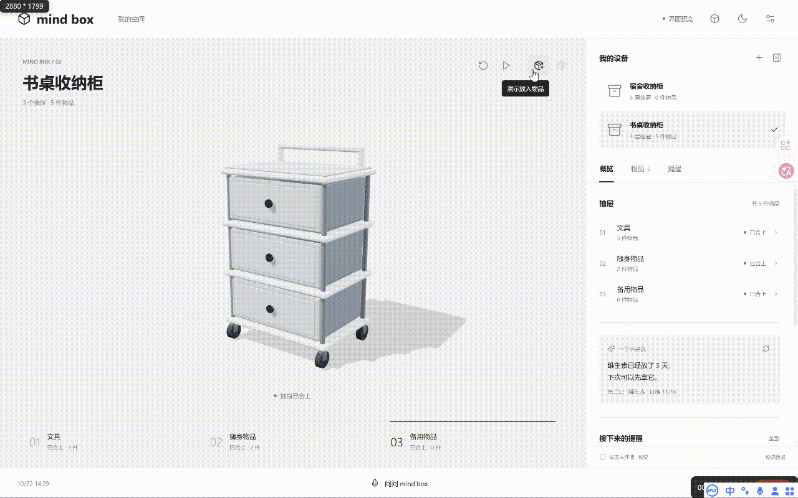
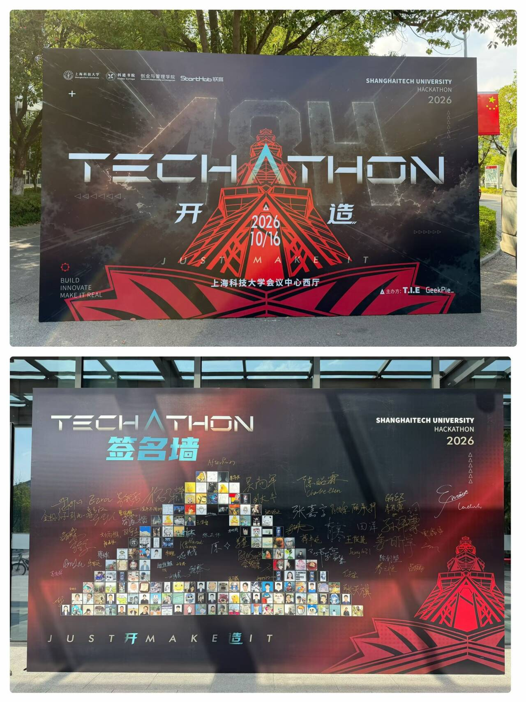
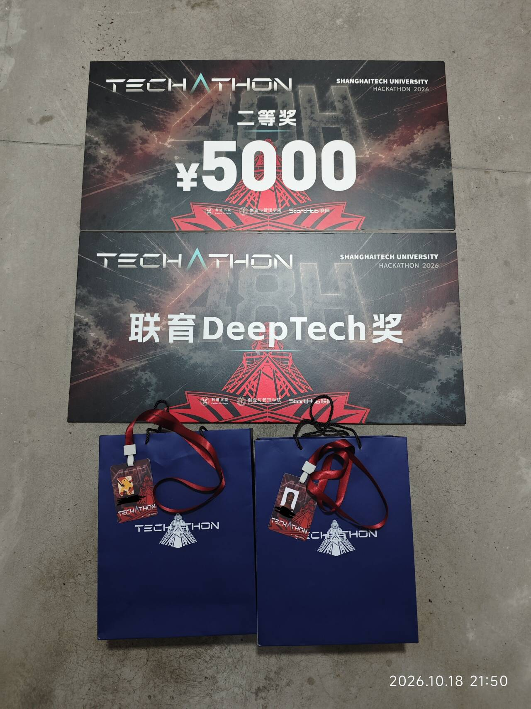

# Mind Box

**Ambient storage for everyday objects. Mind Box records items as they are put away or taken out, so you can ask where something is when you need it.**

[中文版本](README.md) · [Demo video](docs/media/demo.mp4) · [Project presentation](docs/presentation/MindBox.pptx) · [Contact](#contact)

## Project idea

Everyday organization has a simple tension: human attention is limited, while the number of things we manage keeps growing. After putting an item into a drawer, we may quickly forget what it was, where it went, or a reminder we meant to set. Mind Box aims to let the storage process leave a record naturally, so people can keep their attention for more important things.

People use the system as they normally use a drawer. A camera observes the process, software recognizes items and changes, and each record is associated with a drawer location. Later, people can look up an item's location, add information by voice, or set a reminder. The intended experience is useful both for people who enjoy organizing and for people who do not want to maintain an inventory manually.

This idea comes from imagining a future of connected everyday life. AI and multimodal models may be able to work with unfamiliar objects and questions, making item records part of how a personal AI understands real life. The project already includes an authenticated, read-only query API. In the future, a personal agent such as Muse could read item, location, and movement records after authorization. Third-party agent integrations still need validation.

> Let AI handle the tedious details, and leave emotion, creativity, and life to people.

## Current prototype

The repository contains a software prototype and K230 camera integration. A computer-side bridge collects camera footage and uses ArUco visual markers to determine drawer state. The backend stores storage sessions, analyzes images in segments, and writes reviewed item movements to SQLite. The web interface shows items, locations, evidence frames, and operation status. Voice input can query inventory, add information, and create one-time or daily reminders. The authenticated personal-agent API currently provides local read-only queries.

The current trigger chain relies on computer vision: visual markers determine when a drawer opens or closes and start or end a storage session, while an image model analyzes items and movements. This is an evolving prototype. It does not mean general recognition is solved or that recognition will always finish in real time.

Mind Box is still at the prototype stage, and the complete hardware experience is being developed. When recognition is uncertain or evidence is incomplete, the system keeps the result in a review state.

## Demo and presentation

<a id="frontend-demo"></a>

### Web interface demo



- [Demo video](docs/media/demo.mp4)
- [Project presentation](docs/presentation/MindBox.pptx)
- [Setup and run guide](code/README.md)

The cabinet interface and some 3D cabinet visuals shown in the presentation are prototype materials. Concept visuals do not mean that the next physical product has been completed.

## Next steps

1. **Improve recognition algorithms.** Improve item identity matching, movement detection, occlusion handling, and abnormal-state handling, with ongoing evaluation on held-out samples.
2. **Explore next-generation industrial design.** Evaluate an overall form that is better suited to everyday use. One candidate direction is a camera mounted inside a drawer, with further study of view, lighting, installation, power, and maintenance. This remains a product concept.
3. **Improve the trigger design.** The current workflow mainly uses image recognition to detect drawer state and start the storage process. The next step is to compare more stable and responsive trigger methods while reducing false and missed triggers.
4. **Continue improving the web interface.** Improve item lookup, recognition feedback, record review, and the mobile experience.
5. **Validate the agent API and complete device loop.** Test putting away and taking out items, stream recovery, and voice interaction on a physical cabinet, then validate authorized personal-agent integrations step by step.

## Project structure

```text
.
├── README.md          # Chinese project overview, roadmap, and setup
├── README_en.md       # English project overview, roadmap, and setup
├── LICENSE            # MIT License
├── code/
│   ├── backend/       # Python API, recognition, SQLite, voice, and agent API
│   ├── device/k230/   # K230 scripts and computer-side camera bridge
│   ├── scripts/       # Local development launch scripts
│   ├── webui/         # Vite frontend, inventory UI, and 3D model preview
│   │   └── src/       # Frontend JavaScript and CSS source
│   ├── modeling/      # Cabinet 3D modeling workflow and outputs
│   └── datasets/      # Regression data and annotation templates
└── docs/              # Presentation, demo media, and project images
    ├── media/
    └── presentation/
```

`data/` is reserved for local experiment inputs. Raw videos are protected by `.gitignore` and should not be committed.

## Run locally

See the [setup guide](code/README.md), [backend guide](code/backend/README.md), and [K230 device guide](code/device/k230/README.md) for dependencies, hardware setup, and troubleshooting.

From the repository root on Windows, start the configured local development environment:

```powershell
powershell -NoProfile -ExecutionPolicy Bypass -File .\code\scripts\mindbox.ps1 start
```

The default web address is `http://127.0.0.1:5173/`. A complete device workflow also requires configured Python and Node.js environments, model API credentials, and a K230 board connected through the CanMV VS Code extension. Without a development board, you can run the web interface by itself.

To build the frontend in `code/webui`:

```sh
npm install
npm run build
```

To run backend tests in `code/backend`:

```sh
python -m pytest -q
```

<a id="contact"></a>

## Contact

If this idea interests you, feel free to discuss the product direction or the next steps. You can start a conversation through [GitHub Issues](https://github.com/ZnAtom/MindBox/issues), submit an improvement, or share a related experience.

This project is released under the [MIT License](LICENSE). Third-party images, models, and other materials may have separate terms; review their source notes before reuse.

## Acknowledgements

Thank you to ShanghaiTech University Hackathon for the opportunity to create and present this project, to all the organizers, and to Shanghai Lianyu Incubator for providing the competition prize. The prize will be invested in research and development for the next generation of Mind Box. We also thank everyone who watched the demo, asked questions, and helped us improve the idea.

<a id="hackathon-photos"></a>

<table>
  <tr>
    <td width="50%" align="center"></td>
    <td width="50%" align="center"></td>
  </tr>
  <tr>
    <td align="center">Hackathon Event</td>
    <td align="center">Second Prize and Lianyu DeepTech Award</td>
  </tr>
</table>
