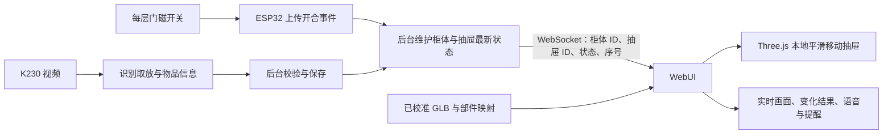
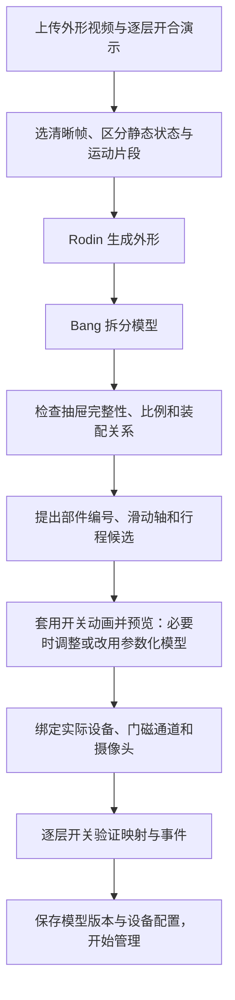

# Mind Box：3D 柜体界面调研与方案

日期：2026-10-17。本文是讨论稿，不表示模型、实时界面或自动设备接入已经实现。本轮没有修改现有 WebUI、数据库或识别代码，也没有调用付费模型生成接口。

## 1. 结论

**可以做出“真实抽屉打开，网页里的对应抽屉流畅拉出”的界面。当前这一个柜子适合先落地。**

**“拍任意新柜子的一段视频，自动得到比例正确、部件独立、运动正确且已连接硬件的设备”还不能作为现成能力承诺。** 需要把外形生成、部件拆分、运动配置和设备绑定分别解决。

推荐路线：先对现有柜体试验 **视频自动抽帧 + Rodin 生成 + Bang 拆分 + 预设抽屉滑动动画 + 一次结构核对 + Three.js 显示**。若外形或拆分不合格，使用按尺寸生成的简化柜体与独立抽屉。以后再把这套过程包装成新设备接入流程。

2026-10-17 补充确认：只需开与关的示意动画，不需要跟随真实抽屉的连续位置和速度；多设备入口移至右侧面板；面板可收起为小图标按钮；设计语言统一参考 Tesla 车机与 Apple 的非玻璃界面，取消此前的生活感配色提议。

## 2. 已确认的实物与体验

- 实物参考：[柜子照片](../../柜子照片.jpg)。用户已确认使用这款柜子，三层均为整只抽屉向外拉，不是铰链门。
- 保留框架、三只抽屉和主要比例；脚轮、顶架可以简化，不建模商品图里的装饰物和背景。
- 保留浅色、深色主题，色彩、字体、控件和动效统一沿用选定的 Tesla / Apple 参考。初稿以 Tesla 车机为主参考，采用中性灰白与近黑色系。
- 平时安静记录；用户唤醒、查询或交代任务时积极响应。不逐件追问，不逐件要求确认。
- 打开抽屉时显示固定实时画面与识别区域；建议是一张小卡片，包含原因与相关物品，可关闭。
- 多柜体列表、选择和添加入口放在右侧面板；主场景只呈现当前选中的柜体。右侧面板可以主动收起，保留小图标按钮。
- 界面使用实色表面，无玻璃拟态、背景模糊或毛玻璃效果。柜体也优先采用简化不透明材质。

## 3. 影眸官方接口能做到哪些

以下是本次公开文档核实结果；企业账户是否开放相同版本、额度和附加接口仍需以实际账户为准。

| 能力 | 核实结果 | 对项目的含义 |
| --- | --- | --- |
| 图片生成模型 | Rodin Gen-2.5 接收 1 到 5 张图片，可附参考方位标签 | 视频先由我们抽取清晰图片，再提交；不能把公开接口写成直接接收视频 |
| 浏览器适用格式 | 支持 GLB，另有 USDZ、FBX、OBJ、STL | 首选 GLB，方便保留场景节点与材质 |
| 简化模型 | 可设置目标面数；可选择无材质 `material=None` | 符合只保留基础结构、不追求原色纹理的要求 |
| 比例控制 | `bbox_condition` 按宽、高、深的顺序控制外包围盒比例 | 可用实测或商家尺寸约束外形；不能据此保证每个抽屉尺寸和内部结构准确 |
| 模型拆分 | Bang 可处理已生成模型或上传模型；`instruction` 支持按指令拆分 | 可尝试分成固定框架与三只完整抽屉；拆分数量和完整性必须检查 |
| 自动运动配置 | 查阅的接口没有承诺自动给出抽屉编号、滑轨方向、行程和硬件映射 | 我们仍需生成或设置这些信息；部件拆开不等于已经会动 |
| Agentic | 接收 1 到 5 张参考图，自动选择生成方式；官方标为 Beta | 可试验，但不作为全自动正确的保证 |

公开文档当前列出 Gen-2.5 基础生成 0.5 credits、Bang 每次 0.5 credits，额外配置可能另计。这里只用于理解调用阶段，不代表比赛提供的额度、金额或账户权限。Business 会员和 API 领取方式在本地赞助资料中分别说明，不能仅凭会员身份推断额度。

## 4. 三种实现路径

| 路线 | 能得到什么 | 主要限制 | 建议 |
| --- | --- | --- | --- |
| A. 按照片和尺寸手动或参数化建模 | 固定框架与三只抽屉从一开始就是独立部件，比例可控 | 需要一次建模或尺寸配置 | 最可靠的回退方案；规则柜体尤其适合 |
| B. 视频抽帧 + Rodin + Bang + 一次校准 | AI 生成外观，尝试自动分出抽屉，套用开关动画 | 可能出现抽屉粘连、内部缺失、部件被多拆或比例偏差 | 推荐先对当前柜体进行小规模试验 |
| C. 任意视频全自动生成可动设备 | 接近用户设想的扫描接入 | 涉及部件发现、隐藏几何、运动估计、尺寸与硬件映射，尚无本项目实测 | 作为后续研发目标，不作为首版前提 |

确有相关研究：[Articulate-Anything](https://articulate-anything.github.io/) 支持从文字、图像、视频生成可动对象的关节描述，项目页有抽屉示例，并展示过对 Rodin 静态网格添加运动关系。其实现主要包含模型检索、VLM 推理、模拟检查与反复修正，不是一次 API 调用就能保证任意柜体正确的扫描产品。

## 5. 当前柜体怎样建模

### 对“只上传两类视频，能否自动建模”的直接回答

**目前不能保证，仅凭一段 360 度外观视频和每只抽屉的开合视频，就能完全自动得到结构正确、比例正确、抽屉可独立运动的模型。** 查阅的影眸公开接口没有承诺这一整套能力，本项目也尚未完成实际生成验证。

可以把这两类视频设计成用户的上传入口，由我们的后台自动抽帧、调用生成和拆分接口、套用预设动画，再输出预览。用户无需自己逐张选图；但这段自动处理流程需要我们开发，模型结构出错时仍需修正。

只要求示意开关后，可以预设运动方向与视觉行程，不再需要从视频恢复每帧位置或原始速度。当前规则柜体的主要待验证环节因此集中在：能否生成完整几何、分出三只完整抽屉、正确对应上中下层。

### 素材分两类

1. **360 度外形视频：** 三只抽屉保持关闭，围绕静止柜体拍摄。后台选择最多 5 张清晰、不同方位且状态一致的图片作为参考。外形生成不混用运动过程中前后不一致的抽屉位置。
2. **逐层开合视频：** 手机固定，每只抽屉依次拉开、停住、关闭，尽量拍到抽屉侧面和底部，用于辅助区分部件、内部结构和滑动方向。开合视频不保证暴露所有隐藏结构；选取的打开帧应分组处理或用于核对，不能直接与闭合外形图无区别地混合提交。

建议补充柜体宽、高、深，用于约束比例。示意开关不要求测量真实拉出行程，可先按抽屉深度设置一个可调整的视觉行程。没有尺寸时可以先做视觉近似，不能标为比例已经校准。透明、反光面板和被遮挡的内部结构可能使几何推断失真；可以采用简化不透明材质显示，但材质调整不能修复错误几何。

### 模型的最小结构

```text
cabinet_root
  frame                 固定框架，含可简化的顶架与脚轮
  drawer_1              上层完整抽屉，含正面、底部、侧面、把手
  drawer_2              中层完整抽屉
  drawer_3              下层完整抽屉
```

抽屉可以由多个网格组成，只要归入同一可动父节点。不需要人物骨骼或 AI 生成每一帧；Three.js 沿配置的局部轴移动抽屉节点即可。框架不能保留一份与可动抽屉重复的封闭正面，否则拉开后会出现重影或堵住的空腔。

Bang 的拆分指令可表达为：“固定框架作为一组；上、中、下三只抽屉分别作为完整部件；把手随各自抽屉；保持装配关系。”这只是试验输入，不代表接口保证输出恰好四个正确组件。

## 6. 动画如何跟真实设备对应



- 模型生成发生在设备接入时。平时的开合动画不调用 Rodin，也不等待大模型返回。
- 门磁检测到开，画面中的对应抽屉平滑移到示意打开位置；检测到关则回到关闭位置。
- **用户已确认只需状态动画，不要求连续位置或速度同步。** 门磁的开与关足以作为动画触发输入，无需为这项显示需求增加位置传感器。动画时长和视觉行程独立配置；动画未结束又收到相反状态时，从当前位置平滑转向新的目标。
- 网络决定状态何时到达；动画流畅度由浏览器本地渲染决定。这两者分别测量。
- 断线时显示“状态暂未更新”，保留最后观察时间，不自动画成已关闭。重新连接时先取最新快照，不回放陈旧开合动画。
- 物品取放结果和抽屉开合分开更新。已有真实入库回执可在关抽屉前显示；待识别名称可稍后补全。不能仅因模型拉开或关闭就修改库存。
- 当前硬件没有电动抽屉。点击模型查看详情不表示能让真实抽屉自行打开。

## 7. 新的界面组织

采用“柜体场景 + 可收起的右侧面板”。设备列表和切换入口统一放在右侧，顶部保留品牌与必要的全局工具。以下尺寸关系用于讨论，实施前通过视觉稿确认。

```text
面板展开
mind box                                              主题  设置

                 约 2/3                         约 1/3
       大面积、无边框的柜体 3D 场景          设备列表 / 当前选择 / 添加 / 收起
       固定默认视角，可拖动查看              开门：固定实时画面 + 取放变化
       对应层随开合变化                      查询：照片 + 位置 + 相关记录
       找物时轻微强调对应抽屉                平时：小建议 + 近期提醒

                唤醒后出现的语音转写与回应区域

面板收起
mind box                                              主题  设置

                  柜体场景扩展                    [展开面板图标]

                 唤醒后出现的语音转写与回应区域
```

- 多设备列表处于右侧面板上部；选择设备后更新主场景与下方信息。添加设备入口也位于此处。
- 右侧面板支持展开与收起，收起后保留固定位置的小图标按钮，悬停提示名称。重新展开时保留设备选择和正在查看的内容。
- 用户主动收起后保持收起，普通开门、建议和记录成功不强制展开。活动可用小圆点提示，展开后显示当前实时画面；语音主动交互仍可在主场景下方显示转写与回应。显式异常通知沿用用户设置。
- 面板收起时，场景平滑重新取景，确保柜体和拉开的抽屉完整可见。移动端采用可收起的覆盖面板，避免压缩到无法阅读或遮住展开入口。
- 默认不自动旋转柜体、不持续闪烁、不播放装饰动画。科技感来自模型比例、光影、及时反馈和连贯的状态切换。
- 设计以 Tesla 车机的柜体主视图和克制工具面板为主参考；文字层级与细节可参考 Apple 传统非玻璃界面。两种主题使用一致的字体、图标、间距与控件规则，以中性灰白、近黑色为基底，少量颜色表达状态。
- 使用实色背景、细分隔线和简洁图标；不使用背景模糊、毛玻璃、玻璃折射、炫光或持续装饰动画。不再沿用生活感配色方案。
- 降低图形负载主要依靠低面数模型、简化材质、控制像素比与阴影，以及静止时按需渲染；取消玻璃效果有助于减少合成和透明渲染开销，但不能据此保证性能达标。
- 日常成功记录在侧面板里安静更新，不弹出必须关闭的窗口。
- 右侧面板展开时，摄像头在抽屉打开后占据面板内固定区域，三维柜体仍保留。多个抽屉打开时显示各自状态，未知归属不强行分配。
- 用户问“充电线在哪”时，显示物品照片、最后可靠位置，并强调对应层。如果真实抽屉关闭，不把模型改成“实际已打开”。
- 原始实时转写和最终确认文字区分；语音、ASR 和业务结果分别有自己的状态。
- 不确定的记录先保留；用户主动点开再纠正。提醒时间缺失等确实无法执行的任务保留待补充，不谎报设置成功。
- 未选中设备可在设备列表显示活动标记，不因另一台柜体开门就抢走当前视图。

可收起的右侧多设备面板、无玻璃效果、开关状态动画已经确认。具体模型视角、侧栏宽度、中性色值与转场效果，在重做界面前通过视觉稿确认。

## 8. “录一圈就接入新设备”怎样逐步实现



以上是需要开发与验证的接入流程，不表示已有自动扫描服务。拍摄能帮助建立外形和运动参考，硬件绑定和视野检查仍然需要。目标可以是“上传视频后自动提出模型与配置，首次接入做一次核对”，日常使用不再反复确认。

同款柜子可以共享模型资源，但每个柜体的网络设备、状态、物品和抽屉映射独立保存。不同型号使用不同模型与运动配置。首版同时只渲染选中的一个精细场景，其余使用缩略图或简要状态。

## 9. 技术选择和验收

建议 React + Three.js，若采用 React 组件组织 3D 则用 React Three Fiber / Drei；正常设置和文字仍使用 HTML。模型使用 GLB，运动映射单独保存。没有必要把设置文字也做成 3D。

以下是首轮验收目标，不是已测性能：

| 检查 | 怎么判断 |
| --- | --- |
| 结构可动 | 三个抽屉各自移动；完整抽屉随动；无重复面、明显缺口或框架一起移动 |
| 比例 | 对照实测或商家尺寸；误差容许范围在首次模型预览时约定 |
| 状态映射 | 分别开关三层，不串层；断线显示未知或最后状态，重连恢复正确 |
| 动画流畅 | 目标笔记本接近 60 fps；较弱设备允许降到 30 fps，实测后决定材质和阴影等级 |
| 资源与功耗 | 从总计约 2 万三角面的简化模型起试；使用简化不透明材质；静止时按需渲染，隐藏页暂停，不保持持续旋转 |
| 面板交互 | 设备从右侧选择；收起后保留图标入口；开门不强制打断收起状态；展开后恢复当前设备和实时内容 |
| 延迟 | 记录门磁事件到浏览器开始反馈的中位数和 P95；与云端识别完成延迟分别统计 |
| 多设备隔离 | 相同抽屉编号在不同柜体不串状态；事件包含柜体 ID 和抽屉 ID |
| 业务真实性 | 开合、动作候选、正式库存、待补全名称分别显示；只有后台真实回执才标为已记录 |

建模文件需关联 `model_version`，部件映射关联柜体与抽屉；更换模型不能靠部件数组下标猜哪层。初始化取最新状态，后续按事件序号处理重复与乱序。这里是未来接口要求，没有新增数据库迁移。

## 10. UI 与技术参考链接

1. [Tesla-UI-prototype 在线演示](https://ryanzeeee.github.io/Tesla-UI-prototype/) / [代码与说明](https://github.com/RyanZeeee/Tesla-UI-prototype)：已实际打开，包含 Three.js 车模、前后备箱/充电口动画、默认视角和面板。最接近本次想要的空间交互。它是第三方原型，README 明确原始项目代码未选定仓库级开源许可证，适合作为视觉参考，不能据“代码公开”直接判定可整套复用。
2. [另一套 Tesla dashboard 模拟器](https://github.com/jakusha/tesla-dashboard)：公开 React 实现和界面图，功能多于 Mind Box，作为面板组织参考。
3. [Apple Human Interface Guidelines：Motion](https://developer.apple.com/design/human-interface-guidelines/motion)：动效用于表达状态和反馈的设计参考。本轮正文直连失败，仅核实官方入口与搜索摘要，不作为已逐条读完的规范。
4. [React Three Fiber](https://github.com/pmndrs/react-three-fiber)：已核实 MIT 许可证，可作为实现基础；[Drei](https://github.com/pmndrs/drei) 提供模型、相机等常用辅助组件。
5. [Three.js：加载 glTF 模型](https://threejs.org/manual/#load-gltf)：官方说明场景节点与独立对象控制，也强调正确比例、局部轴和原点的重要性。
6. [Articulate-Anything 项目页](https://articulate-anything.github.io/) / [实现](https://github.com/vlongle/articulate-anything)：视频到运动关系的后续研究参考；不是本次运行过的组件。

## 附录：影眸依据与首轮试验

- [官方文档入口](https://docs.hyper3d.ai/en)
- [Rodin Gen-2.5：输入数量、GLB、面数、无材质与价格](https://docs.hyper3d.ai/en/api-specification/rodin-gen2-5)
- [Bang：部件拆分与 instruction](https://docs.hyper3d.ai/en/api-specification/bang)
- [BBOX Control：外形比例与坐标顺序](https://docs.hyper3d.ai/en/api-specification/bbox-control)
- [Rodin Agentic：Beta、输入与生成阶段](https://docs.hyper3d.ai/en/api-specification/rodin-agentic)
- [本地赞助资料](../../proj1/competition-info/extracted-text/rodin-selected-award.txt)：会员和 API 支持分别说明。本报告不复制兑换凭证。

首轮仅验证当前柜体：准备干净的同状态外形图与尺寸，生成一份低面数 GLB，再试一次按完整抽屉拆分；检查结构后在浏览器分别滑动三层。如果拆分只得到正面板、隐藏结构错误或多次尝试仍不稳定，就把问题记入试验结果，采用参数化结构继续，不把全自动接入当作已达成。
