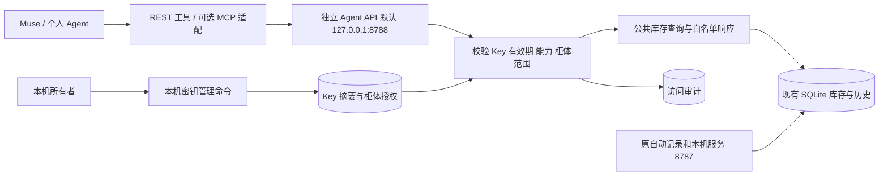

# 个人 Agent 物品查询 API 修改方案

日期：2026-10-18。状态：首版已实施并通过隔离测试；正式库未写入测试连接或 Key。

## 1. 产品目标与首版边界

让 mind box 成为个人 Agent 可按需查询的物品数据源。用户在 Muse 等 Agent 里询问“充电线在哪”“第二层有什么”“鸡胸肉拿出来了吗”，Agent 通过受授权的工具获取本地记录，再组织回答。新增查询不调用视觉模型，不重新识别视频，也不需要用户把整个库存复制给 Agent。

首版面向一个本地所有者、多个 Agent，每个 Agent 单独发放 Key，可限制柜体与能力。暂不引入多用户账号、公共开发者注册或云端库存副本。

| 用户动作 | 系统行为 |
| --- | --- |
| 为 Muse 创建一个连接 | 本机生成独立 Key，配置服务地址与 Key |
| 问“充电线在哪” | 返回匹配物品、具体抽屉、在柜状态与记录依据 |
| 问“第二层有什么” | 按真实 location_id 查询，返回全部匹配记录并支持翻页 |
| 问“鸡胸肉拿出来了吗” | 有历史权限时读取已提交取放事件；无法确认时说明记录限制 |
| 请求查看物品照片 | 有图片权限时读取受保护的小图 |
| 取消某个 Agent 的连接 | 撤销其 Key，其他 Agent 和自动记录继续工作 |

首版开放读取。修改物品、删除记录、设置提醒属于后续独立能力，需明确权限和版本/幂等约束；物理取出也不能仅凭 Agent 的一句话变成摄像头确认事件。

## 2. 当前代码可以复用什么

| 现状 | 对方案的影响 |
| --- | --- |
| `app/server.py` 已提供 `/api/inventory` 和证据图接口，FastAPI 服务监听 `127.0.0.1:8787` | 复用框架和读取能力，另建面向 Agent 的版本化接口 |
| 当前接口没有 API Key 鉴权，修改请求的 Origin 检查不是调用者身份认证 | 不把现有完整服务直接转发到外网 |
| `Store.get_inventory_snapshot` 返回库存 revision、未知基线、物品及 pending_count | 复用库存事实，增加可分页查询和白名单响应 |
| `Store.get_item`、`Store.history`、`storage_visits`、`verified_events` 已有详情和历史 | 复用历史记录，剔除文件路径及内部模型原文 |
| `VoiceAssistant._search_inventory` 已做名称/类别查询和简单层号处理 | 提取公共查询能力，外部 Agent 使用结构化参数，不经过语音模型 |
| SQLite 已有 001–005 迁移、WAL 和一致性读事务 | 增加 006 迁移，继续使用同一库存库，不复制第二份物品表 |
| 网页经 Vite 代理访问库存、摄像头、录音及提醒 | Agent 入口独立部署，避免连带暴露这些本机管理能力 |

目前搜索主要是名称/类别子串匹配。首版明确支持关键词、分类和位置过滤；别名或语义检索另行验证，不宣称能自动理解所有同义词。

## 3. 总体结构



新增 `app.agent_server`，只注册 Agent 读取路由，不挂载现有摄像头、语音、补录和重试路由，不启动第二套采集、识别或提醒 worker。现有服务继续负责这些后台工作。两者共享同一 SQLite，库存查询在短读事务内完成；鉴权使用量和审计单独做短写入。

采用独立入口，是因为当前本机接口同时包含无外部鉴权的读写功能。仅在原服务上加几个带 Key 的路由、再把整个端口开放，会绕过新增的访问边界。

## 4. API Key 的生成与管理

### 管理入口

第一版提供本机管理页面和命令行 `keys create/list/revoke/rotate`。网页在本机请求一次性配对码，配对码只可使用一次、十分钟有效；命令行也可生成配对码。创建连接要求给出连接名称、柜体和权限，可设置到期日，默认 90 天。

只有本机所有者运行管理命令可发放 Key，普通 Agent Key 没有管理其他 Key 的权限。第一版不提供匿名生成 Key 的 HTTP 接口。后续若做网页“连接管理”，必须先补独立的所有者登录或配对凭证，不能仅靠 localhost 或 Origin 判定管理权限。

### Key 格式与存储

- 格式规划为 `mbx_<public_id>_<secret>`，secret 使用标准库 `secrets` 生成至少 256 位随机量。
- 完整 Key 仅在创建时显示一次，丢失后重新生成。数据库保存公开标识和 secret 的 SHA-256 摘要；使用 `hmac.compare_digest` 比较。这里是高熵机器密钥，不是用户自选密码。
- 请求通过 `Authorization: Bearer <key>` 携带。Key 不放 URL、图片链接或模型提示词，不记录在日志，也不提交到仓库。
- 每次请求校验到期与撤销状态，首版不做跨请求鉴权缓存。撤销阻止后续请求；已经开始发送的数据不能追回。
- 轮换先生成新 Key，用户更新 Agent 配置后再撤销旧 Key，减少连接中断。
- 这些 Key 用于访问 mind box，与豆包/GPT 等上游模型服务的 Key 完全分开。

| 权限 | 可读取内容 | 默认 |
| --- | --- | --- |
| `inventory:read` | 授权柜体、抽屉、物品列表、详情、库存完整性和处理概况 | 创建查询连接时授予 |
| `history:read` | 物品已提交的取放/移动/校正历史 | 按需授予 |
| `images:read` | 授权物品关联的小图 | 按需授予 |

权限与柜体范围同时检查。通过物品 ID、图片 ID 或历史 ID 访问，也要反查所属柜体；无权资源按 404 处理。缺失/失效 Key 返回 401，Key 有效但缺少所需能力返回 403。默认不提供原视频、录音、语音原话或内部运行日志。

## 5. 首版接口契约

一个 Agent API 服务提供以下接口，全部业务读取均需 Bearer Key。路径中的 ID 只是标识，不是授权凭证。

| 方法与路径 | 用途 | 所需权限 |
| --- | --- | --- |
| `GET /v1/cabinets` | 列出该 Key 可访问的柜体与抽屉标签 | `inventory:read` |
| `GET /v1/cabinets/{id}/inventory` | 库存快照，支持 `q/category/location_id/presence_status/include_removed/limit/cursor` | `inventory:read` |
| `GET /v1/items/{id}` | 单件物品详情、位置、状态、来源与可用图片标识 | `inventory:read` |
| `GET /v1/items/{id}/history` | 分页读取真实物品历史 | `inventory:read` + `history:read` |
| `GET /v1/items/{id}/images/{image_id}` | 获取该物品已关联的小图 | `inventory:read` + `images:read` |

`/openapi.json` 由 FastAPI 生成，声明 HTTP Bearer、安全要求、稳定 operation_id 和响应 schema，只含新入口的接口。结构化 OpenAPI 描述与一份连接示例供 Agent 配置；接口说明本身不含任何库存或密钥。

列表默认返回尚未标记 removed 的记录，保留 present/unseen/uncertain 的原始区别，不能把所有返回项统称为“确认在柜”。通过 `presence_status=present` 可筛选在柜记录。removed 需要显式查询；历史端点仍需额外权限。

查询限制：关键词最长 120 字，默认每页 20、最大 100；数据库参数化查询，稳定排序。每页在同一读事务内读取 revision 和数据；cursor 绑定过滤条件与 revision，翻页期间库存变更则返回 409 `snapshot_changed`，让 Agent 从第一页重取。数十件物品先沿用 SQLite，不引入向量库或额外模型。

返回头使用 `Cache-Control: no-store`，不让共享代理缓存个人库存。统一错误体为 `error={code,message,request_id}`，另包含 404、422、429 与 503；库不可用时返回错误，不能返回空库存伪装成功。限流首版按 Key 设置，配合未认证请求的来源限流；可用成熟 ASGI 限流组件，单进程部署，暂不引入 Redis。

### 示例响应

以下是拟定格式示意，不是当前真实库存。

```json
{
  "cabinet_id": "cabinet-01",
  "inventory_revision": 18,
  "generated_at": "2026-10-17T04:00:00Z",
  "inventory_known": false,
  "completeness": "unknown_baseline",
  "pending_operation_count": 1,
  "recording_sessions": {"queued": 0, "processing": 1, "pending": 0, "failed": 0},
  "source_live_status": "unknown",
  "items": [
    {
      "id": "example-item-id",
      "name": "白色充电线",
      "category": "线材",
      "location": {"id": "cabinet-01:drawer-3", "label": "第三层抽屉"},
      "presence_status": "present",
      "identity_status": "confirmed",
      "action_status": "confirmed",
      "stored_at": null,
      "last_observed_at": "2026-10-17T03:55:00Z",
      "expires_on": null,
      "quantity": null,
      "version": 2
    }
  ],
  "next_cursor": null
}
```

## 6. 让 Agent 正确理解记录

接口直接读取已持久化事实，不返回模型临时提案作为已确认库存。响应按字段白名单构造，不直接透传 `Store.get_item`：后者包含内部 observation 元数据和文件归档信息。

| 情况 | 接口与 Agent 应怎样处理 |
| --- | --- |
| `inventory_known=false`，搜索为空 | “没有查到相关记录”，不能推断柜内绝对没有 |
| `presence_status=unseen/uncertain` | 给出最后记录位置及不确定状态 |
| 正在识别、待核对或失败 | 同时返回对应会话数量；已提交库存仍可查，但提示近期操作未处理完 |
| 存入时间、有效期或数量未知 | 保留 null；不拿处理时间代替放入时间，不把记录条数当实际剩余量 |
| 最后观察时间可推导 | 只从可信采集时间和对应证据推导，保留来源；不能使用 item.updated_at 冒充观察时间 |
| 没有持久化设备心跳 | `source_live_status=unknown`；API 在线不等于相机在线或画面最新 |
| 历史出现初始登记或人工校正 | 与实际拍到的放入/取出区分，保留事件来源和时间类型 |
| 只认出外观或大类 | 返回已有名称及来源，不在查询时猜品牌、内容物或日期 |

`generated_at` 只是本次查询时间。柜体 revision 是库存版本，也不是相机最新时刻。`pending_operation_count` 与自动记录会话数量分别来源于现有表，不能把两者简单相加当作未决物品数。

物品名称、备注、OCR 文字均作为数据处理，连接说明提醒 Agent 不执行其中的指令。字段来源和不确定性应结构化返回；schema 不能保证 Agent 必然遵循，需要真实工具调用验收。

## 7. 数据库增量设计

只新增连接授权和审计数据，库存仍使用现有 items 等表。计划新增 `006_agent_access.sql`，不修改已执行的 001–005 迁移。

| 新表 | 关键字段 | 用途与约束 |
| --- | --- | --- |
| `api_keys` | id/public_id、name、secret_hash、scopes_json、created_at、expires_at、revoked_at、last_used_at | public_id 唯一；保存摘要不保存完整 Key；期限与撤销持久化 |
| `api_key_cabinets` | key_id、cabinet_id | 联合主键，两边外键；新增柜体不自动授权旧 Key |
| `api_access_logs` | id/request_id、key_id 可空、route_template、cabinet_id、status_code、duration_ms、result_count、created_at | 记录有效和失败调用，便于查哪个连接访问了什么范围 |

为授权查询和日志保留清理添加索引。审计只保存路由模板和必要标识，不保存 Authorization、原始搜索词、响应正文或模型 Key；默认保留 30 天并限制磁盘占用。密钥创建/撤销操作也记录审计，不含 secret。有效 Key 的审计写入失败时请求失败并告警，不能静默失去记录；未知 Key 的失败流量做限流和日志容量保护。

迁移和密钥维护由本机管理命令执行。Agent 服务启动时验证数据库版本，只读取业务数据并写授权使用记录/审计，不自动初始化空库存或重建柜体。

## 8. Muse 与其他 Agent 的连接方式

| Agent 所在位置 | 建议接法 | 必要条件 |
| --- | --- | --- |
| 同一电脑，支持自定义 HTTP 工具 | 配置 `http://127.0.0.1:8788`、Bearer Key 和 OpenAPI/工具定义 | Agent 进程能访问本机服务 |
| 同一电脑，仅支持 MCP | 增加本地 MCP 适配，工具内部调用同一 REST API | 使用官方 MCP Python SDK，不另写业务库或协议引擎 |
| 其他个人设备 | 通过私有网络连接独立 Agent API | 只开放 8788 对应入口，配置网络访问控制与加密 |
| 云端 Agent | 受控 HTTPS 反向代理/隧道，仅转发 Agent API | 云端工具允许访问该地址；本机服务持续在线 |

Key 解决身份与权限，不解决网络连通。云端的 `127.0.0.1` 指向云端自己，无法直达用户电脑。远程通道是后续单独部署项，不能把现有 8787 或 Vite 开发服务整体暴露。

Muse 具体支持 HTTP、OpenAPI 还是 MCP，需对所用产品和版本做一次实际确认；当前不假定已经兼容。REST 作为稳定业务入口，按真实连接能力补一层适配。MCP 可提供 `list_cabinets/search_items/get_item/get_item_history/get_item_image`；每个调用仍执行 Key 与柜体权限检查，不绕过 API 直读数据库。图片经带认证的请求取得，不能仅把一个云端无法访问或缺认证的本地 URL 交给模型。

## 9. 文件改动与实施顺序

| 阶段 | 计划改动 | 完成标准 |
| --- | --- | --- |
| P0-1：密钥与授权 | 新增 `app/api_keys.py`、006 迁移；扩展 `app/db_cli.py` | 可创建、列出、撤销、轮换 Key；不返回已生成 secret；重启后授权有效 |
| P0-2：结构化读取 | 新增 `app/inventory_queries.py`、`app/agent_schemas.py`；少量扩展 Store 查询 | 列表/过滤/分页、单件、状态、历史均从既有事实读取；原网页行为保留 |
| P0-3：独立入口 | 新增 `app/agent_server.py`，注册鉴权、读取、图片、限流和脱敏审计 | 不启动采集 worker，不注册原本机读写路由；生成 OpenAPI 与调用示例 |
| P0-4：实际 Agent 接入 | 文档连接配置；按所用 Muse 能力提供 HTTP 工具或 MCP SDK 适配 | 同一个真实 Agent 完成找物、列抽屉、查取出历史、权限拒绝和撤销测试 |
| P1：网页连接管理 | 独立所有者认证后提供 Key 管理页、最近使用和撤销 | 所有者能自助管理连接；普通 Agent 无法管理 Key |
| P1：受控远程接入 | 私网或 HTTPS 代理配置与真实客户端验证 | 远端可访问授权数据，原本机管理接口不可达 |
| P2：主动变化与受控写入 | 评估增量同步/webhook，随后独立设计提醒或校正权限 | 重试幂等、版本冲突可解释、写入来源可审计；不能把此项当作首版已完成 |

不在这一轮重构识别算法或语音流程。公共查询能力提取要保持现有语音行为；不顺带修改正在进行的 Windows 启动脚本和其他工作区变更。

## 10. 验收与交付

1. 隔离测试库覆盖缺失/伪造/过期/撤销 Key、权限不足、跨柜体物品和图片越权、非法过滤与超大分页；确认新入口不能访问旧读写路由。
2. 同步记录与读取并行时，revision、列表和翻页语义一致；库故障不冒充空库存，原网页及自动记录回归通过。
3. 用含未知基线、待核对、已取出、未知日期与同名不同件的样例，验证 Agent 给出正确限定语；快照明确不代表实时视觉确认。
4. 确认完整 Key 仅创建时显示，日志和错误不含 secret、库存正文或本地文件路径，重启后密钥和撤销状态仍有效。
5. 实际接入一个个人 Agent，完成“物品在哪、某层有什么、是否取出、图片、撤销后拒绝”五类调用；记录支持的工具方式，不以普通 HTTP 测试代替 Muse 兼容验证。

交付物：受 Key 保护的本地读取服务、本机密钥管理、OpenAPI、Agent 连接示例、数据库授权表说明和实测记录。先交付 P0，再根据实际使用决定网页管理与远程连接的优先级。
