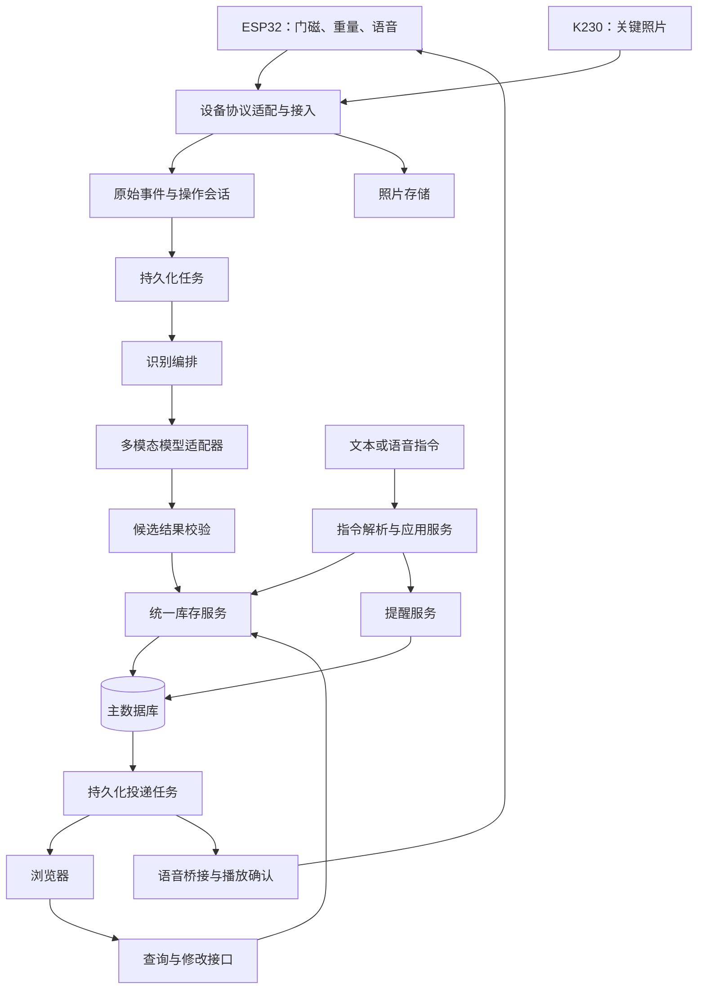

# Mind Box 服务器后端设计

版本：0.1；日期：2026-10-16。状态：拟实施设计，尚无服务代码或运行验证。

## 1. 后端目标与首版范围

后端维护一份可追溯的物品记忆：接收门磁、整柜重量和照片，形成一次取放操作，让 AI 提出变化建议，由程序校验并提交库存；向浏览器和语音端提供查询及一次性提醒。

首版按单用户、单柜体设计，保留三个抽屉位置标识，优先验证一个抽屉。单件、无遮挡、小批量是基础范围。没有日期、数量或确切身份也能保存观察，不强迫用户补录。

首版交付包括：设备接入、照片保存、操作关联、库存持久化、AI 适配、文本查询、一次性提醒、浏览器状态接口、设备模拟器。实际小智语音在核心数据流程后接入。邮件、云端副本、多用户、周期提醒、严重遮挡补全和自动购物暂列后续扩展。

## 2. 技术基线

| 部分 | 推荐 | 原因与约束 |
| --- | --- | --- |
| 语言与 HTTP 服务 | Python 3.11+、FastAPI、Uvicorn | 图像与 AI 服务接入方便，自动生成接口说明，支持异步网络调用 |
| 输入输出校验 | Pydantic v2 | 设备数据、用户指令、模型候选输出采用明确结构 |
| 数据访问与迁移 | SQLAlchemy 2、Alembic | 明确事务边界，保留日后迁移 PostgreSQL 的路径 |
| 首版数据库 | SQLite，WAL、外键检查、busy timeout | 单机原型部署简单；数据库放本机磁盘，写事务短小 |
| 图片 | 本地文件＋数据库元数据 | 图片与业务记录分离，后续可替换对象存储 |
| 后台任务 | 数据库 jobs/outbox＋进程内异步工作循环 | 重启可恢复，不依赖 Redis 或 Celery |
| 对外请求 | httpx，超时、有限重试 | 统一调用 AI、语音和设备网关 |
| 验证 | pytest、HTTP 测试客户端、模拟设备 | 先在无实物条件下验证关键业务约束 |

首版只运行一个 Uvicorn 进程和一组任务循环。多个 HTTP worker 会重复启动调度器、分割连接状态，因此暂不支持。耗时网络请求在事务外运行；同步数据库与文件操作放在线程池或短同步调用边界，不能阻塞音频和 WebSocket 心跳。需要本地重型推理时另开进程或独立模型服务。

## 3. 模块与依赖方向

这里表示业务依赖，真实设备通信协议由适配器处理，不代表现有小智固件已支持上述所有消息。

| 模块 | 职责 | 明确限制 |
| --- | --- | --- |
| 接入与鉴权 | 识别设备、验证消息、限流、记录在线状态、返回接收确认 | 设备身份由令牌绑定，不能信任请求自报的身份 |
| 原始事件服务 | 原样保存有效事件、去重、记录设备时间与接收时间 | 接收成功不等于识别和库存更新成功 |
| 操作会话 | 关联抽屉、操作编号、前后重量、照片和超时 | 不用语音 session ID 代替操作编号 |
| 识别编排 | 选择少量关键帧、读取库存快照、调用模型 | 不把连续视频全部发送给模型 |
| 库存服务 | 校验增删改、版本检查、事务提交、审计 | AI、网页和语音都经此模块修改库存 |
| 指令服务 | 查询库存、修改已知字段、建立或取消提醒 | 对含糊的修改追问，读取类请求直接返回可用事实 |
| 提醒与投递 | 到期扫描、持久化投递、重试与回执 | “已调度”“已发送”“播放完成”分开记录 |
| 状态接口 | 提供库存、操作进度、设备健康和变化通知 | 浏览器不是后端进程，关掉网页不影响调度 |

## 4. 取放操作的完整流程

1. ESP 上报 `door.opened`，携带本地生成的 `operation_id`。服务器持久化事件并创建操作，返回操作已接收。设备重传同一事件得到同一结果。
2. 前重量取该操作前、所有门关闭时最近一次有效稳定读数。须使用同一标定版本、满足有效时间窗口；没有合格读数则记未知，不能用开门后的重量冒充前重量。
3. 服务端建立 `capture.request`，携带 `request_id` 和 `operation_id`，交给 K230 适配器。支持缓存时请求开门前参考帧及操作中照片；无缓存时保留能力缺失。照片应在关闭导致遮挡前采集。
4. 每张照片单独上传、校验并保存。上传重复帧复用记录；文件未完成持久化前不确认成功。接收时间不能伪装成拍摄时间。
5. 门关闭后进入 `waiting_stable`。等待 ESP 上报所有门关闭下的有效稳定重量，并等待对应采集请求结束。使用采集完成标记和服务器侧收帧宽限窗口，避免仅凭关门事件立即分析。
6. 稳定读数、采集结束或超时满足收尾条件后，冻结本次分析输入。证据不足进入 `pending_evidence`；证据可用则持久化识别任务。超时也记录原因，不无限等待。
7. 工作循环读取关键帧、前后重量和相关库存快照，调用多模态适配器。输出只包含候选动作、物品、证据和不确定项。
8. 校验类型、引用、日期来源、物品归属和库存版本。证据充分时自动提交；身份或动作不清楚时保留待定结果、供用户按需纠正，不把每次取放都变成强制对话。
9. 同一事务提交库存、审计和通知任务。事务结束后再推送浏览器、按设置播报简短结果。

两传感器测量整柜：`delta_g = after_total_g - before_total_g`。差值辅助判断变化和稳定，不足以单独决定某件物品、数量或抽屉归属。多门同时打开并入同一柜体操作；不同设备产生的编号冲突或操作重叠应记录关联关系并进入待核实，不能重复计入整柜差值。

### 排序与晚到数据

- ESP 按 `device_id + boot_id + seq` 检测重传、乱序和序号缺口，原始数据都保留。
- 柜体操作采用服务端分配的单调 `operation_no` 串行推进库存写入；操作内的事件、照片按显式关联整理，不能只按网络到达次序推断物理先后。
- 设备重启、未同步时钟及断网补传可能导致真实顺序不明。这样的历史操作可以归档和重新分析，但不能直接覆盖当前库存。
- 模型任务携带 `base_inventory_revision`。提交时版本不符则重新读取并分析或进入冲突状态，不盲写。
- 已冻结操作收到晚到照片，保留原始证据并标记 `late`，不自动再次增删库存。重新分析创建新 attempt，仍须校验版本和已有提交。
- 待定操作不能永久阻塞柜体：收尾为 `pending` 并标记相关库存不确定，后续操作继续；后续分析必须携带这些未解决上下文。

## 5. AI 与查询设计

保留两个独立接口：`VisionRecognizer.analyze(operation_context)` 与 `IntentParser.parse(text, inventory_context, accepted_at)`。提供模拟实现和真实供应商实现，业务服务不依赖模型名称。

视觉输入包含有限数量图片、照片标识与时间质量、位置、重量差及有效性、相关库存和待定操作。输出结构详见接口文档；原始响应、供应商、模型版本、耗时及错误单独记录。模型自报置信度不直接当作准确率或自动提交门槛。

库存事实从数据库读取，日期、数量、未知状态由程序整理后返回。可使用模型润色文字，但最终物品引用和日期仍需校验。用户说“三分钟后提醒我吃苹果”时，以服务器首次接受请求的时间计算 `due_at`，而非模型回复或播放结束时间；同一请求重试不重新起算。

日期规则：明确包装日期或用户提供日期可以作为 `expires_on`；AI 估计、网上常见保质期只写 `review_at/review_reason`。入库、首次看见、开封、生产和实际有效期是不同字段。名称相同不代表同一包装，不能据此合并或删除。

## 6. 提醒与语音

一次性提醒入库后，调度循环每秒扫描到期任务，在短事务内将逻辑提醒置为 `triggered`，同时创建各渠道的 delivery/outbox。宕机恢复后补扫描漏过的任务：首版默认超过到期 10 分钟标为 `missed`，不突然播放旧提醒；仍可在页面查看。宽限时间可配置，属于产品默认值，待演示体验验证。

每个渠道使用稳定的 `delivery_id`，按目标设备、在线状态和退避时间投递。ACK 超时后有限重试；网络交付采用至少一次语义，接收端须按 `delivery_id` 去重。设备若没有持久去重能力，重启后的播报可能重复；不能声称端到端严格只播放一次。

小智音频连接与传感器/控制连接分开建模：

- 音频桥接跟随实物固件的 hello、Opus 参数、监听、打断及播放协议；先核对实际协议版本再实现。
- 持久控制通道用于传感器上报、采集/播报命令和状态，可采用独立 WebSocket 或网关。具体方案需要固件支持，不冒充小智原生能力。
- 设备空闲时无连接，则将播放任务保留为等待设备，网页提示未播放。单纯 WebSocket send 成功只算已发送，必须收到播放完成回执才记 `played`。
- 语音未接通时，文本输入和网页提醒可以验证服务器流程；模拟回执清楚标明来源，不作为扬声器实际发声的证明。

## 7. 持久化任务、恢复与失败处理

jobs 保存任务类型、业务关联、状态、尝试次数、下次执行时间和租约。worker 原子领取任务，执行外部调用期间不占数据库事务，完成后用租约持有者及版本条件写回。长任务续租；重启后回收过期租约。首版建议 API/模型超时、最大重试次数由配置给出，不无限重试。

| 故障 | 行为 |
| --- | --- |
| AI 超时、限流或返回无效结构 | 记录失败并有限重试，保留照片与待定操作，库存不猜写 |
| 数据库暂时忙 | 短事务重试；未提交不返回持久化成功 |
| 数据库或磁盘不可写 | readiness 失败，接入返回可重试错误，不假装接收成功 |
| 图片上传一半或校验失败 | 删除/回收临时文件，不生成可用观察 |
| 图片已落盘但数据库写入失败 | 留待孤立文件清理任务回收，重试保持同一帧身份 |
| 设备断网 | 后端显示离线；设备补传仍按唯一键去重；本地缓存由固件实现 |
| 浏览器断线 | 重连后重新获取当前快照和版本；通知仅用于提示重新取数 |
| 后端重启 | 从数据库恢复未完成操作、jobs、到期提醒和未完成投递 |
| 多门/等重量换物/画面不足 | 记录不确定性，禁止只凭总重量推断具体出入 |

## 8. 部署、配置与可观察性

开发电脑与远程服务器使用同一套服务。首版不强制 Docker，运行路径和照片路径均配置化。正式远程访问时通过反向代理提供 HTTPS/WSS，音频长连接需配置升级和超时支持。SQLite 与照片放持久化目录，不能放临时容器层或网络共享盘。

建议配置分组：数据库路径、图片目录和上传限制、设备密钥、管理端密钥、允许的网页来源、模型供应商/地址/密钥/模型名、调用超时、任务租约、稳定窗口、收帧宽限、提醒宽限及重试策略。供应商未配置时 readiness 分项显示不可用；不能静默启用模拟数据冒充真实识别。

设备 token 绑定柜体、设备与权限；管理端采用单用户 bearer token。HTTP 头传 token，浏览器 WebSocket 使用短期一次性 ticket，避免令牌出现在 URL 和访问日志。局域网调试可以使用 HTTP；公网须 TLS。禁止任意跨域，图片经过授权接口读取，文件名不使用客户端传入路径。

日志关联 `request_id/event_id/operation_id/job_id/delivery_id`。记录各段耗时、任务积压、模型错误、重试、设备最后在线时间、上传字节和播放回执；密钥和原始音频不进普通日志。健康接口区分进程存活、存储可写、模型配置和设备在线，不以“服务器启动”推导端到端健康。

首版备份采用停止写入后的数据库与照片一致性快照，或 SQLite backup API 配合不可变图片清单；不在 WAL 正写入时只复制主数据库文件。照片默认保留，不静默清理仍被库存或审计引用的证据；容量阈值与清理策略在实测后调整。

## 9. 当前取舍与待补信息

现在可开始实现 HTTP、数据库、任务、模拟事件、库存和文本提醒。实际服务供应商、K230 当前 Socket 数据格式、小智固件与空闲主动播报能力确定后接入适配层，不阻塞核心业务开发。

这份设计包含明确的软件默认值，不表示硬件能力已经确认。延迟、识别率和稳定重量阈值都在实测后定标，不作为当前承诺。
