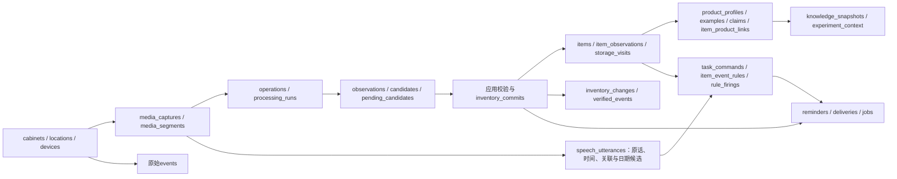

# 数据与调用约定

更新：2026-10-17。本文件只维护现行数据库、字段/状态和写入边界，以及日程扩展所需契约。处理架构见[流程](processing-flow.md)，真实结果统一见[评测](evaluation-and-lessons.md)。原SQL迁移及失败实验保留，历史阶段报告不再复制到此处。

## 1. 实物、商品与证据身份

| 标识 | 作用与边界 |
| --- | --- |
| capture_id / 视频SHA256 | 一次媒体来源；视频/音轨/PTS共享原点，不等于可信绝对拍摄时间 |
| operation_id / run_id | 一次物理操作与其分析attempt；重分析不是新操作，已提交操作不能再add |
| candidate_id | 仅在run中有效，不能跨视频当item_id |
| observation_id / frame_id | 数据库证据ID与本地产物引用；帧ID可能含PTS，时间读media_time_ms |
| item_id | 一件实物及其进出历史；同袋取出再放回复用，同SKU另一袋新建 |
| product_id | 可复用商品/物品类型档案；不能代替实物身份 |
| track_id（待实现） | 会话内轨迹；断轨后须证据关联，不能直接新增第二件 |
| utterance_id | 音轨最终语句、版本、原话及时间窗；当前按同视频/音轨建立稳定ID |
| task_command / reminder / delivery ID | 用户意图草稿、一次发生、某渠道投递，三者不同 |

**大类足够入库。** `identity=supported`表示当前画面与该实物candidate可关联，不表示已认出品牌/款式。`action_status=confirmed`与`product_match_status=category_only`可以同时存在。品牌、容量缺失不产生库存pending；动作、件数/实体混淆仍须待确认。

## 2. 当前数据库

SQLite启用WAL、外键及10秒busy timeout；标准库sqlite3，无ORM。001/002包含20张业务表；003新增10张表，另有schema_migrations保存迁移版本和SHA256。003已用于隔离实验，正式开发库仍只有001/002，未自动升级。已执行迁移不能原地修改。

| 表组 | 关键语义/约束 |
| --- | --- |
| cabinets / locations / devices / events | 柜体revision与inventory_known；位置归属；设备/事件身份去重，同键异内容冲突；无重量事件 |
| media_captures / media_segments | 源哈希、共同时间轴与采集元数据；当前完整文件作为单段，不宣称已接在线分片 |
| operations / processing_runs | 柜体操作序号、当前attempt、基线revision、原始JSON及工具审计；换目录重跑同视频默认复用操作 |
| observations / candidates / pending_candidates | 证据哈希/PTS/归档引用；候选唯一(run_id,candidate_id)；未解决项及审核理由 |
| items / item_observations / storage_visits | 稳定实物、版本及证据关联；每件最多一条未关闭进出记录 |
| inventory_commits / inventory_changes / verified_events | 真实事务回执、净变化审计、映射真实item的过程历史；一个operation只提交一次 |
| jobs | 事务队列、业务唯一键、租约令牌、重试和期限；旧租约不能完成新worker的任务 |
| reminders / deliveries | 一次提醒及渠道queued/received/played等状态；网页不能确认语音播放 |
| product_profiles / product_examples / product_claims | candidate/verified/rejected、版本、多视角、逐字段来源及撤回；不是未经核实模型回答的累积 |
| item_product_links / knowledge_snapshots / experiment_context | 商品版本与实物映射、内容哈希快照、真实隔离scope/mode/manifest |
| speech_utterances | 原音轨归档/哈希、最终原文、分段/偏移、版本、候选事实、item_link与缺失项 |
| task_commands | 当前只支持before_expiry/after_expiry_remove；唯一(utterance_id,kind)，状态needs_input/scheduled/active/canceled |
| item_event_rules / rule_firings | 同item已确认取出的条件及版本；唯一(rule_id,rule_version,event_id)触发去重 |

证据归档为`<数据库stem>-assets/<sha256>`，DB存相对路径；原视频仍为外部引用。`Database.backup`使用SQLite backup API并复制归档资源，不能只复制一个可能含未落盘WAL的文件。副本验收需完整性/外键/哈希/历史数量检查。

## 3. 物品字段与时间

| 字段 | 来源与未知处理 |
| --- | --- |
| name / category / description | 可仅饮品/零食/未知食品；描述保留可见外观，有证据再细化 |
| brand / variant / product_id | 可空；品牌、口味、型号属于补全，不参与粗存门槛 |
| quantity / unit | 有数量依据才填，混框不算一件；null不否定已有一条实物记录 |
| presence_status | present/unseen/removed/uncertain；未见不自动removed |
| identity_status | candidate/confirmed/group_uncertain，描述实物身份，不是SKU确定程度 |
| action_status / product_match_status | confirmed/pending；unknown/category_only/candidate/verified，两条状态轴独立 |
| location_id / storage_visits | 同柜体位置；取出放回沿用item，新增一次访问而非新实物 |
| first_seen_at / last_seen_at / stored_at | 可信采集锚点+媒体证据；无锚点保持null，不用处理时间或文件修改时间补 |
| production_on / expires_on / shelf_life_raw | 明确用户/包装证据；候选月日与正式日期分开，缺年不写假日期 |
| opened_at / review_at / notes | 开封有证据，检查建议不等于有效期；备注不能绕过正式日期校验 |
| created_at / updated_at / version | 系统处理与版本，不冒充采集/放入时间 |

当前没有独立net_content/barcode/aliases字段或解码闭环。无需200ml、品牌或口味即可通过基本认物验收。

`field_meta={source,certainty,evidence_refs,extractor,supporting_sources}`；source可为vision/ocr/barcode/user/system/derived/unknown/speech/rag/web，certainty为recorded/estimated/unknown。枚举有web不表示允许网页直接回写。recorded是有来源，不保证用户/文字绝对无误。

实际标签日期需要可追溯ocr/barcode/user/speech或derived来源；推导须保存输入引用。一年/一个月采用日历运算，不换成365/30天；有效期日期与到期日何时失效的边界策略分开。离线“今年”只用可信采集时钟或显式synthetic_test时钟，不用当前系统年。任一输入疑点只应影响对应字段，逐字段疑点隔离为待修改项。

## 4. 动作证据与写库

状态为inside/outside/absent/occluded/unknown。outside必须在箱外可见；absent须箱内清楚且无目标，不能由反光/关门/无SIFT框推断。before所有引用必须早于after，且仅引用实际提供帧。at_rest表示抽屉承托/已松手，手靠近不等于抓取。

`window-states.json`保存普通观察、initial_observation、review_observation、review_decision、supplied_frame_ids/input_kind。当前`review_conflicts`只按before/after标签比较presence，未对齐不同时间，是已定位缺口；同帧相反放稳/在柜判断仍必须保留冲突。修复契约应保存每条声明的真实时间与来源，不能整窗覆盖其他物品。

`operation_analysis`包含event_candidates、net_changes、pending、observation_gaps、baseline_observations、snapshot_checkpoints、placement_completions、cancelled_placements、unobserved_prefixes。跨窗事件保存evidence_window_ids和state_evidence，不把箱外正证据改写成清楚缺失。supported_endpoints/consistent均不是提交回执，也不是正确率。

`CoarseIntake.assess`当前policy为single-insertion-evidence-v2，路线stable_state_comparison/direct_crossing。单新增、usable物体、同实例、放稳、时间、可见性和无未决冲突成立即可；身份细节缺失不拒绝。当前不支持混合多事件自动准入。

| 调用 | 边界 |
| --- | --- |
| Store.import_run | 归档观察/候选/待处理，不改变库存；相同输入重传复用 |
| Store.get_inventory_snapshot | 同读事务读取真实items/revision；未知基线单列，不把空DB当已知空柜 |
| Store.commit_inventory | 应用显式计划，验证当前attempt、证据归属、item版本、柜体revision及幂等；短事务内写库存/历史/回执/jobs |
| Enrichment.apply | 名称/类别/描述/品牌/款式/商品关联白名单；不改数量、presence、stored_at，不再add；人工新纠正和陈旧响应冲突 |
| SpeechService.apply_facts | 仅已关联语句的日期/期限事实；无关item引用、未知年、冲突均不能覆盖正式日期 |
| Store.correct_item | 受信人工纠正，保存来源和版本审计；不是模型写库工具 |

库存提交计划含operation_id、run_id、base_revision、idempotency_key、reviewed_by与decisions。add创建item；remove/return/update/keep必须带真实item_id和expected_version；return复用已移除身份。一次净决策可同时记录四步历史，不能把v7四个动作都当数量变化。

回执字段为status/commit_id/cabinet_id/operation_id/run_id/revision/added_item_ids/removed_item_ids/updated_item_ids/kept_item_ids/evidence_refs。同键同内容返回原回执，同键异内容冲突；模型请求在事务外。读取当前状态与导入时回执分开，原JSON的committed=false不覆盖后来真实DB提交。

## 5. 语音、商品记忆与联合回执

`SpeechService.ingest`验证视频scope、音轨哈希、最终文本、准确引用的槽位与时间段；原话/候选归一化并存。完全相同稿重传复用；文本/时窗改稿当前拒绝并要求重核验，不静默覆盖事实或任务。中间稿无副作用。

关联目前为同视频新增item、类型原文包含、事件时间接近及仍在柜内。v9“可乐/罐装汽水”匹配失败已实测；后续规范类型匹配要保留证据、唯一候选及冲突拒绝，不按时间强绑。语句先pending不阻塞实物入库。关联成立后的日期只补该item，不继承到其他同款物品。

统一会话回执为计划中的读视图，须返回各阶段status、run/item/utterance/task/reminder/delivery ID、缺失项与来源。不得把inventory=committed、task=needs_input合并成整段失败；同样不得以任务已保存宣称已设置或已播放。联合检查目前由`scripts.workflow_review`生成，尚无对应HTTP服务。

商品RAG只存可复用名称、类别、品牌/款式等类型信息和合格样例；生产/到期日、实际剩余量、数量、位置、stored_at、语音任务不可进入可复用档案。只读verified检索返回最多3候选，词法score不是概率；只有鸡胸肉大类不能继承某SKU。当前限制性自动复用要求已观察到品牌+款式或可靠标识，不妨碍粗存。

隔离模式cold/warm/holdout/disabled由服务固定，每个实验独立SQLite/assets/index/缓存/manifest。冷库禁止回退生产；warm显式种子；holdout排除同商品及同图别名泄漏。manifest记录视频/提示词/代码/商品快照哈希、时钟、预算及显式缓存来源。精确缓存回归不是新模型识别试验。

后台补全键包含item、证据哈希、提取器版本；重读item和柜体版本，人工纠正优先，取出后只能补历史属性，不恢复在柜。新增清晰视角才重开识别；商品撤回后未来召回失效，已有item不静默抹字段。在线拟用capture父会话+子operation，结束仅对账，避免两次add。

## 6. 日程数据与后续迁移

现有任务状态：needs_input为草稿，scheduled为已建一次提醒，active为事件规则生效，canceled为取消。`reminders.pending/triggered/missed`是调度状态；`deliveries.queued/received/played`是投递状态，均不代表用户done。

before_expiry需要同item明确expires_on、显式到期边界和未来due_at，due_at必须早于到期边界。after_expiry_remove不接受due_at，需要同item已提交remove、可信事件时钟、规则生效之后/到期之后的事件。去重键(rule_id,version,event_id)。历史录像无可信时钟不触发新警告；取出不自动完成其他提醒。

语音意图source=speech；用户配置的过期取出策略source=configured_policy，不能伪装音轨听到。日期修改使旧活动规则失效并取消未领取投递；已发出的网络副作用不能保证撤回。草稿目前不自动刷新关联/缺失项，需统一协调器补齐。

### 周期任务扩展（尚未实施）

| 结构 | 设计与复用 |
| --- | --- |
| task_commands | 003已有特定到期语音命令；扩展时迁移/兼容，不再次创建同名通用表冒充全新能力 |
| task_drafts | 多轮槽位、每槽位来源消息/锚点、缺失项、version、续接期限；多个草稿先选中，不广播补答 |
| user_tasks | 标题、可空item、身份/柜体范围、渠道、active/paused/canceled/completed、version；通用提醒不强制item |
| task_schedules | task、once/daily/weekly、本地时间/IANA时区、规则版本、next_due_at、enabled/exhausted、宽限策略；早晚可有两条 |
| task_exceptions / task_events | 今天完成/跳过的唯一发生键，任务本次/系列修改审计；到点前done也能抑制今天发生 |
| reminders（扩展） | 复用一次发生，不另建task_occurrences；唯一(schedule_id,version,scheduled_for)，用户动作与调度状态分列 |
| deliveries（迁移） | 增加round/target_id/规则版本/期限；唯一(reminder_id,round,channel,target_id)，稳定非空target |
| jobs（复用） | schedule.changed/reminder.deliver等类型，同一租约队列；识别与投递分kind保障执行资源 |

修改系列只影响未来并递增版本，保留历史。snooze保留原scheduled_for，另存next_notify_at和新round；done/skip取消该次未来轮次，系列继续。暂停恢复只算未来；离线恢复只按配置补最近仍有效一次，历史记missed，不逐条播报。现有一次提醒默认宽限600秒，不能在迁移时静默更改。

相对时间锚定说出该表达的消息首次accepted_at；重传不重新计时，补答时已过期则澄清。每天当地21点由CronTrigger计算，非固定24小时；next_due_at由库计算，模型不提供任意cron。初期Asia/Shanghai，夏令时未验。

一个独立APScheduler 3.x进程，MemoryJobStore为唤醒投影；业务期限持久化SQLite。启动/周期对账恢复期限与snooze；回调携带规则ID/版本/计划时刻，短事务校验后生成一次reminder/deliveries/jobs，再推进下次时间。模型/网络不阻塞回调。部署需限制第二调度进程。

升级使用下一个可用迁移号，001–003不改；在完整备份副本回填旧ID/幂等键/状态。deliveries旧唯一键不支持多轮多目标，须重建回填，已triggered/played/canceled不能重播。验证外键/完整性/历史数量、旧请求与ACK重放后再迁正式库。

网络投递至少一次，携带稳定delivery_id，客户端持久去重。received/voice played/用户done分开；网页关闭后通知可查询不等于已通知到人。设备主动下发、身份权限、设备回执去重和周期任务HTTP接口均待实施；不能因为FastAPI在依赖中就声称服务已运行。
