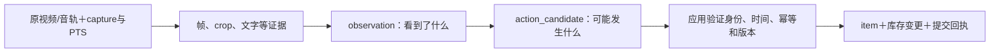
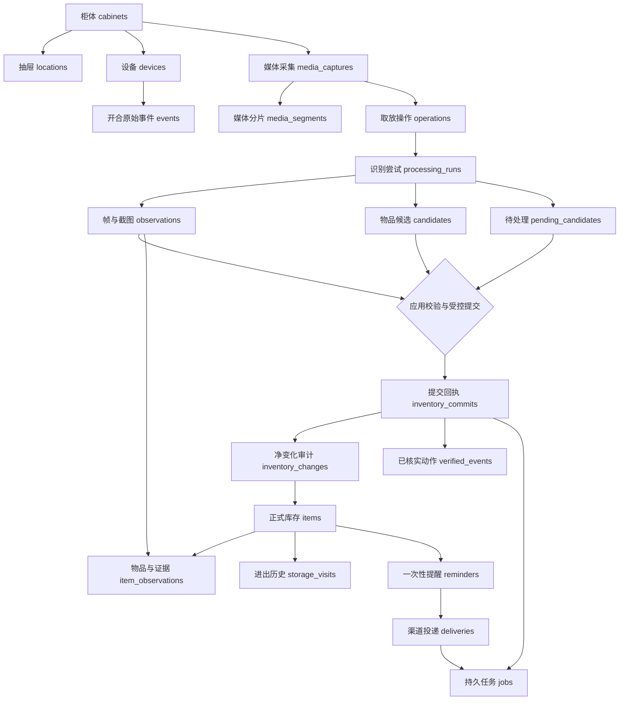

# 数据与调用约定

更新：2026-10-16。SQLite数据库服务层、版本迁移、证据归档、库存受控事务、提醒与任务持久化已经实现。原JSON文件继续作为不可变识别产物保存。HTTP设备上传和实际语音/网页投递仍未实现。

**最新决定：首版暂不做重量变化。** 无重量字段、差重运算、稳定重量等待或HX711接入要求；取放依据为视觉证据及开合状态。

## 1. 历史调用结果（数据库实现前）

旧两轮的`var/runs/improved`执行`inspect-run`得到（新动作回归单独保存，不覆盖此结果）：

```json
{
  "persistence": "local_json_files",
  "video_count": 8,
  "observation_candidates": 22,
  "event_candidates": 14,
  "actual_tool_calls": {"search_catalog": 8},
  "database": {
    "status": "not_implemented",
    "calls_recorded": 0,
    "inventory_commits": 0,
    "inventory_revision": null
  }
}
```

这表示本轮未调用数据库，**不能推断柜内物品数量为0**。22个是观察候选，14个是模型动作候选，均不是已确认库存。工具实参、返回和逐段结果在`backend/var/review/call-results.json`以及原运行目录`tool-trace.json`中。此次核对没有再次调用付费模型。

新动作流程结果在`state-actions-v8`的`operation-analysis.json`；它区分`event_candidates/net_changes/pending/observation_gaps/rejected_state_claims`。`return`沿用原candidate实例而不新建第二件。`inspect-run`会把复用认物结果中的`search_catalog`计入`reused_recognition_tool_calls`，仅把本轮实际证据工具计入`actual_tool_calls`，不会重复计作新调用。`get_inventory_snapshot`未提供初始库存时只是返回unavailable，不是真实数据库读取。

最新8段动作回归的真实汇总如下，详见`backend/var/review/state-action-calls.json`：

```json
{
  "persistence": "local_json_files",
  "video_count": 8,
  "observation_candidates": 22,
  "event_candidates": 19,
  "actual_tool_calls": {"get_inventory_snapshot": 8, "get_frames": 49},
  "reused_recognition_tool_calls": {"search_catalog": 8},
  "database": {"status": "not_implemented", "calls_recorded": 0, "inventory_commits": 0}
}
```

这里的49是工具尝试次数，含1次被范围校验拒绝和1次程序修复后的取帧；48次成功。8次库存快照工具均返回`unavailable`。19条动作只是候选，独立评测仅v1/v7/v8完整通过，不能直接作为数据库变更提交。

## 2. 数据分层



文件保留原始识别结果；`Store.import_run`保存证据、候选和待处理项，`Store.commit_inventory`才写入正式库存。`candidate_id`只在本次运行中有效，不是数据库`item_id`，不能把相同品名当作同一实体。

## 3. 已实现数据库结构

使用标准库sqlite3，开启WAL、外键检查和10秒busy timeout。SQL迁移在`backend/migrations/`，迁移记录保存版本与SHA-256，已执行的SQL不可原地修改。当前共20张业务表，另有1张迁移记录表。保持现有工程轻量，不新增ORM依赖。



图中箭头表示关联/处理方向；可空关联允许通用提醒不绑定物品。实际外键与唯一约束以迁移为准。

| 表 | 关键字段/约束 |
| --- | --- |
| `cabinets` | 柜体、`inventory_revision`和`inventory_known`；默认未知初始库存，不冒充空柜 |
| `locations` | 抽屉及柜体归属；物品位置须属于同柜体 |
| `devices` | 设备、角色、凭据哈希及最后上报时间；网络鉴权仍由未来接入层负责 |
| `events` | 原始开合/心跳；event_id及`(device_id, boot_id, seq)`唯一；相同身份异内容冲突，拒绝weight事件 |
| `media_captures` | 柜体、视频哈希、源文件名、媒体元数据；无可信绝对拍摄锚点时captured_at为空 |
| `media_segments` | capture、分片序号、源引用及哈希；当前离线录像按一个完整分片记录，不宣称已实现上传拼片 |
| `operations` | 柜体内递增操作编号、capture、当前attempt、状态；没有重量依赖 |
| `processing_runs` | 操作attempt、基线revision、内容哈希、原始result、工具/状态审计；整合原计划的analysis_attempts |
| `observations` | 每帧/截图的本地引用、PTS等元数据、毫秒媒体时间、哈希、归档文件；唯一`(run_id, local_ref)` |
| `candidates` | 每轮候选及字段来源；联合主键`(run_id, candidate_id)`，不同运行同名候选不合并 |
| `pending_candidates` | 未解决证据冲突及明确的处理理由、处理人、时间；未解决禁止提交 |
| `items` | 稳定物品ID、名称/类别/位置/在柜状态、version；扩展业务字段及来源保存为结构化JSON |
| `item_observations` | 正式物品与证据多对多关联，保存截图及动作前后帧引用 |
| `storage_visits` | 同一物品多次进出及证据；partial unique index保证最多一条未关闭记录 |
| `inventory_commits` | 真实事务回执、revision、审核人及幂等键；一次操作至多提交一次 |
| `inventory_changes` | 每次净变化的before/after、证据与动作；提交内change_index唯一 |
| `verified_events` | 关联真实item的已核实中间动作；保留拿出再放回，和最终净变化分别记录 |
| `jobs` | 事务内通知任务、重试、租约令牌与到期时间；旧worker不能完成已重新领取的任务 |
| `reminders` | 一次性提醒、实际due_at、渠道、状态和幂等键；可不绑定物品 |
| `deliveries` | 提醒各渠道的queued/received/played/failed/canceled；网页不得确认语音播放 |

提醒数据库层已实现创建/去重/取消、到期扫描、宕机后宽限处理及渠道回执。当前没有常驻调度线程、ASR/自然语言时间解析或实际发送器；须由应用定期调用`trigger_due`并由工作器执行投递。`claim_job/renew_lease/finish_job`提供原子领取、续租、有限重试；网络外部副作用仍为至少一次语义，不保证端到端只播一次。

下一步的每日/每周任务、多轮补充、完成/跳过/稍后提醒统一见[用户任务与定时提醒设计](task-reminder-design.md)。拟复用 APScheduler 和 dateparser，扩展现有 reminders/deliveries 并复用 jobs；该设计尚未迁移执行，本节的已实现表结构不变。

不额外创建与现有功能重叠的`analysis_attempts/idempotency_requests`：前者合并到processing_runs，后者由commits/reminders/jobs各自唯一业务键和请求哈希实现。实时capture_requests、自然语言command_requests和独立回执审计表留待对应服务接入。

### 当前代码职责

| 文件 | 已实现功能 |
| --- | --- |
| `app/database.py` | 连接、事务、校验迁移、完整性检查、WAL一致性备份 |
| `app/store.py` | 初始化柜体/位置、设备登记/事件去重、结果导入、库存读写、审计和真实回执 |
| `app/inventory_schemas.py` | 业务字段、日期来源、提交计划和实体身份校验 |
| `app/scheduling.py` | 持久任务租约、提醒扫描、取消与渠道回执；无网络发送 |
| `app/db_cli.py` | 本地可执行的数据库管理入口 |

截图归档为`<数据库stem>-assets/<sha256>`，数据库存相对路径，不依赖原运行目录继续存在。导入同时读取action-media和工具日志中的额外补帧；原视频仍为外部引用。失败导入可能留下无引用的内容哈希文件，不影响正式数据；本轮不自动清理以免误删并发导入证据。

离线导入默认按柜体和原视频SHA-256复用操作：同一录像换目录重新分析属于新attempt，不创建第二次物理取放。确实是不同采集但字节恰好相同时，由上层显式指定不同operation_id。已提交操作的新分析不会覆盖原提交，纠正使用新操作或主动纠正接口。

## 4. 物品字段与未知值

| 字段 | 生成依据 |
| --- | --- |
| `name/description/category` | 最具体且有视觉/用户证据的称呼；不认识品牌仍可保存饮品/食品 |
| `brand/product_model` | 可读包装/用户确认；当前输出`variant`未来映射商品变体，保留候选原文 |
| `appearance/aliases` | 当前原文保留在候选描述中，尚未独立建字段 |
| `quantity/unit` | 单件/一包装实体或不明组；看不清用null，不把候选条数当件数 |
| `net_content/barcode` | 尚未提取或建独立字段，后续接入包装读取后增加；不代表当前已有数据 |
| `location_id` | 有证据的区域；抽屉不明时null |
| `identity_status` | `candidate/confirmed/group_uncertain`；相同SKU不等于同一件 |
| `presence_status` | `present/unseen/removed/uncertain`；未见不自动变removed |
| `first_seen_at/last_seen_at` | 可信拍摄锚点＋证据时间；无锚点时只存媒体引用 |
| `stored_at` | 有效入柜时刻；外部`put_in_at`映射同一语义，不另建可独立漂移的列 |
| `production_on/expires_on` | 包装/用户明确日期；不根据商品常识补全 |
| `shelf_life_raw/opened_at/review_at` | 原始期限、开封事件、建议检查时刻；建议检查不等于保质期 |
| `created_at/updated_at/version` | 程序生成；处理时间不冒充放入时间 |

关键业务字段保存`field_meta={source, certainty, evidence_refs, extractor}`。`source`取`vision/ocr/barcode/user/system/derived/unknown`；certainty取`recorded/estimated/unknown`。`recorded`表示有来源，不表示绝对正确。多个来源放在supporting_sources中。品牌被程序降级后，其他文字描述仍可能含模型猜测，用户界面也需展示待核实状态。正式库存中的证据引用转换为数据库observation ID，原始候选保留原引用。

片头已有物品：入柜开始未知。只有相对媒体时间：绝对日期保持null。生产/有效期角色不清的数字只保留日期候选。按月/年保质期需日历运算和保存条件，不能直接按30/365天估算。外观不能证明“新鲜、未变质、剩余80%”。

## 5. 净变化和事件历史分开

`operation_net_changes`用于一次操作后的最终库存差异，`event_candidates`保留中间的进出历史。例如v7预期：

- 净变化：新增软糖、移除鸡胸肉，辣条最终保留。
- 动作顺序：取出辣条→放入软糖→取出鸡胸肉→放回辣条。
- 数据库可一次事务保存净变化和已验证历史；不能将四个动作盲目当四次独立数量更新。

遮挡或同款身份不明确时写待处理观察，保持已有库存；不能通过“入/出数量恰好对上”强行确定实体。当前完全不使用重量证据。

## 6. 调用与写库边界

| 调用 | 执行者 | 状态 |
| --- | --- | --- |
| 定位、crop复核、事件判断 | Python调用视觉接口 | 已实现，产出候选 |
| `search_catalog/get_evidence/search_product_images` | 模型请求，程序校验后执行 | 只读；只有search_catalog在本轮实际调用 |
| `get_frames/get_object_evidence/get_inventory_snapshot()` | 动作证据白名单；模型可请求，程序执行 | 未连接DB仍返回unavailable；batch/actions传database时读取真实库存及revision |
| `Store.get_inventory_snapshot(cabinet_id)` | 应用读取当前库存/revision | 已实现，同一读事务读取快照，未知基线单独标记 |
| `Store.import_run(directory, ...)` | 保存观察、候选和待处理项 | 已实现，内容一致重传复用，身份相同内容不同报冲突 |
| `Store.commit_inventory(plan)` | 程序事务，不向模型开放SQL | 已实现，显式计划、审核人、版本及证据校验 |

当前事务：校验真实证据/旧item归属→确认当前attempt/操作ready→短事务比较柜体revision→写items/item_observations/visits/changes/commit→更新操作状态及通知任务→提交后返回回执。任一步失败回滚；模型调用在事务外。相同幂等键重试返回原提交，同键不同内容冲突；旧版本不能覆盖用户新纠正。

真实回执返回`status/commit_id/cabinet_id/operation_id/run_id/revision/added_item_ids/removed_item_ids/updated_item_ids/kept_item_ids/evidence_refs`。pending从操作与库存快照独立查询；历史JSON不被重写为已提交，`inspect-run --database ...`只读取匹配导入结果的真实回执。

### 提交与纠正的请求格式

`db import-run`返回run_id、operation_id、base_revision。应用审核身份后，用这些真实值构造下列请求；尖括号值需要替换，不是可执行固定样例：

```json
{
  "operation_id": "<导入返回的operation_id>",
  "run_id": "<导入返回的run_id>",
  "base_revision": 0,
  "idempotency_key": "operation-review-001",
  "reviewed_by": "operator",
  "decisions": [
    {"candidate_id": "obj01", "action": "add", "evidence_refs": ["v8-o00-c0"]}
  ]
}
```

add创建稳定item_id；remove/return/update/keep必须带真实item_id及expected_version。return复用已移除物品的身份，不新增第二件。动作须匹配net_changes，不能漏掉净变化或中间历史的实体映射。pending需`db resolve`留下明确审核理由后才允许提交；当前尚未实现自动审核策略，正常用户体验不因此被规定为逐件确认。

手工初始物品请求（`db create-item`）：

```json
{"values":{"name":"苹果","category":"食品"},"base_revision":0,"idempotency_key":"seed-001","reviewed_by":"operator"}
```

主动纠正请求（`db correct-item`）：

```json
{"item_id":"<真实物品ID>","patch":{"name":"青苹果"},"expected_version":1,"base_revision":1,"idempotency_key":"correct-001","reviewed_by":"operator"}
```

纠正同样递增版本、写审计和通知；删除使用presence_status=removed软删除，不抹掉证据。标签日期必须有明确来源，模型估计的日期只可写review_at。管理命令为本地受信入口，面向公网前仍须实现鉴权与权限层。

下一步HTTP最小面：完整媒体/分片上传、操作结果读取、库存快照查询、明确用户纠正。既有照片、语音、小智适配器应调用同一应用服务；完整协议以实现后的OpenAPI和迁移为准，不保留多份未实施接口样例。

目前数据库记录处理完成后的操作，状态为ready/pending/failed/committed；实时capturing、采集超时和在线重连状态随设备上传服务实现。pending是业务不确定；处理异常的原始错误保存在processing_runs，不能与已提交混同。

## 7. 本轮验证记录

2026-10-16，使用现有Python 3.13虚拟环境执行，未重新调用模型、未新增外部服务依赖。

| 检查 | 结果 |
| --- | --- |
| 全部自动测试 | 62项通过，其中29项为本轮数据库/调度新增测试 |
| 现有8段state-actions-v8结果导入 | 8个run、778条帧/截图证据、22个物品候选、19个动作候选；正式库存提交0次 |
| 独立真实证据事务验证 | v8的49条证据导入后，在隔离测试柜体提交1件测试库存，revision=1；重复提交返回同一回执 |
| 备份恢复 | 隔离库通过SQLite backup API连同归档截图备份，恢复后的库存快照一致，integrity_check=ok |
| 正式开发库 | `var/mind-box.sqlite3`已建库，仅导入v8证据；初始库存未知、revision=0，未自动提交 |

验证记录：`backend/var/review/database-all-imports.json`、`backend/var/review/database-smoke.json`。隔离验证库在`backend/var/database-validation/`，其中测试空柜基线与审核人仅为数据库验证设置，不表示现实柜体已人工核实或模型识别已经准确。

可重复验证命令（每次选择新的隔离数据库路径，已有数据库会拒绝覆盖）：

```powershell
.\.venv\Scripts\python.exe -m pytest -q
.\.venv\Scripts\python.exe scripts/database_smoke.py var/runs/state-actions-v8/v8 --database var/database-validation/new-check.sqlite3 --output var/review/database-new-check.json
```

## 8. 商品RAG与异步补全约定

2026-10-17第一批已用003迁移在隔离库实现商品档案、样例、字段来源、关联和快照，服务为`ProductMemory`。`knowledge/catalog.json`仍只是6条类别定义，与新增商品记忆分开。正式开发库未迁移，001/002未改；完整目标字段与本批实际子集的差异见第10节，不部署独立向量数据库。

### 三种身份与两条状态轴

| 标识/状态 | 语义 |
| --- | --- |
| `track_id` | 本次视频流中的暂时轨迹ID；跟踪断裂后需要证据关联，不能自动当新实物 |
| `item_id` | 一件物理实物及其进出历史；同一袋取出又放回可沿用；同款另一袋须新建 |
| `product_id` | 可复用的商品/物品类型档案；可细到已验证SKU，也可仅为已知物品类型，不要求所有生活物品有条码 |
| `action_status` | 已实现`confirmed/pending`；观察/正在放入的在线状态留待M5 |
| `product_match_status` | 已实现`unknown/category_only/candidate/verified`，说明与商品档案的匹配程度 |

现有`identity_status`继续表达实物实例身份，不挪用为商品型号确认状态。UI、事件和记录同时保留这两个维度：`action_status=confirmed`且`product_match_status=unknown`可以表示“已放入未知物品”；动作pending不能因命名准确而自动入库。数量也须有逐件/分组依据，不能把一个混合crop当一件。

时间顺序示例：T0观察到新轨迹，显示“正在放入”；T1越界、放稳与可见性证据满足规则后，持久化“未知零食”，返回真实item_id；T2同一轨迹露出正面或异步任务返回，可将该item名称补为“鸡胸肉”；T3已有证据支持品牌/款式时再补充。名称更新不重放add、不重置stored_at、不增加数量。无可信拍摄时钟时仍只存媒体时间窗，stored_at保持null。

### 计划扩展的数据结构

| 结构 | 内容与约束 |
| --- | --- |
| `product_profiles` | product_id、粒度、名称/类别/品牌/变体/标称规格、别名、status、version、created_seq；candidate/verified/rejected分开，未知字段为空 |
| `product_examples` | product_id、原始observation和capture引用、图片哈希、正背面/侧面、可见性、质量、来源实物；只接收可区分的样例，不学习混框或背景 |
| `product_claims` | 每字段value、真实source、evidence/source_ref、验证状态、提取器、时间和撤回信息；保留相互冲突的候选，不最后写入优先 |
| `item_product_links` | item_id、product_id、candidate/verified、匹配证据、引用的商品版本；同款多件可指向同档案，但仍保留多个item |
| `knowledge_snapshots` | 快照ID、版本/内容哈希、允许的profile/example集合、来源会话及逻辑截止序号；用于重现与隔离 |
| 文本/图像索引 | 首版持久化文字特征并复用中文二元组匹配；需要时增加embedding及encoder/model哈希/维度；索引从已验证资料重建，不是事实主库 |

商品记录附带可复用字段，不存“这一袋”的生产/有效期、开封、剩余量、实际数量、位置、在柜状态或入柜日期。商品标称净含量可复用，但不是当前剩余量。取走实物不删除其商品知识；错误档案和样例可以撤回，撤回后索引/缓存失效，追踪受影响item以便重新核实。商品资料修订不会静默批量覆盖已有关联实物。

检索顺序：有效条码/明确标识精确匹配→OCR与别名的中文词法召回→必要时多视角图像向量召回→最多3个候选重排/交叉核验→引用字段生成补全建议。初期用SQLite和小规模内存向量余弦比较即可，不为“RAG”强行引入FAISS/Qdrant或常驻服务。FTS/embedding方案先测试中文与包装正背面的效果，再确定一种实现。只有“鸡胸肉”三个字时，返回鸡胸肉候选，不直接继承某品牌或奥尔良口味。

可信记忆来自明确用户核实或满足可追溯规则的视觉/OCR/条码多证据；视觉模型自报high、已经写入库存、搜索排名靠前都不单独构成商品verified。允许把待核实资料存为candidate，但默认可信检索不读取它，避免模型猜测自我强化。在线新证据只能在其真实到达后参与后续查询。

### 写入和异步任务边界

复用现有jobs及租约，补全任务键包含item_id、证据哈希和提取器版本；任务输入保存item版本、知识快照和证据集合，避免无新证据反复调用模型。只出现更清晰/新正面、新OCR/条码或显式重试才重开一轮识别；多个近似帧合并为同一任务。

已实现`Enrichment.apply(..., facts=False)`事务，限定可改名称/类别/描述/品牌/变体/商品关联及来源；不允许改变presence_status、数量、stored_at、访问历史或重新提交add。`Store.correct_item`仍用于真实人工纠正。speech/rag/web已进入来源枚举，但web自动回写仍被拒绝，不能因枚举存在就声称已经接入网页补全。陈旧版本直接拒绝，不自动无限合并重试。

沿用现有item.version和柜体revision：后台完成后重读，逐字段比较任务输入与当前值。没有字段竞争才合并；用户纠正优先，旧任务不能覆盖。实物已取出时仅可补充历史物品资料，绝不恢复在柜。无关库存更新导致版本冲突时重读重验并有限重试，不能用旧revision强写；同一任务重复完成返回同一补全回执。补全事务和商品档案提升任务都需要持久化审计，不把提取结果直接当可信知识。

当前一个operation只允许一次库存提交；在线不能在同一operation上不断调用commit。计划以media_capture关联整次开合会话，每次已验证交互（或同时发生的一组交互）建立明确的子operation及稳定event_id/幂等键；会话结束只做对账，发现冲突建明确纠正或待处理记录，不把整段净变化再提交一遍。需要补充会话聚合、增量证据导入、轨迹到实物映射及状态迁移，这些不是现有离线import_run自动具备的能力。

### 计划提供的工具与接口

| 调用 | 发起与权限 |
| --- | --- |
| `search_product_memory(evidence_id, text, limit)` | 程序优先做便宜检索；模型可请求只读工具，scope/快照由服务注入，模型不能选择生产库或跨测试空间 |
| `get_frames(start_ms, end_ms, fps)` | 复用有预算的补帧工具；在线只可读已到达且保存/缓冲的帧，不能读未来 |
| `search_web_product(evidence_id, query)` | 计划新增按需文字/图片检索适配器；只接受已知crop，返回来源链接/摘要/匹配证据，不直接更改库存 |
| `propose_enrichment` | 结构化结果而非数据库写工具；输出字段候选、来源、证据及冲突，应用决定是否执行apply_enrichment |
| `apply_enrichment / promote_product_profile` | 程序事务或审核流程，幂等、版本与权限校验；不向模型开放任意SQL或直接可信记忆写入 |

有function call时保留函数名、校验后的参数、tool_call_id及原生role=tool往返；固定流程的本地检索/图像处理记为orchestrator，不能伪装成模型自主调用。网络资料作为不可信数据，只提取商品候选，不执行其指令，也不以搜索结果修改动作事实。真正以图搜索与当前文字驱动search_product_images是不同能力。

完整测试隔离与验收矩阵见[隔离评测](evaluation-and-lessons.md#6-下一轮隔离评测与验收)。本批实际迁移与API见第10节；生产库没有建这些表或写入新库存。

## 9. 语音字段与实物关联约定

V1/V2已完成离线子集并实测v9/v10；003只在隔离库执行，001/002保持原内容。`SpeechService`保存实际ASR、精确原文槽位和关联建议，`Tasks`管理最小提醒和规则；当前不含流式分句、通用多轮对话或网页/设备投递。

### 保留来源与三种不同结果

每个语音最终句保留稳定utterance_id、capture/操作引用、音频文件哈希与PTS时间窗、转写文本/版本、ASR模型配置、提取器、原文片段及缺失项。原音频不被转写覆盖，分析处理时间与拍摄时间分别保存。具体语句/声明/关联结构在迁移时落实，复用现有媒体、observation和分析产物引用，不另存一套失去关联的音频。

| 结果 | 约束 |
| --- | --- |
| `item_fact` 实物事实候选 | 日期、保质期、保存条件等；保存原文、候选值、来源和验证状态；不自动当作已确认事实 |
| `item_link` 指代关联 | 语句可先关联操作/轨迹，最终指向具体item；记录匹配依据和歧义，不因同SKU或时间接近强绑 |
| `task_command` 用户任务 | 复用提醒设计中的task_commands/草稿；日期事实不自动生成用户没有要求的提醒，完整任务才进入调度 |

识别出品牌、用户说“要放入”、日期识别正确，都不构成已发生取放的证据。v10已有可乐保留原item，鸡胸肉新增单独item；新日期只写入关联成立的鸡胸肉。尚未确认实体时，语音建议保留在操作层，不能先写到任意已有物品。

### 写入权限与时间依据

`apply_enrichment`继续只处理名称/商品资料，不扩为任意字段更新。计划新增受限`apply_item_facts`服务，白名单为production_on、expires_on、shelf_life_raw及有证据的相关备注/保存条件；输入包含item/version、语句与原文片段引用、日期锚点和幂等键。它不能改变数量、在柜状态、stored_at、访问历史或提交新的add。

语音是用户提供的信息，提取执行者仍是ASR/语义程序。现已增加`source=speech`及`speech:<utterance_id>`引用；只有该记录已关联同一实物，事实事务才接受。来源不伪装为人工纠正。原文无法归一化、缺年、存在语义疑点或与既有事实冲突时不覆盖正式日期。

生产/到期日期优先保留用户/包装明确表达；推导值保存所有输入证据及日历算法。缺年份仅保留月日和原话，直到有可信拍摄/对话锚点或用户补充。v9的“一年”不视为365天、不从入柜时间起算；v10的日期不自动成为一个具体提醒时刻。保存条件缺失时不将推导日期描述为无条件安全期限。语音与OCR冲突须保留双方，不以用户来源标签或最近一次模型输出自动消除分歧。

离线录像不以当前系统日期或文件修改时间解释“今年”；隔离评测可显式注入测试时钟，清单标明为测试条件。在线相对提醒的接收时刻约定沿用[任务设计](task-reminder-design.md#4-自然语言与多轮补充)，过期补传需澄清，不把推理完成时间重新当倒计时起点。日期语义、时区和有效期边界有歧义时不激活依赖该边界的规则。

### 任务、条件规则与幂等

V2先复用task_commands/草稿、一次任务、reminders/deliveries/jobs及统一调度。到期前定时提醒与“过期后取出时提示”是不同触发类型：后者的持久规则与任务关系统一在[提醒设计](task-reminder-design.md#实物到期与取出条件规则)维护，不复制一套定时系统。缺年份/时刻先needs_input；完整指令通过程序校验并实际保存后才返回已设置。

同一句的ASR中间稿不产生副作用；最终句重传/重新转写保持来源身份和版本，改正已有建议/草稿而非另建相同任务。用户明确重新说出一条新指令则有新message_id，不按文字完全相同永久合并。实物事实任务晚到必须重新检查item版本、用户修正、指代和日期证据；取出后可补历史属性，不能恢复在柜。商品RAG不继承这些批次日期、音频和用户任务。

第一批将同一音轨的最终转写保存为一条稳定记录，ASR分段和时窗完整保留；不是任意长对话的多句编排器。完全相同重传返回原记录，内容/时窗发生变化的最终稿明确拒绝并要求重新核验，不静默改已应用事实或另建任务。自动改稿重关联尚未实现。

## 10. 第一批实际扩展与回执

`003_incremental_memory_speech.sql`新增10张表，沿用原库存和任务队列。只在`var/experiments/*/inventory.sqlite3`使用，不默认读取生产库；独立assets、缓存、任务和manifest。manifest记录输入/代码/提示词哈希、模式、基线及显式时钟，打开时验证数据库scope和清单一致；商品快照按内容哈希验证。

| 表 | 已实现内容 |
| --- | --- |
| experiment_context | 本实验scope/mode/manifest；拒绝改选外部数据库 |
| product_profiles / product_examples / product_claims | candidate/verified/rejected、版本、身份字段/别名/条码、归档crop和来源capture、字段声明 |
| item_product_links / knowledge_snapshots | item到具体商品版本的关联；可导入的已核实商品及多视角快照 |
| speech_utterances | 视频/音频哈希、归档音轨、时间窗、最终原文/ASR配置、解析及关联状态 |
| task_commands | before_expiry / after_expiry_remove；needs_input/scheduled/active/canceled；语音或配置策略来源 |
| item_event_rules / rule_firings | 规则版本、明确过期边界；同rule/version/已提交event最多一个提醒 |

`product_profiles`暂未单列粒度、标称规格或逻辑created_seq；没有向量索引。首版每次直接对小规模verified档案做中文二元组召回，快照带图片SHA256及dHash。holdout按排除ID、同条码、同图或近重复视角过滤；这不保证识别所有拍摄条件下的同SKU，真实留出还需人工按产品组划分。目标视频直接进入seed时拒绝导入。

| 应用调用 | 实际边界 |
| --- | --- |
| CoarseIntake.assess/commit(run_id) | 从已归档快照、窗口和原复核检查单次明确放入；consistent不充分；拒绝原因写pending，复杂取放不开自动权限 |
| Enrichment.apply(..., facts=False) | 保留真实来源、item版本/柜体revision及幂等；名称补充不会改变物理库存 |
| Enrichment.apply(..., facts=True) | 独立白名单production_on/expires_on/shelf_life_raw/notes；只接受同item语音或OCR等证据，禁止RAG继承日期 |
| SpeechService.ingest/link/apply_facts | 原音轨精确哈希；同视频、单个已确认新增、类型词和相邻事件共同关联；不靠“这个”或时间单独绑定 |
| ProductMemory.stage/verify/search/reuse/snapshot | 学习需真实关联crop，提升需显式证据复核；至多3候选；词法分数不是概率；复用需当前真实品牌+款式或已解码条码证据 |
| Tasks.draft/complete/cancel/scan_rules | 日期和边界/钟点未齐先草稿；补齐与reminder/规则同事务；日期变更撤销旧待投递；确认取出不视为吃掉 |
| task_worker | APScheduler周期扫描SQLite期限及已确认取出事件；trigger后进入既有deliveries/jobs，无真实接收/播放器 |

实际`search_product_memory`工具参数为`query/limit`；scope/数据库/快照由服务注入。模型只读工具请求与role=tool往返已保留在`batch-a-assisted-v10-r2/comparisons/warm/product-tool-trace.json`。商品撤回后搜索和未来复用失效，可列出已关联实物；已有字段不会自动清空，仍需复核。

v10经照片复核的演示库新增item=`9e8a4c7e-543a-4f31-988d-c1ff147bea01`：粗存revision1/name=未知食品，补全revision2/name=鸡胸肉、version2，只有同一个item；quantity/stored_at仍null，不把候选的一包解释为已知内部数量。语音已关联它，10月21日原文入库但年份未明，正式expires_on仍null；两个任务为needs_input，未创建真实v10定时提醒。原有红罐未新增，整柜初始库存仍未知。

历史第一批自动v9/v10库均revision0、库存提交0次；复核演示不计自动成功。历史审计在`backend/var/review/batch-a-audit.json`。本轮P0使用另外的隔离库，回执见下节；正式库仍只含001/002、revision0、commits0。

## 11. P0状态证据与提交回执

`operation_analysis`新增`baseline_observations`（实际状态/来源/媒体时间）、`snapshot_checkpoints`、`placement_completions`、`cancelled_placements`、`unobserved_prefixes`。`net_change_status=supported_endpoints`只表示端点可比较，不是已提交或绝对正确；`history_status/status`仍单独表示证据对账是否有未决问题。未知前缀表示首次清楚观察前未建立库存事实，不能把较晚看见箱内物品直接标成新增。

跨窗口事件带`evidence_window_ids`、`placement_completed_in_later_window`和`state_evidence.before/after`；桥接保存真实原状态，不把箱外可见伪装成箱内清楚缺失。事件媒体时间是估计区间，不是采集年月日；`stored_at`继续可为null。

`window-states.json`保存`supplied_frame_ids/input_kind`及原观察/复核/保护决定。复核反转已知存在状态或同一帧的放稳状态会生成pending。模型只读tools和应用提交继续分离，模型不能通过返回crossing或工具参数直接改库。

`CoarseIntake.assess`的`policy=single-insertion-evidence-v2`，`evidence_route=stable_state_comparison/direct_crossing`；保留状态一致、唯一新增、身份、crop、放稳、可见性及证据时间检查。无候选/多候选也返回run/operation/revision以便追踪。SQLite版本、幂等及证据归属约束未移除。

最新实际回执在`backend/var/experiments/p0-final-20261017-01/report.json`：v9/v10/v8各一条新增事务revision1、一条同item补全revision2、仍只有一件实物；重复执行补全后revision仍2。v7为pending、无库存提交。`receipt`是粗存回执，`enrichment_receipt`是补全回执，`inventory/receipts/operation_state`为查询的当前状态；分析文件中的未提交候选不会被伪装为数据库回执。语音、提醒、RAG库未在这次动作回归中重新执行。
