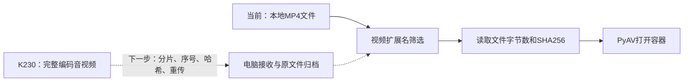
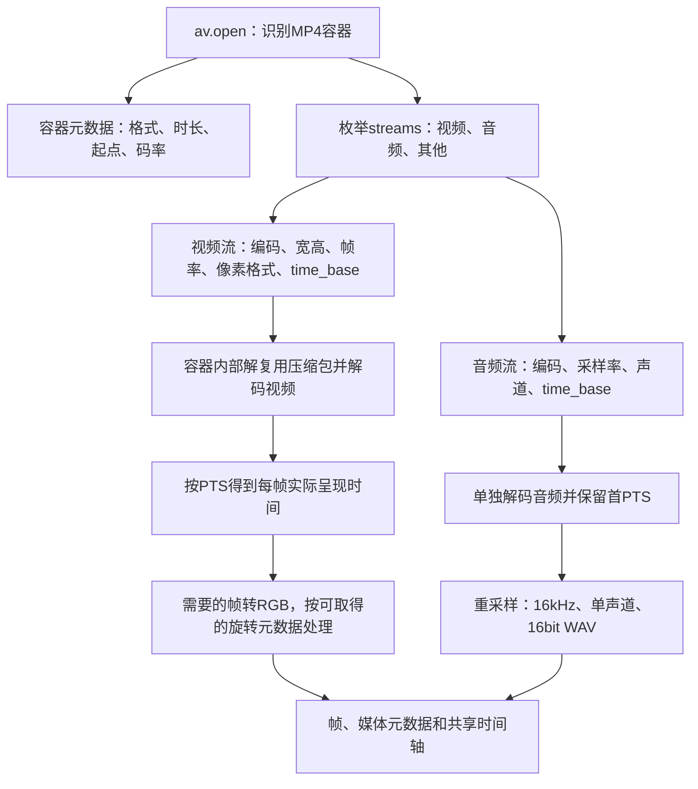
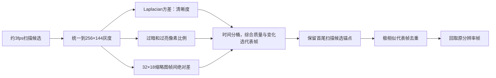
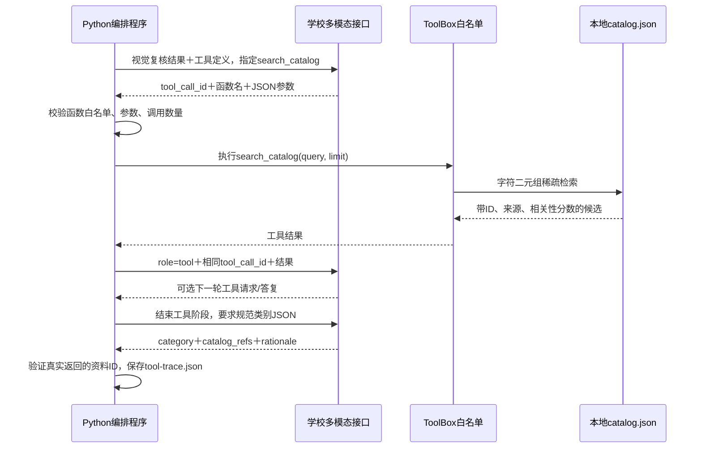
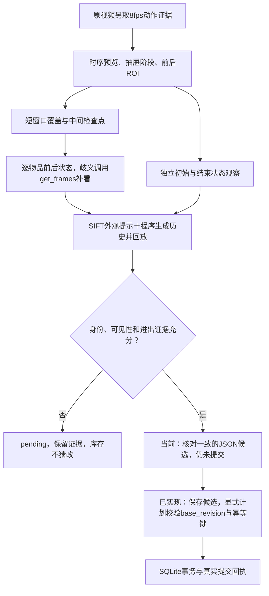
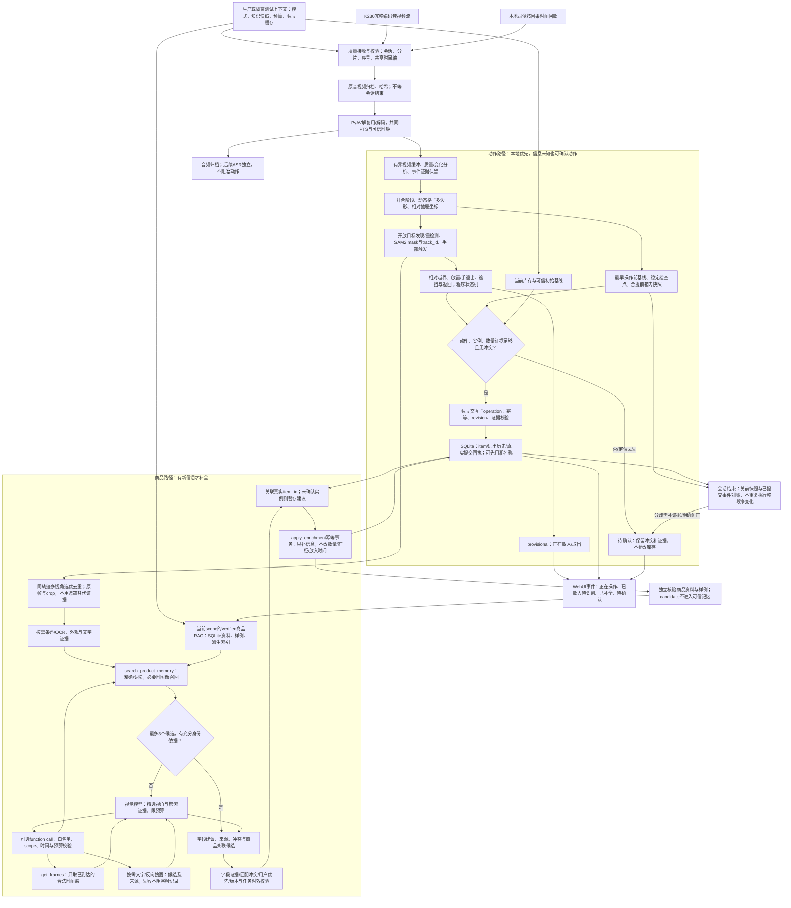

# 视频处理流程与调用

更新：2026-10-16。本文是当前实现的说明；标记“下一步”的节点尚未实现。运行入口和唯一待办见[开发入口](../README.md)，数据语义见[数据与调用约定](data-contract.md)，效果见[评测与失败经验](evaluation-and-lessons.md)。

## 1. 设备到电脑

K230负责采集并传输完整编码视频和音频，电脑负责解码、分析和记录。当前已实现从本地文件开始的离线处理，尚未实现K230上传、断点续传和设备鉴权。

上传应保留`capture_id/segment_id/device_id/boot_id/seq`、采集共同原点、时间质量、字节数和哈希。先确认文件完整再分析；重传不产生重复操作。原视频只读，派生帧、音轨和模型结果另存。`ans.md`只用于人工评测，不进入识别输入。

## 2. 从文件解码出视频信息

代码：`backend/app/media.py`中的`inspect_media/describe_container/prepare_video`。PyAV使用FFmpeg库，不依赖本机安装`ffmpeg`命令。

具体顺序：

1. `av.open(path)`读取容器，不是直接把文件当成图片序列。容器里的压缩包需要解复用，H.264解码器会处理参考帧和重排；代码通过`container.decode(stream)`取得解码帧，不拿包的读取顺序当播放顺序。
2. 读取容器`start_time/duration`，其单位为微秒；流的`start_pts/duration_pts`必须乘本流`time_base`。平均帧率是统计信息，不能用`帧号/fps`替代PTS，尤其是可变帧率和有偏移的录像。
3. 使用同一个容器原点：`origin_s = container.start_time / av.time_base`；没有容器起点时当前回退0并保留原始PTS，不视为有可信拍摄时钟。
4. 对有效帧计算`pts_s = frame.pts * frame.time_base`，`media_time_ms = round((pts_s - origin_s) * 1000)`。缺失PTS的帧当前跳过，不能编造时间。
5. 第一遍顺序解码全视频，约每1/3秒保存一个扫描候选的RGB代理图和分数。**3fps是候选采样频率，解码器仍会解码中间帧**。
6. 选出候选PTS后，第二遍顺序解码视频，回取这些PTS对应的原分辨率帧，保存JPEG和提供给模型的缩放图。这一版不是随机seek，长视频的两遍解码成本后续需要计量。
7. 重新打开原文件，单独解码第一条音轨，转为16kHz单声道16bit WAV并flush重采样器，记录音频首PTS相对共同原点的偏移。WAV没有保留原始不连续时间戳，精确同步仍以原音视频为准；未做ASR。
8. 输出`media.json/frames/contact-sheet.jpg/audio.wav`。新`inspect-media`命令还能独立读取全部流信息，既有实验产物不会被它改写。

真实例子：v1为1920×1080 H.264/YUV420P，平均帧率`45000/1499`，视频`time_base=1/90000`、起始PTS=63；音频为AAC、48kHz、双声道、`time_base=1/48000`、起始PTS=0。视频首帧相对容器起点约0.7ms，音频约0ms，不能将二者分别归零而丢掉偏移。PTS=66019的帧约为0.733544秒，导出约734ms；这不是绝对拍摄日期。

当前只处理第一条视频和第一条音轨；旋转只读取已有代码支持的元数据。多流、损坏帧、完整Display Matrix旋转和长视频内存/磁盘预算尚未全面验证。

## 3. 质量、选帧和去重

当前评分为`log(1+sharpness)-3*bad_exposure`，桶内再加有上限的变化奖励。近静态代表帧的平均灰度差小于0.8时抑制，但保留锚点。阈值是实验启发式，不是已校准的感知相同判据。第二轮最多10帧/视频；短片只有9个扫描候选时输出9帧。

当前“末锚点”是最后一个扫描候选，不保证是文件最后解码帧；首尾也不保证恰好是无手、无遮挡的操作前后画面。全图清晰和全图相似不能保证小物品清晰或没变化。后续操作判断必须另外选稳定前后帧，不能直接拿首尾图代替。

## 4. 物品框、截图和字段

`bbox`为0–1000归一化`xyxy`，由程序映射原图像素，不把它解释为中心点和宽高。模型给框无需为任意生活物品训练固定类别，但会框偏、混入邻物、把透明抽屉当容器；几何合法不表示定位正确。最新局部排序只对v8补测，完整两轮仍保留原截图顺序。

提示词保存在`backend/app/prompts/`，分定位、crop复核、类别规范、事件四个任务；结果保存提示词哈希。包装文字和检索资料一律作为数据。品牌/款式须出现在模型抄录文字中才保留，仍可能抄错；`identity_support`最高保守为medium，不是概率。重复框只提示，不直接合并实体数量。

## 5. tools / function calling：谁发起、谁执行

当前底层模型响应只披露学校别名`deepseek-pro`。视觉调用、裁剪和时间计算由程序顺序执行；原生function calling发生在RAG类别规范及动作歧义补看阶段。

这不是“模型直接访问数据库”。程序实际执行工具，模型只请求调用。工具最多2轮、每轮最多4个调用；参数无效或引用未知证据时拒绝。不支持原生调用时，程序检索同一资料再请求规范，明确记录`orchestrated_retrieval`。

| 工具 | 实际用途 | 第二轮实际调用 |
| --- | --- | --- |
| `search_catalog(query, limit)` | 检索6条本地类别定义，最多5条返回 | 8次，均为原生function call |
| `get_evidence(evidence_id)` | 读取本次crop元数据，只接受已知ID | 0次；已实现，不能称为本轮调用过 |
| `search_product_images(query)` | 可选文字驱动图片搜索 | 0次；未配置搜索Key，不是反向搜图 |
| `Store.commit_inventory(plan)` | 已实现的程序内SQLite库存事务 | 显式计划、证据、版本与幂等校验；自动审核策略待实现，不向模型开放 |

真实调用例子来自v2：`search_catalog({"query":"饮品 食品 日用品 工具 电子用品 其他 大类定义","limit":5})`，结果ID依次为`category-household/category-electronics/category-food/category-tool/category-beverage`。这是宽泛查询，饮品排最后，说明检索排名本身不证明物品身份。下一步按每个crop的文字/外观针对性检索，不能靠RAG修复错框。

## 6. 动作到库存：已实现的状态对账与下一步

`backend/app/actions.py/action_schemas.py/matching.py`已替代原先整段稀疏帧直接猜动作的阶段。现有学校视觉接口识别抽屉阶段、选择前后快照、逐候选观察状态；OpenCV提供局部特征身份提示，程序生成事件并检查终态。已有SQLite证据/库存服务；专用手部检测器、连续物体跟踪器和几何配准尚未部署。

1. 从原视频另解码8fps动作证据，不受认物最多10帧限制，保留真正最后解码帧。最多480帧，超预算明确失败并要求拆操作，不悄悄截断。
2. 对已验证usable的crop提取OpenCV SIFT，与当前帧匹配并用RANSAC筛几何关系，按内点数/比例/分布和投影形状过滤，在当前图标候选ID。保存`appearance-matches.json/matched-frames`。这是正向外观提示；背景纹理也可能匹配，无匹配绝不推出缺失，更不是连续跟踪或校准概率。
3. 最多20帧时序预览，每4帧拼一页，印上真实帧ID/毫秒。模型输出开合阶段、合拢前结束快照及箱内ROI；快照必须落在可见open阶段。阶段、窗口等仍是模型估计，原文保留审计。
4. 初始/结束ROI分别裁剪并带全帧做独立状态观察。当前是矩形归一化，不是透视或光流配准。认物样例图片可能干扰当前存在判断，因此状态调用只给候选文字和当前照片；样例图仍可通过只读工具按需取得。
5. 对操作区间每约1.25秒做短窗口覆盖，前后加约250ms上下文，并截在合拢前结束快照；避免分段器漏掉多次取放。每个窗口以两端检查点先做局部库存观察，遮挡/冲突时再看连续片段。固定窗口边界尚不保证无手和稳定，这仍是优化点。
6. 每个候选输出`inside/outside/absent/occluded/unknown`、帧引用、可见性、放稳与身份依据，不让模型选择动作标签。`absent`要求箱内清楚；模型同时说不存在和不可见时，程序将该状态降为unknown并记录原声明，不通过重试要求模型强行说看清。关闭后不可见不算移除。
7. 程序回放状态：非在柜→放稳在柜为add，在柜→确认在外/缺失为remove；本次已取出且同一候选返回为return。先前有引用的已确认状态可跨短时遮挡关联，保留`bridged_from_prior_evidence`及可能变宽的时间窗。它不证明同款多件的唯一身份。
8. 对照独立结束快照。冲突按具体物品触发一次原生`get_frames`请求，再观察补帧，不整段覆盖全部候选；每次复核前重新读取当前冲突，解决后立即停止。未解决保留pending，已找到的动作也保留；全部仍`committed=false`。不确定身份的“前后未变”只记观察缺口，不能推翻先前已确认状态。

实测限制：v4的before被选在第一批物品进入之后，补看又把较早空柜误认为已有物品，覆盖原先正确观察并得到错误consistent。当前阶段校验只能验证模型输出格式和引用范围，未客观验证“操作前/已看清”。下一步必须保留相互矛盾的复核证据并加强基线检查；完整结果见[评测与失败经验](evaluation-and-lessons.md)。

工具执行边界：`get_frames(start_ms,end_ms,fps)`从原视频读取，限制时间范围、帧率与返回数量，结果附采样信息；`get_object_evidence(candidate_id)`只读已知候选样例；`get_inventory_snapshot()`读取显式提供的初始库存，或在CLI传入`--database`时读取真实库存及revision；未连接或基线未知时明确返回对应状态，绝不当空柜。原生请求→白名单校验→role=tool返回元数据→用户消息附带有ID的图片→结构化观察→程序对账。调用及拒绝均保存在`action-tool-trace.json`。

手和物品二维重叠不等于抓取。物品短暂消失可能是手遮挡、翻面或移到不可见处，不足以删库存。前后差分负责判断最终净变化，轨迹负责解释顺序和拿出后放回，两者需要共同作用。

## 7. 合并后的总体结构

实线是现有离线主流程；虚线为尚未实现的增量。首版暂不做重量变化。`batch/actions --database ...`可读取真实库存快照并保存证据和候选；显式提交计划才更新库存。`inspect-run --database ...`读取真实回执；不传数据库返回not_connected。历史JSON保留原状态，不能当作新提交回执。详见[数据库关系图与表格](data-contract.md#3-已实现数据库结构)。

## 8. 开发流程与复用组件

开发顺序：隔离环境和密钥 → 无模型的媒体检查 → 文本/图片/JSON/工具能力探测 → 小样本定位/crop复核 → 全部开发样本 → 冻结结果和提示词哈希 → 对照人工答案 → 针对错误改进 → 必要测试 → 新留出集。每次更换算法保留原证据和独立运行目录。

现用：Python 3.13、PyAV、OpenCV、Pillow、Pydantic、httpx；学校模型按需处理精选帧。RAG是本地中文字符二元组检索，尚非商品库或向量数据库。Docker引擎正常，项目镜像下载受阻，实测在`.venv`中完成。

下一步定位可比较[Grounding DINO](https://github.com/IDEA-Research/GroundingDINO)＋[SAM 2](https://github.com/facebookresearch/sam2)，文字用[PaddleOCR](https://github.com/PaddlePaddle/PaddleOCR)，语音可用[faster-whisper](https://github.com/SYSTRAN/faster-whisper)；手部可比较预训练的[MediaPipe Hand Landmarker](https://ai.google.dev/edge/mediapipe/solutions/vision/hand_landmarker)。这些均未安装实测，不需要先训练任意生活物品分类器。

## 9. 增量优化实施规划

本节为下一轮设计，不表示下列模块已经完成。唯一勾选式TODO保留在[开发入口](../README.md#下一步-todo)，商品结构与写库约束见[数据约定第8节](data-contract.md#8-下一步商品rag与异步补全约定)，测试见[隔离验收](evaluation-and-lessons.md#6-下一轮隔离评测与验收)。先交付M0-M2的离线小闭环，再投入动态几何、GPU跟踪和在线服务；暂不引入重量变化。

### 阶段、交付与停止条件

| 阶段 | 交付内容 | 验收与效率约束 |
| --- | --- | --- |
| M0 冻结评测 | 保存原结果；独立库存基线、商品快照、缓存和运行清单；划分cold/warm/holdout/disabled | 人工答案不进入推理；冷启动不读取暖启动缓存；先确认评测有效再改算法 |
| M1 先存后识别 | 拆分动作与商品状态；已验证动作写入粗名称；异步任务通过新补全事务更新同一item | 饮品/未知零食先入库，后补名称不增件、不重置放入时间；动作歧义仍pending；先用已通过的简单样本跑通 |
| M2 商品RAG | 现有SQLite新增商品档案、多视角样例、字段来源与知识快照；条码/文字召回后核验 | 前一会话核实的鸡胸肉可在下一会话复用；相似款拒绝错误复用；新实物有新item，批次日期不继承 |
| M3 基线与抽屉坐标 | 最早操作前基线、稳定检查点和关前快照分开；人工多边形标定，逐帧更新；矛盾复核保留双方证据 | v4不能再用已入物的533ms当操作前；v8拉开/合上不产生取放；定位丢失暂停自动提交，不靠提示词强行对齐 |
| M4 分割与实例时序 | 先人工首框验证SAM 2.1，再加自动发现/重检测、手部触发；输出轨迹和轮廓审阅视频 | v7四步与净变化都正确；v6正背面不重复；先判断跟踪收益，再投入自动发现和图像向量 |
| M5 在线链路 | 因果顺序回放现有录像，再接K230增量音视频；独立交互子操作、事件推送与最小WebUI | 不等录像结束即可展示；回放不能看未来；重连/重试不重复提交，会话结束只对账 |
| M6 增量补全 | 新正面/清晰文字触发OCR、RAG、必要的视觉与网络搜索；限额、去重和陈旧任务保护 | 搜索失败仍保留粗名称；新信息更新原item；晚到任务不能覆盖用户改名或把已取走物品恢复在柜 |
| M7 回归与留出 | 固定预算消融：原流程、动态区域、跟踪、RAG、网络逐项比较 | 报告动作、实例、字段、延迟、成本和失败，不用品牌准确掩盖库存错误；未达标保留已验收的小闭环 |

M1-M2的首次交付不宣称已经修复复杂视频：先验证“粗名称存入→同item补全→另一会话复用”三件事。M3优先解决已知错误基线，M4才处理正背面、快速取放和遮挡。每个阶段固定输入与预算，失败先区分定位、动作、身份或字段来源，再改一个主要变量；不循环调用直到碰巧答对。

### 两条并行路径：动作先到，身份后补

动作路径由抽屉坐标、物品时序、放稳及前后快照支持，商品路径负责回答“这是什么”。首次展示可仅为“未知物品”；已有证据支持饮品/零食时再使用对应粗名称。品牌未知不阻塞已确定的放入；认识品牌也不能替代存入证据。当前pending会阻塞整个操作，实施时需拆分动作冲突与纯字段未知，不能一律将pending标已解决。

示例：观察新包装→显示正在放入→确认放稳并创建item-A/未知零食→新正面支持鸡胸肉→补充item-A名称→可靠文字/条码支持品牌款式→建立verified商品档案。下一次同款新包装创建item-B并引用档案；若是item-A刚取出又返回，则依赖时序证据复用item-A。没有完整动作证据时两者都不能仅凭商品相同强行判定。

粗名称和完整名称共用item_id/event_id；UI按版本替换文字，不追加第二件。物品名称后补不能改变quantity、presence_status、stored_at或访问历史。可信拍摄时钟缺失时，记录相对PTS/动作窗，绝对放入时间保持null。识别先于动作确认返回时，先保存到暂时轨迹候选，实物关联确认后才应用。

计划中的职责分工：

| 模块 | 输入/输出 | 技术与调用策略 |
| --- | --- | --- |
| 视频与状态 | 时间戳、抽屉位置、轨迹、稳定前后帧→动作候选 | PyAV/OpenCV；先修现有规则，再加SAM2；不逐帧调用云模型 |
| 商品记忆 | 条码/OCR/当前crop→带来源的最多3个候选 | SQLite为主库；先词法召回，必要时才加一种经测试的CLIP/SigLIP类图像编码器 |
| 视觉语义 | 精选新视角及真实检索证据→字段建议/不确定项 | 先复用已实测学校别名deepseek-pro；不将其别名推断为某个官方版本，其他模型在同预算留出集胜出后替换 |
| tools | 证据不足→有范围的补帧/本地检索/按需联网 | 模型只请求只读工具，程序校验scope、时间与预算并执行；固定流水线调用另记orchestrator |
| 写库 | 已验证动作或受限字段建议→真实回执 | 应用层commit_inventory与新增apply_enrichment；模型不直接写SQL或将候选升级为可信记忆 |

提示词分别处理“当前空间状态”“目标/文字辨识”“与检索候选核验”，不在一次请求中让模型同时猜动作、补品牌和决定写库。状态提示只观察当前证据；商品记忆用于身份而非证明物品现在在柜。每个字段返回证据引用与支持/冲突理由，未知允许为空。模型自报high和检索相似度均不解释为准确概率；后续用留出集校准自动接受/拒绝阈值。

### 动态抽屉、分割和手部如何组合

先把格子标为多边形，而非屏幕固定矩形；有条件在刚性抽屉边框贴多枚ArUco，或在纹理充分时用角点/LK光流和RANSAC更新单应性。格子边界随抽屉移动，运动判据使用相对抽屉位移，减少把抽屉整体移动判作物品移动。标记被手挡住、角点不足或重投影误差过大时进入定位lost，不能继续沿用过期区域自动提交。

“拉开/合上减去”应按阶段排除整体位移和遮挡效应，同时保留原视频与异常交互；不能整段删除开合帧，否则可能漏掉开门尚未到位时已发生的放入。最早基线不一定稳定，稳定快照不一定在首次操作前；两者同时保存。关门前选最后一组可见稳定箱内照片，关闭后前板图仅证明关闭，不能证明物品被取出。复核推翻早先观察时保存冲突，不以最后一次模型回答或“正好对上终态”为准。

SAM2试验先人工指定首框/首mask，单独衡量轮廓传播；通过后用Grounding DINO宽泛提示、变化区域与区域提议发现未知物品，周期性重检测。开放词汇检测也可能漏掉陌生物品，不假设“任意生活物品必然被检出”。手部mask用于避免把手当物品、定位交互与恢复遮挡，不把手物重叠当抓取证明。必要时才加局部点跟踪，避免同时堆叠多个重模型。

目标停止运动后继续传播已有mask并保存稳定截图；轨迹丢失时明确显示lost/虚线最后位置，不能把旧轮廓画成仍然可见。审阅视频可叠加红色轮廓、ID、状态与抽屉边界，推理保留原帧和局部裁剪；模糊背景仅作可选展示，不删除判断箱口、邻物和手部关系所需信息。[SAM2](https://github.com/facebookresearch/sam2)与[Grounded-SAM-2](https://github.com/IDEA-Research/Grounded-SAM-2)提供分割/跟踪组件，仍需本项目的交互规则、身份映射和回归测试。

二维入多边形只代表图像投影相交；物品悬在箱口上方也可能“在框内”。最终放入需要进入轨迹、放置/手退出、内部稳定可见及前后变化的联合证据；完全遮挡、同款交换或深度不明时保留pending。单目无法恢复的视频事实不靠RAG或搜索填补。若这些场景是核心需求，后续再评估俯视固定机位/第二机位，先用现有视频量化必要性。

### 在线、预算和渐进部署

在线先用现有视频按真实时间顺序回放：所有工具仅能访问已经到达的时间点，验证不依赖后面的正面画面。随后接设备流；RTSP等协议须先确认K230固件实际支持，否则使用有序短分片/持续上传。只需当前分片完整可解码，不等整个会话录完。视频/音频保持共同PTS和源数据归档，初期音频只保存，ASR不阻塞动作链路。

分析维护约2-3秒前滚缓冲与有界队列；压力大时合并重复静态待处理帧，保留事件前后及原始媒体，不静默丢掉交互证据。持续采集归档与分析队列分开。启动值需在实际硬件测量，不承诺未经测试的FPS或云端延迟。先用单机SQLite和已有jobs租约，GPU模块在独立Python 3.11/兼容PyTorch环境及独立容器配置中验证，不破坏现有3.13环境；镜像/硬件受阻仍可先完成文字RAG与离线事务。

实时提交须新增会话父级与交互子operation，以及增量证据导入；现有import_run在完成后批量导入，不能直接充当流式入库。每次确认的交互或同时发生的一组操作有稳定event_id/幂等键；同一operation只提交一次。会话结束对账已提交事件，冲突建立纠正/待处理，不再把整段净变化重复执行。WebSocket推送实际回执及item/version，断线后以库存快照和事件游标恢复，避免“界面显示成功但数据库没提交”。

建议首次实验预算如下，均为待验证配置而非当前实测指标：

- 本地状态/几何尽快更新；云端默认单并发，界面先显示provisional，动作确认才显示已放入。
- 每物品每轮保留最多3个有互补信息的视角；一次主要身份调用，最多一次由新证据或明确冲突触发的复核；预算耗尽保留粗名称/待确认。
- 条码/文字记忆足够且无冲突时跳过昂贵视觉调用；缺少信息的同一背面不定时重复识别。
- 每个补全轮次至多一次外部检索；新正面/新文字才开启新轮。有明确文字先文字搜索，图片相似搜索作为最后补充。
- 真正反向搜图可评估[Lens适配器](https://serpapi.com/google-lens-api)，须配置对应服务；上传物品crop而非整柜，使用短期资源引用。搜索返回的是候选，需比对品牌、款式、规格及来源，不能由首条结果直接确定。
- 网络429/5xx/超时有限退避重试；400参数/权限错误先修配置。逐次记录耗时、HTTP状态、校验拒绝、缓存与重试次数，不把本地权限失败混作模型拥堵。

图像索引、OCR、网络各自独立开关；先证明它们减少错认或模型调用，再扩容。不优先做独立向量服务、复杂WebUI或语音识别。阶段报告保留失败片段及原因，用户可补充不同角度/光照/交互的视频；修改后重新固定条件回归，不将旧开发样本通过当作新物品泛化结论。

## 10. 目标流程总图

下图合并下一轮的完整目标结构，含尚未实现的商品RAG、动态分割、增量入库和WebUI；当前已实现范围仍以第1-8节为准。动作主路径先产出真实库存回执，商品路径随后更新同一实物信息。所有读写沿用当前生产/测试上下文；商品记忆不参与推断物品是否在柜。图中“确认”须通过阶段验收确定规则，不能因模型自报高置信直接提交。

