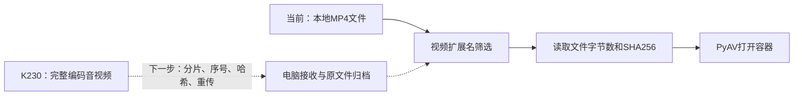
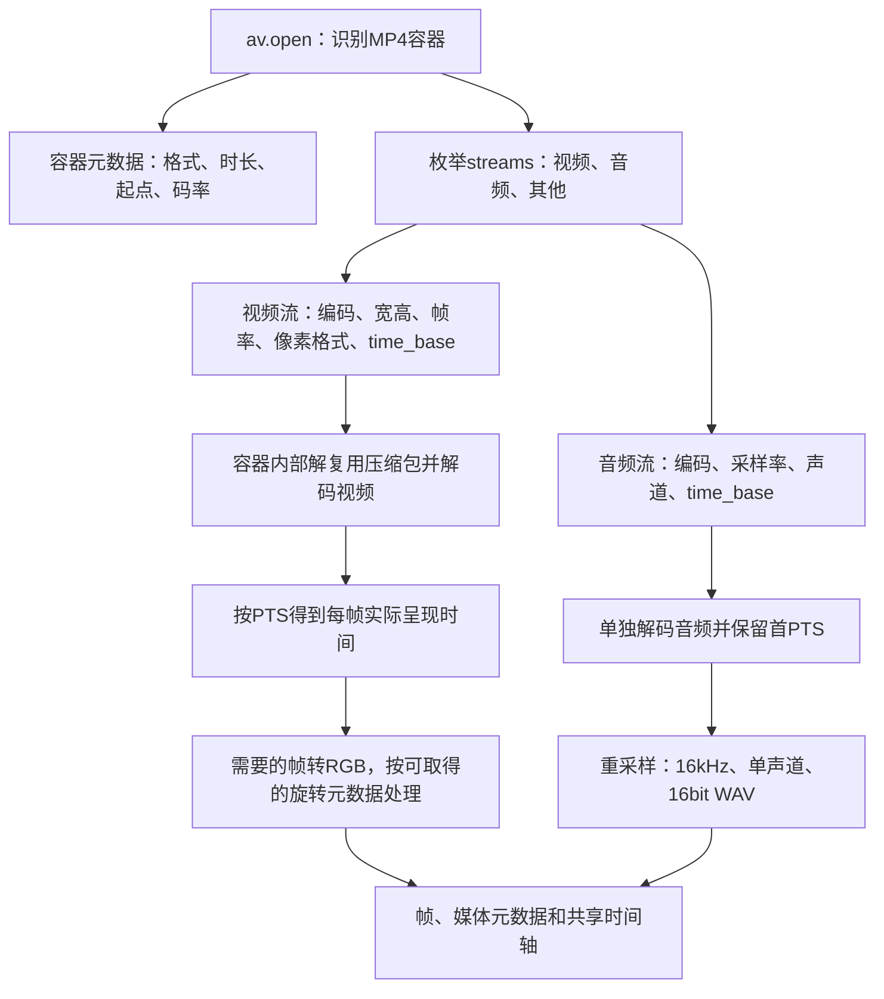
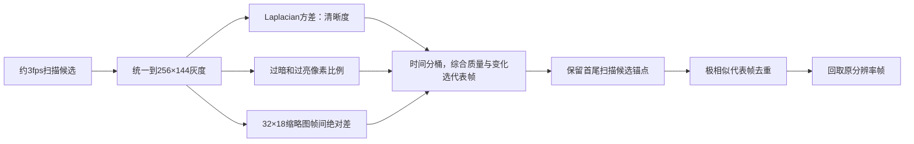
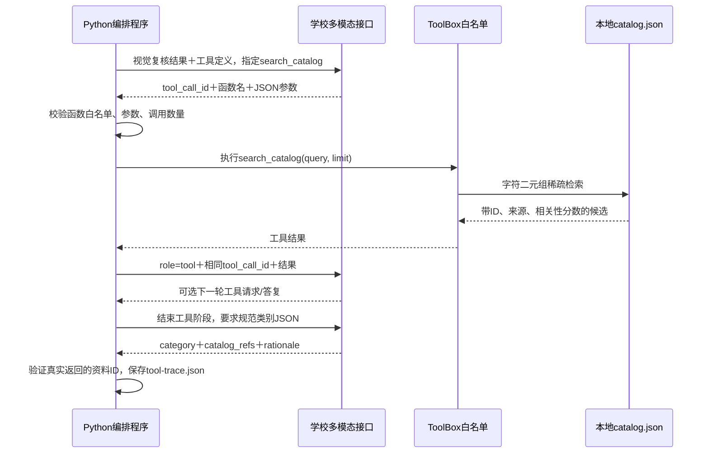
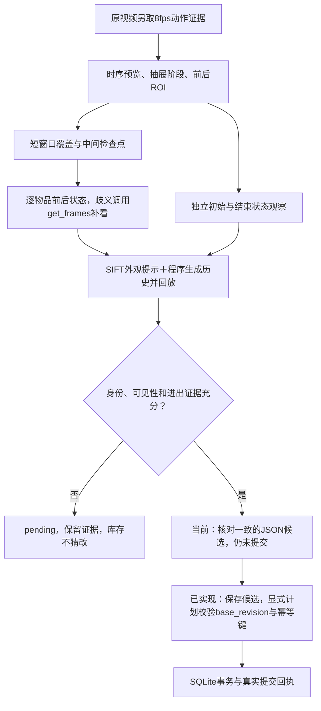
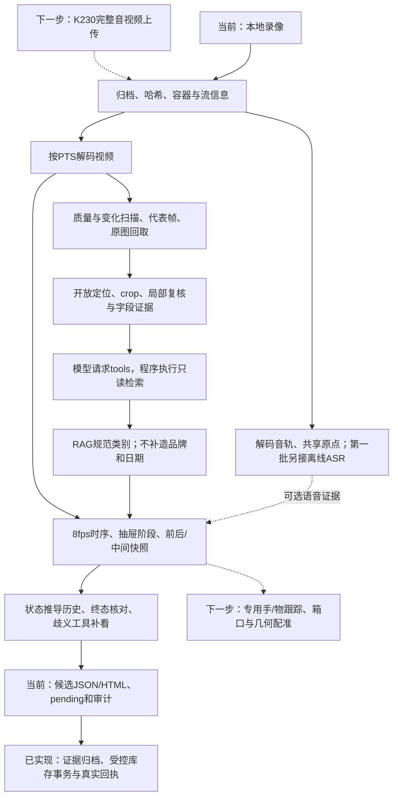
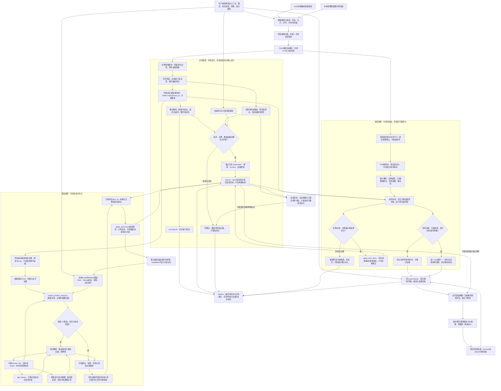
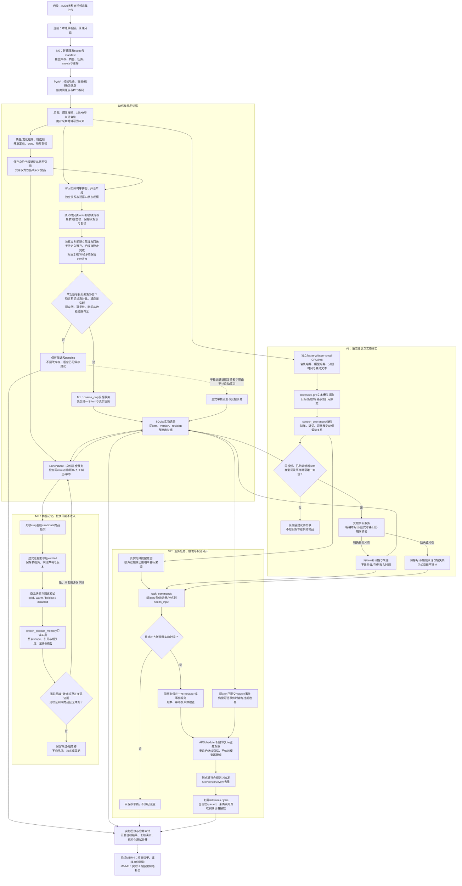

# 视频处理流程与调用

更新：2026-10-17。第1-8节说明原视觉主干，第9-10节保留后续整体设计，第11节为第一批实际实现及合并流程图。运行入口和唯一待办见[开发入口](../README.md)，数据语义见[数据与调用约定](data-contract.md)，效果见[评测与失败经验](evaluation-and-lessons.md)。标记待实施的跟踪/在线模块不能当成本批能力。

## 1. 设备到电脑

K230负责采集并传输完整编码视频和音频，电脑负责解码、分析和记录。当前已实现从本地文件开始的离线处理，尚未实现K230上传、断点续传和设备鉴权。

上传应保留`capture_id/segment_id/device_id/boot_id/seq`、采集共同原点、时间质量、字节数和哈希。先确认文件完整再分析；重传不产生重复操作。原视频只读，派生帧、音轨和模型结果另存。`ans.md`只用于人工评测，不进入识别输入。

## 2. 从文件解码出视频信息

代码：`backend/app/media.py`中的`inspect_media/describe_container/prepare_video`。PyAV使用FFmpeg库，不依赖本机安装`ffmpeg`命令。

具体顺序：

1. `av.open(path)`读取容器，不是直接把文件当成图片序列。容器里的压缩包需要解复用，H.264解码器会处理参考帧和重排；代码通过`container.decode(stream)`取得解码帧，不拿包的读取顺序当播放顺序。
2. 读取容器`start_time/duration`，其单位为微秒；流的`start_pts/duration_pts`必须乘本流`time_base`。平均帧率是统计信息，不能用`帧号/fps`替代PTS，尤其是可变帧率和有偏移的录像。
3. 使用同一个容器原点：`origin_s = container.start_time / av.time_base`；没有容器起点时当前回退0并保留原始PTS，不视为有可信拍摄时钟。
4. 对有效帧计算`pts_s = frame.pts * frame.time_base`，`media_time_ms = round((pts_s - origin_s) * 1000)`。缺失PTS的帧当前跳过，不能编造时间。
5. 第一遍顺序解码全视频，约每1/3秒保存一个扫描候选的RGB代理图和分数。**3fps是候选采样频率，解码器仍会解码中间帧**。
6. 选出候选PTS后，第二遍顺序解码视频，回取这些PTS对应的原分辨率帧，保存JPEG和提供给模型的缩放图。这一版不是随机seek，长视频的两遍解码成本后续需要计量。
7. 重新打开原文件，单独解码第一条音轨，转为16kHz单声道16bit WAV并flush重采样器，记录音频首PTS相对共同原点的偏移。WAV没有保留原始不连续时间戳，精确同步仍以原音视频为准。媒体模块只导出音轨；第一批新增`app.asr`独立转写，分段毫秒再加音轨first_media_time_ms回到共享时间轴。
8. 输出`media.json/frames/contact-sheet.jpg/audio.wav`。新`inspect-media`命令还能独立读取全部流信息，既有实验产物不会被它改写。

真实例子：v1为1920×1080 H.264/YUV420P，平均帧率`45000/1499`，视频`time_base=1/90000`、起始PTS=63；音频为AAC、48kHz、双声道、`time_base=1/48000`、起始PTS=0。视频首帧相对容器起点约0.7ms，音频约0ms，不能将二者分别归零而丢掉偏移。PTS=66019的帧约为0.733544秒，导出约734ms；这不是绝对拍摄日期。

当前只处理第一条视频和第一条音轨；旋转只读取已有代码支持的元数据。多流、损坏帧、完整Display Matrix旋转和长视频内存/磁盘预算尚未全面验证。

## 3. 质量、选帧和去重

当前评分为`log(1+sharpness)-3*bad_exposure`，桶内再加有上限的变化奖励。近静态代表帧的平均灰度差小于0.8时抑制，但保留锚点。阈值是实验启发式，不是已校准的感知相同判据。第二轮最多10帧/视频；短片只有9个扫描候选时输出9帧。

当前“末锚点”是最后一个扫描候选，不保证是文件最后解码帧；首尾也不保证恰好是无手、无遮挡的操作前后画面。全图清晰和全图相似不能保证小物品清晰或没变化。后续操作判断必须另外选稳定前后帧，不能直接拿首尾图代替。

## 4. 物品框、截图和字段

`bbox`为0–1000归一化`xyxy`，由程序映射原图像素，不把它解释为中心点和宽高。模型给框无需为任意生活物品训练固定类别，但会框偏、混入邻物、把透明抽屉当容器；几何合法不表示定位正确。最新局部排序只对v8补测，完整两轮仍保留原截图顺序。

提示词保存在`backend/app/prompts/`，分定位、crop复核、类别规范、事件四个任务；结果保存提示词哈希。包装文字和检索资料一律作为数据。品牌/款式须出现在模型抄录文字中才保留，仍可能抄错；`identity_support`最高保守为medium，不是概率。重复框只提示，不直接合并实体数量。

## 5. tools / function calling：谁发起、谁执行

当前底层模型响应只披露学校别名`deepseek-pro`。视觉调用、裁剪和时间计算由程序顺序执行；原生function calling发生在RAG类别规范及动作歧义补看阶段。

这不是“模型直接访问数据库”。程序实际执行工具，模型只请求调用。工具最多2轮、每轮最多4个调用；参数无效或引用未知证据时拒绝。不支持原生调用时，程序检索同一资料再请求规范，明确记录`orchestrated_retrieval`。

| 工具 | 实际用途 | 第二轮实际调用 |
| --- | --- | --- |
| `search_catalog(query, limit)` | 检索6条本地类别定义，最多5条返回 | 8次，均为原生function call |
| `get_evidence(evidence_id)` | 读取本次crop元数据，只接受已知ID | 0次；已实现，不能称为本轮调用过 |
| `search_product_images(query)` | 可选文字驱动图片搜索 | 0次；未配置搜索Key，不是反向搜图 |
| `Store.commit_inventory(plan)` | 程序内SQLite库存事务 | 显式计划、证据、版本与幂等校验；第一批单次放入保守门槛见第11节，不向模型开放 |
| `search_product_memory(query, limit)` | 新增verified商品只读检索 | 第一批复核演示2次原生请求/执行/role=tool闭环；至多3候选，scope由服务固定 |

真实调用例子来自v2：`search_catalog({"query":"饮品 食品 日用品 工具 电子用品 其他 大类定义","limit":5})`，结果ID依次为`category-household/category-electronics/category-food/category-tool/category-beverage`。这是宽泛查询，饮品排最后，说明检索排名本身不证明物品身份。下一步按每个crop的文字/外观针对性检索，不能靠RAG修复错框。

## 6. 动作到库存：已实现的状态对账与下一步

`backend/app/actions.py/action_schemas.py/matching.py`已替代原先整段稀疏帧直接猜动作的阶段。现有学校视觉接口识别抽屉阶段、选择前后快照、逐候选观察状态；OpenCV提供局部特征身份提示，程序生成事件并检查终态。已有SQLite证据/库存服务；专用手部检测器、连续物体跟踪器和几何配准尚未部署。

1. 从原视频另解码8fps动作证据，不受认物最多10帧限制，保留真正最后解码帧。最多480帧，超预算明确失败并要求拆操作，不悄悄截断。
2. 对已验证usable的crop提取OpenCV SIFT，与当前帧匹配并用RANSAC筛几何关系，按内点数/比例/分布和投影形状过滤，在当前图标候选ID。保存`appearance-matches.json/matched-frames`。这是正向外观提示；背景纹理也可能匹配，无匹配绝不推出缺失，更不是连续跟踪或校准概率。
3. 最多20帧时序预览，每4帧拼一页，印上真实帧ID/毫秒。模型输出开合阶段、合拢前结束快照及箱内ROI；快照必须落在可见open阶段。阶段、窗口等仍是模型估计，原文保留审计。
4. 初始/结束ROI分别裁剪并带全帧做独立状态观察。当前是矩形归一化，不是透视或光流配准。认物样例图片可能干扰当前存在判断，因此状态调用只给候选文字和当前照片；样例图仍可通过只读工具按需取得。
5. 对操作区间每约1.25秒做短窗口覆盖，前后加约250ms上下文，并截在合拢前结束快照；避免分段器漏掉多次取放。每个窗口以两端检查点先做局部库存观察，遮挡/冲突时再看连续片段。固定窗口边界尚不保证无手和稳定，这仍是优化点。
6. 每个候选输出`inside/outside/absent/occluded/unknown`、帧引用、可见性、放稳与身份依据，不让模型选择动作标签。`absent`要求箱内清楚；模型同时说不存在和不可见时，程序将该状态降为unknown并记录原声明，不通过重试要求模型强行说看清。关闭后不可见不算移除。
7. 程序回放状态：非在柜→放稳在柜为add，在柜→确认在外/缺失为remove；本次已取出且同一候选返回为return。先前有引用的已确认状态可跨短时遮挡关联，保留`bridged_from_prior_evidence`及可能变宽的时间窗。它不证明同款多件的唯一身份。
8. 对照独立结束快照。冲突按具体物品触发一次原生`get_frames`请求，再观察补帧，不整段覆盖全部候选；每次复核前重新读取当前冲突，解决后立即停止。未解决保留pending，已找到的动作也保留；全部仍`committed=false`。不确定身份的“前后未变”只记观察缺口，不能推翻先前已确认状态。

实测限制：v4的before被选在第一批物品进入之后，补看又把较早空柜误认为已有物品，覆盖原先正确观察并得到错误consistent。当前阶段校验只能验证模型输出格式和引用范围，未客观验证“操作前/已看清”。下一步必须保留相互矛盾的复核证据并加强基线检查；完整结果见[评测与失败经验](evaluation-and-lessons.md)。

工具执行边界：`get_frames(start_ms,end_ms,fps)`从原视频读取，限制时间范围、帧率与返回数量，结果附采样信息；`get_object_evidence(candidate_id)`只读已知候选样例；`get_inventory_snapshot()`读取显式提供的初始库存，或在CLI传入`--database`时读取真实库存及revision；未连接或基线未知时明确返回对应状态，绝不当空柜。原生请求→白名单校验→role=tool返回元数据→用户消息附带有ID的图片→结构化观察→程序对账。调用及拒绝均保存在`action-tool-trace.json`。

手和物品二维重叠不等于抓取。物品短暂消失可能是手遮挡、翻面或移到不可见处，不足以删库存。前后差分负责判断最终净变化，轨迹负责解释顺序和拿出后放回，两者需要共同作用。

## 7. 合并后的总体结构

实线是现有离线主流程；虚线为尚未实现的增量。首版暂不做重量变化。`batch/actions --database ...`可读取真实库存快照并保存证据和候选；显式提交计划才更新库存。`inspect-run --database ...`读取真实回执；不传数据库返回not_connected。历史JSON保留原状态，不能当作新提交回执。详见[数据库关系图与表格](data-contract.md#3-已实现数据库结构)。

## 8. 开发流程与复用组件

开发顺序：隔离环境和密钥 → 无模型的媒体检查 → 文本/图片/JSON/工具能力探测 → 小样本定位/crop复核 → 全部开发样本 → 冻结结果和提示词哈希 → 对照人工答案 → 针对错误改进 → 必要测试 → 新留出集。每次更换算法保留原证据和独立运行目录。

现用：Python 3.13、PyAV、OpenCV、Pillow、Pydantic、httpx；学校模型处理精选帧及语音文本槽位。第一批新增SQLite商品记忆、faster-whisper、dateparser和APScheduler；检索仍为中文字符二元组，无向量服务。历史Docker引擎曾正常但镜像下载失败；本轮找不到Docker程序，实测在主venv及独立ASR环境完成。

下一步定位可比较[Grounding DINO](https://github.com/IDEA-Research/GroundingDINO)＋[SAM 2](https://github.com/facebookresearch/sam2)，文字用[PaddleOCR](https://github.com/PaddlePaddle/PaddleOCR)；手部可比较[MediaPipe Hand Landmarker](https://ai.google.dev/edge/mediapipe/solutions/vision/hand_landmarker)，本批均未安装。语音[faster-whisper](https://github.com/SYSTRAN/faster-whisper)已安装并实测；不需要先训练任意生活物品分类器。

## 9. 增量优化实施规划

本节为分批实施设计，第一批M0→M1→V1→V2→M2已经执行，实际边界见第11节；M3之后尚未实施。唯一勾选式TODO保留在[开发入口](../README.md#下一步-todo)，商品结构见[数据约定第8节](data-contract.md#8-商品rag与异步补全约定)，语音来源见[第9节](data-contract.md#9-语音字段与实物关联约定)，测试见[隔离验收](evaluation-and-lessons.md#6-下一轮隔离评测与验收)。暂不引入重量变化。

### 本轮模块变更与执行批次

保留PyAV共同PTS解码、原媒体归档、质量评分/局部选图、8fps状态观察与补帧工具、SQLite事务/证据及jobs租约。v9/v10约10.38秒/7.24秒，旧`voice-intake-20261016-01`是not_run的媒体基线，未重写；新`batch-a-asr`已有真实转写，隔离库有槽位、草稿及复核演示回执。下表说明设计上的新增/修改/退出方向；动态几何/跟踪/增量会话仍待实施。

| 类型 | 模块 | 从原流程到新流程 | 对应教训/验收 |
| --- | --- | --- | --- |
| 新增 | 独立动作/身份/字段/任务状态 | 动作可确认、名字可未知、提醒可待补充，分别表示 | 不因名字未知堵住放入，不用命名准确放行动作 |
| 新增 | 自动补全及实物字段服务 | 基于item_id、来源、版本和幂等更新；身份补全与日期事实分权限 | 补名/日期不重复加物，不改在柜状态或放入时间 |
| 新增 | 语音识别与关联 | 最终句+时间窗→语义槽位→交互/类型关联；歧义留操作层 | v10鸡胸肉日期不能绑给原有可乐；重转写不重复建任务 |
| 新增 | 商品记忆及快照 | 已验证档案/多视角样例→受scope约束的检索→候选核验 | 复用鸡胸肉知识；拒绝相似款；cold不读warm |
| 新增 | 到期前提醒与取出条件规则 | 复用任务/调度/投递服务；时间缺失保存草稿；条件规则监听确认事件 | 设置/触发/送达分别有回执；取出不等于吃掉 |
| 新增 | 动态几何与连续分割 | 标定抽屉多边形并随动，SAM2传播mask，周期性重检测 | 减少开合整体运动、混框与正背面重复 |
| 新增 | 增量会话与界面事件 | 会话父级+交互子操作、增量证据、实际回执推送 | 不等文件结束，重连与会话结束不重复增删 |
| 修改 | 选帧与去重 | 全图质量留作粗筛；动作保留连续证据，身份选局部互补视角 | 静态背景不代表小物品无变化；v7不能只看首尾 |
| 修改 | 基线、复核和状态对账 | 最早操作前与稳定快照分开；矛盾复核保留双方 | v4的533ms不冒充初始状态；不接受错误consistent |
| 修改 | 提示词与function calling | 视觉状态/身份核验/语音槽位分任务；只读工具有白名单和预算 | 不让一次回答包办动作、品牌、日期和写库 |
| 修改 | 音频优先级 | 从只导出音轨改为先验证v9/v10离线ASR，不等SAM2全部完成 | 语音成为实物日期和用户任务的证据，仍不阻塞视频动作 |
| 修改 | 网络补全与缓存 | 新证据触发、限预算；缓存包含模式/快照/配置；图片搜索可选 | 不在同一背面反复调用，不把搜索第一名当事实 |
| 退出主判断 | 稀疏整段直接猜动作 | 最早的整段事件提示已由状态流程替代；继续以程序状态机为准 | 标签/解释波动，不足以支持库存事务 |
| 退出主判断 | 固定矩形/二维越框直接判取放 | 矩形保留作展示/裁图，不能单独触发库存改变 | 抽屉移动、物品悬空、遮挡都可能制造假越界 |
| 退出主判断 | 最后一次复核覆盖冲突 | 用证据审计和待确认替代“最后答复优先” | 不为追求终态一致抹掉真实分歧 |
| 退出关键路径 | 认全品牌后才入库、结束后一次展示 | 已确认动作先粗存，身份和语音事实异步补充 | 降低首条可用记录的延迟 |

上述“退出”是取消旧策略的决定权，不在本轮物理删除源文件、提示词、原视频、日志或历史产物；旧版本保留作消融对照。6条类别定义继续作为通用词表，不冒充商品RAG。现有人工纠正接口继续用于真实人工操作，新增自动服务保存提取来源。重量功能不加入本轮。

| 批次 | 顺序与交付 | 进入下一批的条件 |
| --- | --- | --- |
| A：离线基础与语音 | M0→M1→V1→V2→M2；先独立环境与结构化服务，再接模型；交付粗存、补全、v9/v10语音事实/提醒、隔离记忆 | 同一item不重复增件；关键日期/指代正确或明确待补充；提醒不虚报；cold/warm隔离 |
| B：视觉动作可靠性 | M3→M4；先基线/冲突保护，再动态区域，再人工初始化跟踪，最后自动发现 | 保住v1/v7/v8；定位v4错误consistent及v6正背面问题；复杂场景未通过不自动提交 |
| C：实时与扩展 | M5→M6→M7；因果回放→设备流/最小界面→按需OCR联网→留出集 | 无未来帧、无重复提交、真实延迟/成本报告；原始失败证据可查 |

批次A的开发验收只在隔离库及明确信息场景放行，不将现有consistent作为全场景自动入库条件。通用每日/每周/多轮任务仍按[提醒设计](task-reminder-design.md#9-实施顺序与验收)推进，V2只先取所需最小功能，不复制另一套队列或定时器。全局只有README维护勾选TODO，阶段表记录交付和依赖。

已确认的执行约定：本轮只做A；日期/年份/提醒时刻和“这个”有歧义时默认待补充；不擅自设提前几天/几点提醒；优先本地ASR和现有学校接口。其他付费模型、图片搜索与B/C留待后续。ASR依赖/权重失败已记录，Docker本轮不能实测，不预估未经测量的工期/FPS。

### 阶段、交付与停止条件

| 阶段 | 交付内容 | 验收与效率约束 |
| --- | --- | --- |
| M0 冻结评测 | 保存原结果与v9/v10媒体基线；独立库存/任务/商品快照/缓存和运行清单；划分cold/warm/holdout/disabled | 人工答案不进入推理；冷启动不读暖启动缓存；先确认评测有效再改算法 |
| M1 先存后识别 | 拆分动作/商品/字段/任务状态；隔离简单样本粗存，新增来源真实的异步补全事务 | 同item不增件、不重置时间；consistent不自动放行复杂视频；动作歧义仍pending |
| V1 语音与指代 | 独立环境验证ASR；最终句/PTS/原话→类型化槽位及候选实物关联 | v9/v10关键数字、单位和日期正确或明确未知；原有可乐不承接鸡胸肉日期；先存建议不直接写任务 |
| V2 实物日期与提醒 | 结构化日期事务、草稿/一次提醒、调度和取出规则先验证，再接语音；复用任务设计 | 未知年份/时刻不猜补；无任务回执不报已设置；模拟投递不称设备播放；重传不重复 |
| M2 商品RAG | 现有SQLite新增商品档案、多视角样例、字段来源与知识快照；条码/文字召回后核验 | 前一会话核实的鸡胸肉可在下一会话复用；相似款拒绝错误复用；新实物有新item，批次日期不继承 |
| M3 基线与抽屉坐标 | 最早操作前基线、稳定检查点和关前快照分开；人工多边形标定，逐帧更新；矛盾复核保留双方证据 | v4不能再用已入物的533ms当操作前；v8拉开/合上不产生取放；定位丢失暂停自动提交，不靠提示词强行对齐 |
| M4 分割与实例时序 | 先人工首框验证SAM 2.1，再加自动发现/重检测、手部触发；输出轨迹和轮廓审阅视频 | v7四步与净变化都正确；v6正背面不重复；先判断跟踪收益，再投入自动发现和图像向量 |
| M5 在线链路 | 因果顺序回放现有录像，再接K230增量音视频；独立交互子操作、事件推送与最小WebUI | 不等录像结束即可展示；回放不能看未来；重连/重试不重复提交，会话结束只对账 |
| M6 增量补全 | 新正面/清晰文字触发OCR、RAG、必要的视觉与网络搜索；限额、去重和陈旧任务保护 | 搜索失败仍保留粗名称；新信息更新原item；晚到任务不能覆盖用户改名或把已取走物品恢复在柜 |
| M7 回归与留出 | 固定预算消融：原流程、动态区域、跟踪、RAG、网络逐项比较 | 报告动作、实例、字段、延迟、成本和失败，不用品牌准确掩盖库存错误；未达标保留已验收的小闭环 |

批次A不宣称已修复复杂视频：先验证粗存/同item补全、语音日期及提醒、另一会话商品复用。M3解决已知错误基线与动态区域，M4处理正背面、快速取放和遮挡。每阶段固定输入与预算，失败先区分定位、动作、身份、语音、时间或事务来源，再改一个主要变量；不循环调用直到碰巧答对。

### 两条并行路径：动作先到，身份后补

动作路径由抽屉坐标、物品时序、放稳及前后快照支持，商品路径负责回答“这是什么”。首次展示可仅为“未知物品”；已有证据支持饮品/零食时再使用对应粗名称。品牌未知不阻塞已确定的放入；认识品牌也不能替代存入证据。当前pending会阻塞整个操作，实施时需拆分动作冲突与纯字段未知，不能一律将pending标已解决。

示例：观察新包装→显示正在放入→确认放稳并创建item-A/未知零食→新正面支持鸡胸肉→补充item-A名称→可靠文字/条码支持品牌款式→建立verified商品档案。下一次同款新包装创建item-B并引用档案；若是item-A刚取出又返回，则依赖时序证据复用item-A。没有完整动作证据时两者都不能仅凭商品相同强行判定。

粗名称和完整名称共用item_id/event_id；UI按版本替换文字，不追加第二件。物品名称后补不能改变quantity、presence_status、stored_at或访问历史。可信拍摄时钟缺失时，记录相对PTS/动作窗，绝对放入时间保持null。识别先于动作确认返回时，先保存到暂时轨迹候选，实物关联确认后才应用。

计划中的职责分工：

| 模块 | 输入/输出 | 技术与调用策略 |
| --- | --- | --- |
| 视频与状态 | 时间戳、抽屉位置、轨迹、稳定前后帧→动作候选 | PyAV/OpenCV；先修现有规则，再加SAM2；不逐帧调用云模型 |
| 商品记忆 | 条码/OCR/当前crop→带来源的最多3个候选 | SQLite为主库；先词法召回，必要时才加一种经测试的CLIP/SigLIP类图像编码器 |
| 视觉语义 | 精选新视角及真实检索证据→字段建议/不确定项 | 先复用已实测学校别名deepseek-pro；不将其别名推断为某个官方版本，其他模型在同预算留出集胜出后替换 |
| 语音语义 | 原音频/最终句/PTS→实物属性、日期片段、任务意图与缺失项 | V1先评估faster-whisper中文转写，数字/日期独立核验；现有语言接口仅处理转写文本，不假设支持音频输入 |
| tools | 证据不足→有范围的补帧/本地检索/按需联网 | 模型只请求只读工具，程序校验scope、时间与预算并执行；固定流水线调用另记orchestrator |
| 写库 | 已验证动作或受限字段建议→真实回执 | 应用层commit_inventory与新增apply_enrichment；模型不直接写SQL或将候选升级为可信记忆 |

提示词分别处理“当前空间状态”“目标/文字辨识”“与检索候选核验”，不在一次请求中让模型同时猜动作、补品牌和决定写库。状态提示只观察当前证据；商品记忆用于身份而非证明物品现在在柜。每个字段返回证据引用与支持/冲突理由，未知允许为空。模型自报high和检索相似度均不解释为准确概率；后续用留出集校准自动接受/拒绝阈值。

### 第三条并行路径：语音事实与用户任务

语音在V1/V2提前实现，但与动作独立：保留原音频及共享PTS，ASR最终句保留时间段、版本和稳定utterance_id；中间稿只展示，改稿重新核验已有建议，不重复生成实物/任务。先用文本/结构化输入验证程序校验与写库，再接真实ASR，分别报告转写和语义失败。学校deepseek-pro可用于文本槽位提取，不由它直接推断可信年月或执行提醒。

关联“这个”时，结合相邻交互、当前/最近确认轨迹、实物类型和用户原话；只有时间接近不足以确定。暂时只有track_id时建议挂在轨迹/操作上，有真实item_id后再应用；多件同类无法区分则待确认。用户说“我要放可乐”是意图，不证明已经放入；字段明确也不能越过动作冲突。

v9提取“生产日期=今年7月14日、期限=一年”。拍摄年份来自可信采集锚点；离线测试可显式注入测试时钟并标注，不用文件修改/分析日期代替。无年份先保留原文与月日。生产日期明确后按日历年推导日期候选，保存期限单位、保存条件和推导证据，不从放入日期加一年。语音与标签冲突保存双方来源。

v10实际音频提取到期月日及“提醒吃掉”意图；额外“过期后取出时提示”来自显式产品策略，单独记configured_policy，不造一条ASR指令。年份、提醒哪天几点及日期边界未明确时存草稿，不擅自设提前一天或上午九点。到期前提醒由同一调度服务执行；取出规则由可信过期边界与已提交remove事件共同触发，保存rule/version/event幂等键，不能由关闭抽屉或ASR一句话触发。取出不视为吃掉或完成任务。

身份补全继续只改名称/商品资料，生产/有效期走独立受限实物事实校验，不放宽原接口成任意字段写入。提醒需要真实任务回执，网页收到与柜体播放分别记录；结构化验收明确标“模拟”。语音日期、指令和音频不进入可跨实物复用的商品记忆。详细数据约定见[语音事实](data-contract.md#9-语音字段与实物关联约定)，调度/投递复用[提醒设计](task-reminder-design.md)。

### 动态抽屉、分割和手部如何组合

先把格子标为多边形，而非屏幕固定矩形；有条件在刚性抽屉边框贴多枚ArUco，或在纹理充分时用角点/LK光流和RANSAC更新单应性。格子边界随抽屉移动，运动判据使用相对抽屉位移，减少把抽屉整体移动判作物品移动。标记被手挡住、角点不足或重投影误差过大时进入定位lost，不能继续沿用过期区域自动提交。

“拉开/合上减去”应按阶段排除整体位移和遮挡效应，同时保留原视频与异常交互；不能整段删除开合帧，否则可能漏掉开门尚未到位时已发生的放入。最早基线不一定稳定，稳定快照不一定在首次操作前；两者同时保存。关门前选最后一组可见稳定箱内照片，关闭后前板图仅证明关闭，不能证明物品被取出。复核推翻早先观察时保存冲突，不以最后一次模型回答或“正好对上终态”为准。

SAM2试验先人工指定首框/首mask，单独衡量轮廓传播；通过后用Grounding DINO宽泛提示、变化区域与区域提议发现未知物品，周期性重检测。开放词汇检测也可能漏掉陌生物品，不假设“任意生活物品必然被检出”。手部mask用于避免把手当物品、定位交互与恢复遮挡，不把手物重叠当抓取证明。必要时才加局部点跟踪，避免同时堆叠多个重模型。

目标停止运动后继续传播已有mask并保存稳定截图；轨迹丢失时明确显示lost/虚线最后位置，不能把旧轮廓画成仍然可见。审阅视频可叠加红色轮廓、ID、状态与抽屉边界，推理保留原帧和局部裁剪；模糊背景仅作可选展示，不删除判断箱口、邻物和手部关系所需信息。[SAM2](https://github.com/facebookresearch/sam2)与[Grounded-SAM-2](https://github.com/IDEA-Research/Grounded-SAM-2)提供分割/跟踪组件，仍需本项目的交互规则、身份映射和回归测试。

二维入多边形只代表图像投影相交；物品悬在箱口上方也可能“在框内”。最终放入需要进入轨迹、放置/手退出、内部稳定可见及前后变化的联合证据；完全遮挡、同款交换或深度不明时保留pending。单目无法恢复的视频事实不靠RAG或搜索填补。若这些场景是核心需求，后续再评估俯视固定机位/第二机位，先用现有视频量化必要性。

### 在线、预算和渐进部署

在线先用现有视频按真实时间顺序回放：所有工具仅能访问已经到达的时间点，验证不依赖后面的正面画面。随后接设备流；RTSP等协议须先确认K230固件实际支持，否则使用有序短分片/持续上传。只需当前分片完整可解码，不等整个会话录完。视频/音频保持共同PTS与源数据归档；V1/V2先验离线ASR，M5再接流式VAD/分句与最终句，语音失败不阻塞动作链路。

分析维护约2-3秒前滚缓冲与有界队列；压力大时合并重复静态待处理帧，保留事件前后及原始媒体，不静默丢掉交互证据。持续采集归档与分析队列分开。启动值需在实际硬件测量，不承诺未经测试的FPS或云端延迟。先用单机SQLite和已有jobs租约，GPU模块在独立Python 3.11/兼容PyTorch环境及独立容器配置中验证，不破坏现有3.13环境；镜像/硬件受阻仍可先完成文字RAG与离线事务。

实时提交须新增会话父级与交互子operation，以及增量证据导入；现有import_run在完成后批量导入，不能直接充当流式入库。每次确认的交互或同时发生的一组操作有稳定event_id/幂等键；同一operation只提交一次。会话结束对账已提交事件，冲突建立纠正/待处理，不再把整段净变化重复执行。WebSocket推送实际回执及item/version，断线后以库存快照和事件游标恢复，避免“界面显示成功但数据库没提交”。

建议首次实验预算如下，均为待验证配置而非当前实测指标：

- 本地状态/几何尽快更新；云端默认单并发，界面先显示provisional，动作确认才显示已放入。
- 每物品每轮保留最多3个有互补信息的视角；一次主要身份调用，最多一次由新证据或明确冲突触发的复核；预算耗尽保留粗名称/待确认。
- 条码/文字记忆足够且无冲突时跳过昂贵视觉调用；缺少信息的同一背面不定时重复识别。
- 每个补全轮次至多一次外部检索；新正面/新文字才开启新轮。有明确文字先文字搜索，图片相似搜索作为最后补充。
- 真正反向搜图可评估[Lens适配器](https://serpapi.com/google-lens-api)，须配置对应服务；上传物品crop而非整柜，使用短期资源引用。搜索返回的是候选，需比对品牌、款式、规格及来源，不能由首条结果直接确定。
- 网络429/5xx/超时有限退避重试；400参数/权限错误先修配置。逐次记录耗时、HTTP状态、校验拒绝、缓存与重试次数，不把本地权限失败混作模型拥堵。

图像索引、OCR、ASR、网络各自独立开关；先证明它们减少错认或模型调用，再扩容。不优先做独立向量服务或复杂WebUI。语音最小闭环因v9/v10提前，实时语音与复杂对话后续再接。阶段报告保留失败片段及原因，修改后固定条件回归，不将旧开发样本通过当作新物品泛化结论。

## 10. 目标流程总图

下图为完整目标架构，动态几何/连续分割、增量会话与WebUI尚未实现；第一批已实现的离线子集另列于第11节。视频动作、商品身份、语音事实/任务三路关联同一实物；商品记忆与语音意图均不证明物品已在柜。图中确认须通过阶段规则，不能因模型自报高置信提交；本轮自动v9/v10仍pending。

## 11. 第一批实际流程

第一批已实现M0/M1/V1/V2/M2的离线子集，83项测试通过。下面是实际组件的合并流程；逻辑上分三路，当前CLI按步骤执行，不是已经接通K230的实时并行系统。动作仍依赖模型状态观察和保守程序规则，没有连续物体/手部跟踪，不能保证画面歧义被自动解决。

| 本批变化 | 实际实现 | 原流程经验如何落实 |
| --- | --- | --- |
| 新增隔离上下文 | Experiment、003迁移、scope/manifest、独立库存/任务/商品/assets/API缓存 | 空商品记忆与空抽屉分别表达；cold不回退生产库，warm必须显式seed |
| 修改入库门槛 | CoarseIntake读取独立快照/逐窗口及原复核；只放行单次明确放入，拒绝原因持久化 | consistent不足以提交；遮挡、复核逆转、多物品历史不能用名字准确代替动作证据 |
| 新增受限补全 | 同item的Enrichment、来源引用、版本和幂等；身份与实物日期分别白名单 | “未知食品→鸡胸肉”只更新字段，不再add；用户改名和移除状态不被晚到响应覆盖 |
| 新增离线语音 | 独立faster-whisper small/int8→精确原文槽位→保守实物关联 | 原话不是库存事件；缺年/同音错字留待确认，鸡胸肉信息不绑已有饮品 |
| 新增最小任务闭环 | Tasks草稿/显式补齐/条件规则；APScheduler扫描既有reminders/jobs | 不默认提醒时间，定时/取出是两种触发，原话与配置策略分来源，投递不冒充播放 |
| 新增持久商品记忆 | 已复核档案和3视角、词法召回、快照及受限复用 | 历史知识只补商品身份；新实物不继承生产日期、数量、位置或入柜时间；相似类名不证明同SKU |
| 退出决定权 | 不让稀疏整段事件标签、最后复核或模型high直接决定写库 | 原证据/失败保留；没有通过的动作宁可pending，也不伪造闭环 |

工具调用边界：模型原生请求`search_product_memory(query,limit)`，程序校验工具名/参数并在固定scope检索，最多3候选，以相同tool_call_id返回role=tool，模型再收到结果。真实轨迹见`batch-a-assisted-v10-r2/comparisons/warm/product-tool-trace.json`。六条类别的search_catalog仍独立存在；数据库提交、日期写入、商品提升和提醒设置由应用执行，均不是模型直接调用SQL。固定的扫描、裁剪和词法查询标为orchestrator。

历史第一批回执：当时自动v9/v10均pending、revision0、commits0。经照片复核的独立v10演示粗存revision1、同item补成鸡胸肉后revision2；语音链接成立，日期缺年，两个任务仍needs_input。暖库检索命中是候选；真实倒计时仅queued待投递。P0修复后的自动回执在第12节及[本轮实测](evaluation-and-lessons.md#10-p0修复与实际回归2026-10-17)，与历史失败/复核演示分开。

该批规划中的基线、矛盾证据保护和时序输入已在第12节P0修改中推进；下一步优先动态多边形和连续实例跟踪。SAM2、标红轮廓、实时WebUI和真正图片搜索仍未实现。

2026-10-17另做视频直传能力探测，尚未替换下面的实际流程。学校`deepseek-pro`两种MP4格式共4次均未通过正序/倒序语义检查，三张图片对照通过；未进入历史失败视频比较，不改库存门槛。详见[直传测试结果](evaluation-and-lessons.md#8-视频直传最小测试2026-10-17)。接入顺序为：明确支持的视频接口→合成时序验收→真实交互片段对照→证据校验；接口返回200本身不能跳过验收。

## 12. P0实际修改与边界

本轮修改已实施，整体框图已更新为上述流程。普通窗口不再只传首尾照片，实际传入端点ROI/全帧和带PTS标签的时序拼图；模型返回状态，程序合成动作。快照仍独立用于核对，`comparable_states`不必伪装成`crossing`才能准入。

| 修改模块 | 现在的行为 | 保留的限制 |
| --- | --- | --- |
| actions普通观察 | 使用states提示及真实中间帧，保存supplied_frame_ids/input_kind；before所有引用严格早于after | 仍是抽帧图片输入，不是视频直传、连续追踪或动态区域 |
| 时间基线/对账 | 更早的有支持观察作为基线；较晚快照是时间检查点，不能向更早窗口补未来证据 | 只比较实际可见证据；首次看见已有物品会记录未知前缀，不保证关闭时刻箱内状态 |
| 放置过程 | 暂存进入/手持，后续同candidate放稳完成一次事件；退出而未确认承托不算已存入 | 同candidate仍依赖视觉身份，复杂多件不能据此可靠关联 |
| 复核保护 | 保存initial_observation/review_observation/review_decision；已知存在状态反转、同帧放稳反转均pending，最多3窗复核 | 没有独立视觉裁判自动消除真实分歧；不默认原回答或后回答必然正确 |
| CoarseIntake v2 | 稳定状态对比或直接穿越两条路线；已看见目标在外不再额外要求整个箱内可见；拒绝原因不因全局pending提前隐藏 | 仍仅自动授权单次新增；混合取放、重复身份、未知端点和冲突保留审核 |
| 回执与回归 | 新action_regression分别生成旧证据重放、新动作调用、精确缓存回归；finalize执行同item补全，当前库存重新查询 | 识别阶段commit=0和net_changes.committed=false是该阶段候选，最终提交必须看report.receipt及数据库；不混用旧阶段快照 |

真实结果为v9/v10/v8自动粗存后同item补全，各1件、revision2；v7仍pending、0件/0次提交。最终使用首轮完全相同请求的缓存，36次命中、没有新增HTTP调用；这是规则修复的可重复验证，不是多次独立识别成功。未重新识别语音、推测年份、触发实际提醒或部署容器。具体失败和预算在[统一实测记录](evaluation-and-lessons.md#10-p0修复与实际回归2026-10-17)。
