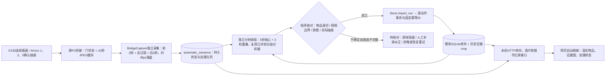
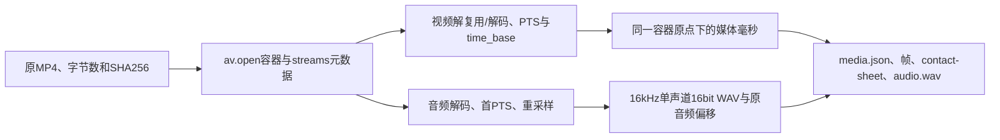
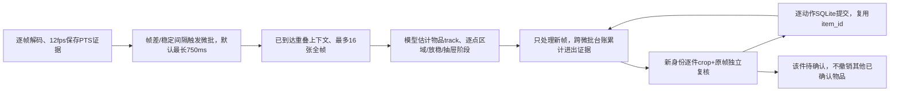
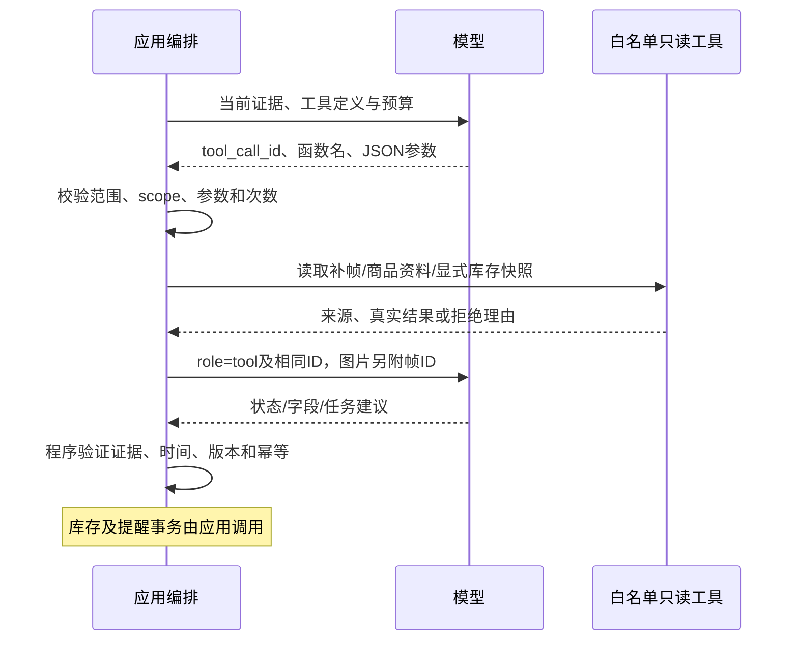
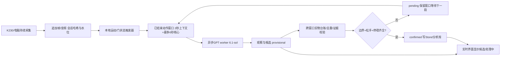
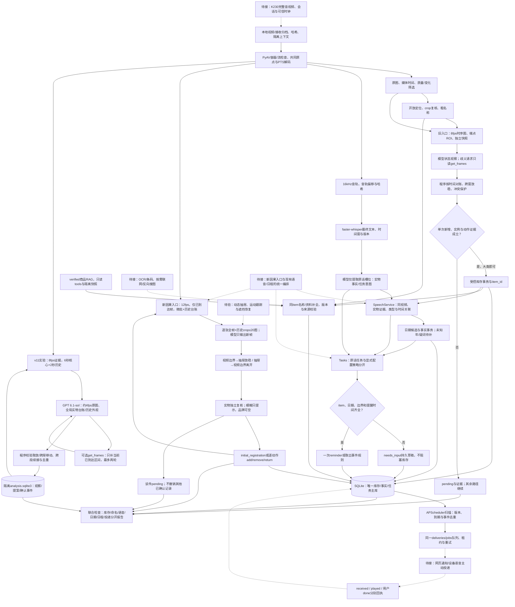

# 视频、库存与日程处理流程

更新：2026-10-17。本文件统一当前流程、提醒架构和实施顺序；字段/事务见[数据约定](data-contract.md)，结果/失败见[评测](evaluation-and-lessons.md)，唯一TODO见[开发入口](../README.md)。原独立提醒设计已合并，不再保留平行计划。首版不使用重量变化。

## 0. 自动记录闭环

当前实现“视觉开柜 → 前2秒/全过程/后2秒存档 → 后台分段判断 → Store事务 → 网页同步”。门磁由ArUco视觉代替，不做重量变化。电脑录音通过柜体、boot和主机触发时刻关联同一次视频；等库存提交后，复用按钮/文字的语义工具处理日期和提醒。音画偏移基于主机时钟估计，不是硬件同步。

在线语音入口统一在`app.server`：本地ASR → `VoiceAssistant` → SQLite搜索/`SpeechService.apply_facts`/`Scheduling` → 网页结果与TTS回执；提醒调度独立于AI请求。支持一次和每日定时提醒。后文的旧离线任务实验仍保留，复杂取出条件规则尚未迁移到在线服务；完整启动与能力边界见[运行说明](../backend/README.md#统一语音文字与提醒)。

| 模块 | 已完成行为 | 实现 |
| --- | --- | --- |
| 采集 | 网页关闭也持续采集；将滚动缓存冻结为会话前导，后续画面持续追加；快速重开沿用同会话 | `app/capture.py` |
| 状态 | capturing → queued → processing → committed；异常转pending或failed；人工dismissed | 004迁移、`automatic_sessions` |
| 恢复 | 采集中断保留待确认；处理中断回队列；已完成切片和已提交事务复用 | `app/automatic.py`、服务文件锁 |
| 判断 | 复用`model_comparison.long_video`的切片、补帧、动作规则和历史外观机制；实验入口和分析库职责不变 | `app/automatic.py`生产适配器 |
| 身份 | 会话开始绑定已有item_id、状态与历史crop；同件取出/放回复用ID，同名不直接合并 | 库存快照 + 模型视觉关联 + 程序保护 |
| 位置 | 用本机视觉状态时间轴确认哪个抽屉打开；模型猜测的drawer-1不作为真实柜层 | `location_at` |
| 写入 | 首次看到已有物体单独登记，不冒充拍到放入；add/remove/return/move逐动作提交，保存版本和证据 | 既有Store事务 |
| 时间 | 正式采集用主机收到证据帧的UTC时刻，来源system、estimated；不是相机曝光时刻；已有物初始登记不虚构存入时间 | `Store.commit_inventory(capture_times=...)` |
| 网页 | 第一台柜子只读真实库存，显示缩略图/原图和记录状态，支持核对帧、补录、纠正、取出 | `app/server.py`、WebUI |

约束与失败行为：

- 一次只开一层。相机断流、重启、明显帧间缺口或抽屉状态未知，整次采集进入待核对，不能通过“重试”强行提交不完整画面。
- 模型提案只有跨画面边界、松手放稳等证据成立才通过；关闭抽屉或物体被遮挡不能直接取出。品牌与SKU未知不阻止粗名称记录。
- 带入最多24件库存身份参考，含已取出物品；超过预算暂停等待核对，尚无大规模视觉检索。缺少已有物品参考图时不自动执行其取放。基于模型的实物匹配仍有误认风险，需要实柜回归。
- 每次会话上限180秒或512MiB；超限保留为待核对。自动识别队列最多10次等待/执行会话，满时仍保留采集结果供稍后重试。没有自动清理历史原帧，需监控磁盘空间。
- 同一次存在未补齐动作或观察冲突时先整次待核对；已提交事务不会因后续失败被抹掉。识别期间库存被人工修改时暂停后续写入，避免覆盖新事实。
- 重试复用已成功的模型切片，适合网络失败或进程重启；不能改善原始画面缺失。人工可查看原帧并补录/纠正库存，再忽略本次后续核对；尚无直接在画面上重绑实例的编辑器。
- 识别按合柜后的完整会话异步进行，不宣称实时完成。ArUco长时间被遮挡仍可能将开柜误判为关闭；短暂重开会合并，仍需在实际设备验证贴码和拍摄角度。
- 当前环境验证了真实GPT短视频回放、真实SQLite事务和桌面/手机网页；随后补齐Windows命名管道，实测K230约29fps、视觉门状态、网页代理与后端会话落盘在线。正式自动识别密钥尚未配置，未完成实柜模型入库或麦克风联合验收。后续验收见开发入口。

## 1. 验收与模块边界

**能区分实物，并确认取放，即可记录库存。** 可识别大类就用大类；不认识内容物时用“白色袋装物品”“黑色带线物品”等可见描述，不猜食品或用途。品牌、口味、容量、精确SKU和日期为独立补全项。图像偏模糊但物品及动作可确认仍允许入库；提醒缺时间不阻塞库存。同款商品知识与一件实物的身份分开。

| 模块 | 当前实现 | 边界 |
| --- | --- | --- |
| 采集 | 本地MP4、桥接JPEG会话完整时段落盘 | 主机接收时间，不是相机曝光时间；音画关联和远程上传鉴权待接 |
| 解码/选帧 | PyAV、PTS、质量/变化筛选；因果入口逐帧解码并仅交付已到达帧 | 音轨仍由原离线入口处理，不等于设备流式服务 |
| 认物 | 旧入口为学校`deepseek-pro`；v11独立实验用中转站`gpt-6.1-sol`逐张原图 | 底层版本未独立验证；不需要先训练固定生活物品类别 |
| 动作 | 旧8fps快照/窗口流程；新增12fps因果微批、持久track台账和逐动作事务 | 新入口仍在实测，v7未通过；track关联来自模型，不是已接入SAM/运动跟踪器 |
| 库存 | SQLite、旧单新增准入；因果入口有序add/remove/return、初始观察登记 | 初始登记不冒充视频放入；实测结果见评测，不以状态机测试宣称v7成功 |
| 语音 | 独立faster-whisper small/CPU int8、槽位及日期候选、名称归一化和类别兼容关联 | 离线最终稿；缺年份、边界或提醒时刻仍需用户补齐 |
| 日程 | `Tasks`草稿/显式补齐、一次提醒、取出条件规则 | 每日/每周、通用多轮、稍后提醒未实现 |
| 调度/投递 | APScheduler扫描、SQLite reminders/deliveries/jobs | 已测入队；网页通知/设备主动下发及真实ACK待接 |
| 商品记忆 | verified档案、多视角、词法检索、隔离快照 | 无图像向量/条码解码/真正反向搜图闭环 |

## 2. 从视频到共享时间轴

入口为`app/media.py`的`inspect_media/describe_container/prepare_video`。PyAV调用FFmpeg库，不要求额外安装ffmpeg命令。

1. 归档原件，记录视频哈希和容器格式、时长、起点、码率；枚举编码、宽高、帧率、像素格式、音频采样率/声道与各流time_base。
2. `container.decode(stream)`取得解码后的呈现帧，解码器处理参考帧与重排；压缩包顺序、帧编号除以平均fps都不可靠替代PTS。
3. `origin_s = container.start_time / av.time_base`；缺容器起点时当前回退0并保留原PTS。容器时间单位微秒，流PTS须乘本流time_base。
4. `media_time_ms = round((frame.pts * frame.time_base - origin_s) * 1000)`；无PTS的帧跳过，不编造采集年月日。帧ID后缀可能是原始PTS，不能直接当毫秒。
5. 第一遍顺序解码，约3fps保存扫描代理图与质量分数；选定PTS后第二遍回取原分辨率图。3fps是采样频率，不是只解码3帧；长视频两遍成本待量化。
6. 另开原文件解码首音轨并flush重采样器。ASR分段时间加`first_media_time_ms`回到共享时间轴；不分别把音视频归零。WAV不保留原始不连续时间戳，精确同步仍以原媒体为准。
7. 输出派生产物和错误。损坏媒体、多流、Display Matrix完整旋转及长视频预算仍需扩展验证。

实例：v1为1920×1080 H.264，视频time_base=1/90000、首PTS=63；AAC音频48kHz双声道、首PTS=0。视频首帧约0.7ms，PTS=66019约734ms，均不是绝对拍摄日期。v7帧`v7-t449702`的媒体时间为4997ms。

## 3. 清洗、截图与商品补全

当前质量分为`log(1+sharpness)-3*bad_exposure`，桶内加有上限的变化奖励；256×144灰度评分，32×18变化图；代表帧平均灰度差小于0.8时抑制，保留锚点。阈值是启发式。认物通常最多10张代表帧，不能拿它恢复全部动作；全图清晰/相似也不证明小物品清晰/未变。

模型bbox采用0–1000归一化xyxy，映射原图后裁剪；几何合法不代表语义正确。`usable`要求目标确实可辨，混框不能按候选条数当物品数量。包装文字/品牌有证据才补；模型自报high不是概率。状态推断优先看当前原图，包装样例只帮助实例关联，不能当作当前画面。

### P0-D：模糊与遮挡怎样度量

`visual_quality`和`assess_quality`将像素质量、独立物品可辨性、动作证据分开。**没有一个“低于某分就禁止入库”的模糊阈值。** 以下阈值是当前启发式报警，未在这些视频上标定成识别正确率；低纹理瓶身即使清楚也可能得到低分。

| 指标 | 当前算法/暂定分档 | 实际用途 |
| --- | --- | --- |
| 截图清晰度 | crop缩放到256×144，灰度Laplacian方差；<35重度、35–120偏软、>=120清楚 | 排序和提示；不单独阻止库存 |
| 曝光风险 | 灰度<12或>245像素比例；>30%提示、>55%严重 | 纯白包装也可能偏高，不代表整件不可辨 |
| 原始crop大小 | 任一边<32像素提示细节不足；小于12像素当前裁剪工具不能用 | 保留原始尺寸，不把放大后的像素当新增细节 |
| 遮挡/可见比例 | 模型估计最好视角中物品可见比例；<45%严重、45–70%部分、>=70%大部可见，不能估计用null | 不是分割mask面积，也不是测量真值；优先结合其他已到达视角 |
| 接触边缘 | bbox与原视频边界相接的数量 | crop完整性与进出证据提示，不能代替完整时序 |

`eligible_with_warning`：像素质量差或crop部分截断，但目标确为独立可移动物品、可辨认且可关联。`pending`：手/背景、混框/错框、独立实物本身不可辨；动作阶段还要单独检查唯一实例、进出和放稳。品牌/OCR弱不降低“确实有这一件物品”的支持度。缺乏可辨目标时保留待确认候选，而不是编造库存。

演示协议：固定摄像头、视频四边包住整个抽屉，每个动作只操作一件、少量物品、背景干净；物品从画面边缘进入，放入后松手停留约半秒，取出则让物品完整离开画面。物品类型不限；手持或轻度模糊可以有记录，但在空中悬停不算放稳。**不要求逐帧人工标数据，也不要求逐视频画抽屉边界。** 当前抽屉内外由模型估计，一次性ROI配置可后补；动态多边形未实现。

补全顺序：新清晰视角/包装文字 → 本地商品记忆 → 必要时联网。现有`search_product_images(query)`只是文字驱动图片搜索接口，不是真正以图搜图，未配置/实测。网络结果只形成带来源的字段建议，不能证明取放；同款RAG不继承这一袋的日期、数量或在柜状态。新证据触发有预算的任务，不在同一背面反复请求。

## 4. 动作观察与入库

### 原离线入口：保留作对照

1. 另解码8fps动作证据，最多480帧，保留真实末帧；超预算要求拆操作。
2. 当前SIFT/RANSAC以crop匹配原帧，在图上提供候选ID提示；没有匹配不表示缺失。强重叠的不同candidate提示会被标成实例冲突并阻止提交；不能把框或内点数当真实物体。
3. 最多20帧预览、每4张拼图并印帧ID/毫秒。模型建议开合阶段和快照ROI；当前ROI为矩形，未做透视配准。独立首末快照必须处于声明打开可见阶段。
4. 程序按约1.25秒覆盖窗口并加250ms上下文。**普通窗口已实际发送首末ROI/全帧和中间时序拼图**，记录`supplied_frame_ids/input_kind`，不再只有两张照片。
5. 模型返回位置、放稳、可见性、身份和证据时间；程序生成add/remove/return。unknown/遮挡不能自动变absent，合屉后看不见也不等于取出。
6. 从最早有支持的证据建立有时间基线，较晚快照作为检查点；首次看见原有物品可建基线并记录未知前缀，不能编造新增。未来帧不能补早期事实。
7. “进入但仍手持”先暂存，同实例后来放稳才完成一次新增；退出且未确认放置不算存入。原观察和最多3窗复核均保留；before复核只能向更早时间修正、after只能向更晚时间修正，真正同帧冲突为pending。
8. `CoarseIntake`接受稳定前后状态对比或直接穿越两条路线；核实唯一新增、同实例、可见性、放稳、证据时间及无未决冲突。没有品牌/规格门槛。
9. `Store.commit_inventory`才创建item和真实回执；`Enrichment`只补同item资料。净变化、过程历史、商品信息和真实提交分别输出。

P0已固定计划端点、时间方向复核和强重叠实例排他保护；不能确定唯一实例或端点的结果进入pending，不自动写库存。v7新模型观察仍需后续单变量视觉回放，旧正确观察在当前状态机下通过。改动范围与逐项对照见[评测第3节](evaluation-and-lessons.md#3-v7退化的逐模块证据)。

### 新入口：P0-E因果回放（M5-lite）

`python -m app.causal`为独立实验入口。它不读取ans.md，不预设切成四个动作，也不把整段未来视频先发给模型。v7的四动作是事后验收目标；实际先按时间微批，再由跨批状态机发现事件。

1. 解码器只产出当前及过去帧。微批按低分辨率帧差/稳定间隔触发；这是启发式分段，不是光流或手部跟踪。保留约750ms上下文，均匀采样至16张全图，保留首末锚点；最多4张历史身份crop，单请求不超过学校20图上限。
2. 重叠旧帧标为CONTEXT ONLY，不得重新输出状态；NEW帧才可推进台账。图像全帧逐张发送，坐标统一0–1000；不使用上一轮产生错框的时序拼图坐标。
3. 每个track保存位置序列、同件关联、物理实物支持度和待确认原因。名称相近不合并；同帧强重叠、反转旧声明、虚构未来帧等拒绝，不能用多次重试掩盖语义错误。
4. 存入必须有视频边界接触证据，随后inside松手，至少两张相隔180ms的放稳证据；只在抽屉内突然出现不算完整存入。outside框真正接触视频边界也计作接触证据，单纯接触抽屉边界不计。
5. 取出必须有先前inside→outside/视频边界→out_of_frame；occluded/unknown/关屉不算离开。抽屉开合阶段按逐点判断，不用窗末的closing否定窗中先前已发生的动作。
6. 首帧已经在柜且放稳的物品可在**隔离演示库**登记为initial_registration，`filmed_inventory_action=false`，不是视频新增；不会把整个未知柜体标为已盘清。生产已有库存的跨会话身份绑定尚待接入。
7. 新增或初始登记前逐件独立复核crop与同帧原图；可辨的部分截图允许带警告。某件复核失败仅回退该件提案并保存原因，其他件可提交；失败件不宣称已自动恢复。
8. 同一父media_capture下每个动作有确定性operation_id，add创建item、remove引用既有item、return复用原item。DB版本/幂等校验复用Store；部分提交后中断时暂停，用同配置resume找回原回执，防止重复新增。
9. `session.json`输出逐动作回执、结果字段、最终库存和完整性。解码结束但有待确认/失败时为`completed_with_pending`，不等于识别通过。`--max-calls`实际约束微批数，独立复核、一次格式修复和HTTP重试另计。

连续动态区域、SAM 2.1轮廓传播、Grounding DINO自动发现、手部触发和局部点跟踪仍是P2实验。二维入框不证明深度，手接近不证明抓取。当前没有自动针对漏失边缘补采的完整闭环，短暂越界仍可能漏掉；本入口也尚未统一调用ASR/RAG/日程，不应把旧流程已有模块说成新入口已全部接齐。

## 5. tools / function calling

| 调用 | 谁调用、允许做什么 |
| --- | --- |
| `search_catalog(query, limit)` | 模型请求、程序执行；6条类别定义的词法检索，不是商品数据库 |
| `search_product_memory(query, limit)` | 模型或程序只读检索verified商品，最多3候选；scope/快照由服务注入 |
| `get_frames(start_ms,end_ms,fps)` | 模型请求或程序补帧；有时间/帧数限制；实时接入后还须禁止未来帧 |
| 因果入口`DeliveredFrames.get_frames(start_ms,end_ms,limit)` | 当前是程序编排调用，拒绝未来帧并记录origin=orchestrator；不是模型原生function call，不能宣称模型主动补看过遗漏帧 |
| `get_object_evidence(candidate_id)` | 只读本次candidate样例；不能证明它现在出现 |
| `get_inventory_snapshot()` | 只读显式库存上下文；未连接/未知基线如实返回，不能当空柜 |
| `commit_inventory / Enrichment.apply` | 应用事务，不向模型开放SQL或任意写库 |
| `SpeechService / Tasks / Scheduling` | 应用执行语句归档、事实校验、任务持久化与调度；模型仅提取有原话引用的槽位 |

程序主动检索标记orchestrated，原生请求保留tool_call_id及role=tool；两者不混算。RAG和网页资料均作为数据，检索分数不是置信概率。

## 6. 库存与日程的联合架构

日程复用现有后端：`speech.py → tasks.py → scheduling.py → task_worker.py`，共用SQLite、reminders/deliveries/jobs。**收纳、日期、任务、投递分别有状态**；日程缺输入不应把已成功入库的操作退回失败。

| 层 | 现在的职责 | 需要接齐的联系 |
| --- | --- | --- |
| 会话协调 | 离线脚本分别编排动作与语音 | 统一capture/session，按阶段独立重试；已提交动作仍继续语音/日程，不重复视觉或add |
| 语句与实物关联 | 原音轨哈希、最终稿、PTS；同视频新增item、名称归一化、类别兼容和时间匹配 | 多候选/类型冲突保留待关联；不要求精确SKU |
| 日期事实 | 原话与归一化分开，明确日期才写同item | 逐字段管理疑词，可信采集/对话时钟；不把一个期限疑词升级为所有字段不可信 |
| 用户任务 | 保存before_expiry或after_expiry_remove草稿；关联/日期晚到刷新同一草稿的缺失项 | 显式补齐后调度；版本变化要求客户端重新确认，避免另建任务 |
| 调度 | APScheduler 3.11.3唤醒，SQLite保存业务期限 | 单独一个调度进程，视频/网络/模型不进入定时回调；进程部署锁与常驻运行待完善 |
| 投递 | deliveries/jobs及租约/重试/ACK服务 | Web通知列表+事件流、设备主动下发；received/played/用户done分别记录 |

建议统一只读会话回执包含`inventory_status/identity_status/speech_status/item_link_status/facts_status/task_status/delivery_status`及各自真实ID/缺失项。它是汇总视图，不另存第二份库存或日程事实主库。晚到补全只改对应字段；取出不等于吃掉，不自动完成任务，也不复活库存。

### v9/v10纳入同一个检查

本轮已用`scripts.workflow_review speech`把P0成功库存与已保存真实ASR/槽位接到**新SQLite副本**，两次处理检查幂等，没有重新调用模型或ASR。结果统一见[评测第4节](evaluation-and-lessons.md#4-语音库存与日程联合检查)。

- v9：饮品已入库；“今年7月14日”“保证期一年”原话保留，语音未提出提醒，不创建提醒。“可乐”已通过饮品类别兼容规则关联“罐装汽水”；缺可信拍摄年份与期限疑词独立列出。
- v10：鸡胸肉已入库，原话“10月21日…提醒我吃掉它”关联同一item，保存到期月日与提醒草稿。用户需求中的“到期后取出提示”作为单独configured_policy来源保存。缺年、提醒时刻、到期边界时仅任务needs_input。
- 检查分别报告：物品是否已存、原话/数字是否保留、是否绑对item、日期候选/正式值、任务缺失项、是否进入reminders、是否投递/收到/播放。0条真正提醒并不否定收纳成功，也不伪称日程已设置。

### 日程扩展顺序

1. P0会话续跑、类型关联和草稿刷新已接齐；继续把v9/v10联合检查固定为回归入口。
2. 补明确时间的一次任务：通用文字/语音入口、草稿补答、查看/修改/取消；同一消息重传沿用首次accepted_at，原相对倒计时已过则澄清，不重新起算。
3. 补真实网页通知，再接设备语音与ACK；重连可查持久通知，模型不可用时已保存任务照常触发。当前WebUI是独立预览，尚未连后端。
4. 再做每日/每周、暂停/恢复、本次done/skip/snooze和系列修改；“今天完成”不结束每日任务，取出物品不等于完成。周期发生/轮次/迁移约束见[数据约定第6节](data-contract.md#6-日程数据与后续迁移)。

APScheduler使用稳定3.x接口，dateparser 1.4.3仅辅助时间解析；不接受模型生成任意cron。业务进度在SQLite，不共享3.x job store给多个调度进程；当前MemoryJobStore只做唤醒投影。每天本地21点与每24小时不同，初期时区限定Asia/Shanghai；未来夏令时另验。

## 7. 开发与部署顺序

每次固定输入、提示词/代码哈希、预算与隔离上下文；先无模型媒体检查，再组件验证、冻结证据回放、有限真实调用和留出评测。ans.md只在推理完成后评分。新结果用新目录，失败保留，不能请求到碰巧答对。

P0-D质量诊断和P0-F开放命名/回执已接入；M5-lite因果回放及逐动作事务已实现，视频验收仍以评测页为准。下一步首先修复真实视频中可复现的观察错误，再接K230持续流或有序短分片；WebUI由用户开发，本轮不修改UI。动态轮廓和复杂遮挡留到后续实验。

运行环境目前为主venv及独立ASR环境；Docker配置存在但本机缺完整CLI/Desktop/引擎，尚未构建。学校MP4上传两种格式未跑通、图片对照可用；须取得正式视频协议和模型ID后再测，图片通道不等于原生视频。环境恢复和协议核实是独立事项，不影响离线诊断。

技术备选：[SAM 2](https://github.com/facebookresearch/sam2)、[Grounding DINO](https://github.com/IDEA-Research/GroundingDINO)、[PaddleOCR](https://github.com/PaddlePaddle/PaddleOCR)、[MediaPipe Hands](https://ai.google.dev/edge/mediapipe/solutions/vision/hand_landmarker)均待实测；已用[faster-whisper](https://github.com/SYSTRAN/faster-whisper)、[APScheduler 3.x](https://apscheduler.readthedocs.io/en/3.x/userguide.html)、[dateparser](https://dateparser.readthedocs.io/en/latest/)。本轮不据此宣称跟踪、OCR或实时链路已完成。

### v11：GPT长流程分片实验

新增独立入口`model_comparison.long_video`，不替换旧DeepSeek因果入口。原因是750ms微批容易丢失完整动作语境，而整段长视频会带来上下文和事件混淆；本轮以约6秒核心区间、2秒已到达历史重叠平衡两者。原视频只读，PyAV按PTS保存8fps证据，约4fps逐张原图交给`gpt-6.1-sol`，实际抽样受原视频帧率影响。

每段接收全局物品ID、历史外观截图、最近位置观察和已确认事件。模型识别开放类别物品并给出逐点状态/动作提案；程序推导台账，不再让模型独立填写可能矛盾的净变化。片段内可通过`get_frames(start_ms,end_ms,reason)`补看最多2.5秒的8fps帧，最多两轮，禁止访问该片段截止以后的画面。片段固定时间切分，尚不是训练的动作边界检测器。

物品从视频边缘进入并在抽屉内松手放稳，才接受add/return；取出必须经过视频边缘并完全离开。合屉/遮挡保留原有存在状态；移动需有两个不同抽屉相对位置的放稳证据。未知起始物品仅登记为observed_existing，不冒充拍到了放入。不同抽屉位置分别记录，跨屉搬动视为move，不凭品名新建另一实物。

跨片段未完成动作保留历史点，后续可补齐；重叠事件去重，同帧区域冲突保留并阻止相关事件。每段输出不可变JSON，恢复时检查输入/代码/提示词/台账哈希。独立`analysis.sqlite3`存实物、时序观察、全部提案、符合规则的事件；这是可审计分析账本，**尚未调用Store库存事务，也未接RAG/日程/设备实时流**。报告必须区分模型观察、规则通过、真实生产库存提交，不能用实验库数量冒充业务入库。

### 在线处理可行性与推荐架构

当前 v11 实验是**完整文件后的离线回放**：`prepare()`先解码整段视频并生成所有帧/切片，`run()`再依次调用模型；切片计划可以看到文件末尾时间，所以不能直接当成在线算法。现有 `app.capture.BridgeCapture` 已经能在录制期间持续接收并追加保存帧，`app.automatic.AutomaticRecorder` 也能在会话结束后独立调用 GPT 并按规则写入 Store；但它只在 `session.json.complete` 后进入 `queued`，尚未按已到达帧创建分析窗口。两者之间需要增量窗口和水位层。

在线处理应拆成两条时间线：采集线程持续接收并追加保存帧/音频，给每帧写`capture_id、epoch、seq、received_monotonic_ms、device_pts`；分析线程只取已到达帧，用门状态/帧差/稳定区间发现动作结束，维护“最近2秒上下文 + 当前最多6秒核心区间”。物品经过视频边缘、进入抽屉、手离开、至少两帧相隔约0.2秒停稳后，才把候选送给 GPT；动作跨片段就保留`pending`继续接收下一段。

推荐状态为`observed -> candidate -> confirmed | pending | rejected`。`candidate`可以立即推给 WebUI 做“正在放入/可能是绿色茶包装”的反馈；`confirmed`才写正式库存。模型输出只更新观察和候选，程序根据视频边界、抽屉阶段、松手/停稳和同一实物ID决定是否确认。抽屉合上或物品被前板遮挡只进入`occluded`，不改变库存。

远端 GPT 放在独立 worker 队列中，按动作顺序串行合并台账；采集与本地证据抽取可以并行。每个窗口带前一窗口的最后状态和历史外观，但不能带未来帧。网络错误、429、远端断开时保留窗口和请求哈希，稍后重试；重复响应按`event_id`/窗口哈希幂等合并。队列长度、最老待处理时间和捕获水位必须在状态接口中可见。

**准确率与延迟的取舍：** v11 成功请求累计约507.57秒，视频时长约36.5秒；按当前请求体量，6秒一个 GPT 窗口的串行处理无法实时追平。即使增加并发，也会增加限流、顺序冲突和成本，不能直接保证准确率。黑客松推荐“本地即时提示 + GPT 延迟确认”：本地只判断运动/边界/停稳，不给最终物品结论；GPT完成后更新名称、动作和证据。若队列落后，优先保留完整动作窗口和关键帧，降低背景帧/重复历史图，不能丢掉进入边界、松手和停稳帧。

**第一阶段可实现的在线体验：** 采集延迟低于1秒；本地在动作结束后约0.3–1秒显示候选；GPT在网络完成后更新“已确认存入/移动”或“待补证据”。这属于准实时反馈。要做到连续稳定的秒级 GPT 确认，需要先测中转站 p50/p95 延迟、并发限额和图像输入吞吐；不能仅把 Responses 的输出改成流式就解决，因为流式文本仍不能在JSON未完成、证据未闭合时提交库存。

**实现难度评估：** 采集与切片追加、队列、断点续跑、状态接口属于中等工程量；跨片段身份/动作对账是高风险核心；音画同步、断线恢复和正式库存幂等需要单独回归。先做“离线模拟在线”最稳：按视频到达时间逐帧释放，禁止读取未来帧，复用 v11 的台账和审计库；通过后再接 K230。在线准确率必须同时检查动作、边界漏检、重复率、合屉误判和网络失败样本。

## 8. 合并后的总体流程

实线表示已有程序模块，虚线表示待接能力；已有模块不代表每个视频都通过。旧离线、新因果微批、v11 GPT分片是三条并列实验路径；语音/日程目前接在旧离线流程，新入口统一编排尚待完成。

