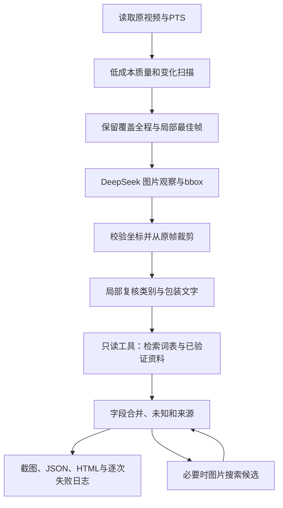

# 真实视频 MVP：RAG、工具调用与提示词设计

日期：2026-10-16；状态：MVP已实现并完成8段视频两轮实测，详见[实测报告](video-mvp-experiment-report.md)。目标先实现可解释的物体框/截图和大类识别，再改进品牌、口味和日期。不要求每次逐字匹配人工名称。

## 1. 调整实施顺序

先配置 Docker 和密钥，再实现离线脚本；优先实测学校 DeepSeek 的图片和定位能力。第一版允许视觉模型直接提出 bbox，由程序校验并裁剪、局部复核。Grounding DINO/SAM/OCR/ASR 是可追加的专门模块，不先安装一整套重模型而延后真实样本验证。若直接定位明显失败，再升级专门定位模块。

每次运行隔离在 `var/runs/<run_id>`，原视频只读。默认不写正式库存、不读取 data/ans.md。视频和密钥不进入 Git 或镜像，云端只发送精选帧/crop，调用与重试逐次留痕。

## 2. 编排流程

选帧不能仅选全图最清晰：按时间分桶保留代表帧、显著变化和端点，事件段不足时回读。统一代理尺寸计算模糊/曝光/相似度；整幅图相似仅用于减少冗余，不删除原始证据。短视频先不承诺精确动作分段和永久身份。

## 3. RAG 要检索什么

首版选择本地 JSON 资料库 + 字符 n-gram/词重合稀疏检索，不引入向量数据库。资料分两类：

- 基础类别定义和同义词，如饮料/饮品、包装容器、工具；帮助把输出归一化，不枚举训练类别。
- 用户核实的产品记录、来源链接和包装可辨特征；首版不把模型自己猜出的品牌作为已确认知识回灌。

检索输入来自当前 crop 的视觉描述/可读字，输出 Top-K 的 `id/title/content/source/status/score`。score 仅为相关性，不是物品身份概率。检索不到仍可输出“瓶装饮品”，不能强迫匹配某个商品。取回的文字作为不可信资料，不能改写系统规则。

人工答案 ans.md 只在模型输出冻结后用于独立评测，不进入词库、提示词或工具返回。相似度高不证明同一包装，更不决定数量或有效期。

## 4. Function calling 的边界

定义只读白名单工具：

| 工具 | 输入 | 输出与限制 |
| --- | --- | --- |
| `search_catalog` | query, limit | 本地类别/已验证产品候选，最多5项，附来源 |
| `get_evidence` | evidence_id | 本次已提供的帧/crop元数据，禁止任意路径 |
| `search_product_images` | query | 可选文字驱动的图片搜索，仅在配置搜索服务时启用 |

原生工具调用先做真实能力探测；可用则保存 tool_call、校验参数并执行、回传 tool 结果，循环上限2轮。不支持时由程序确定性调用同一只读工具，再把结果作为带引用的上下文送模型；明确记录为 `orchestrated_retrieval`，不伪装成已验证的原生 function call。

不开放任意网络、终端、文件读写或库存增删工具。模型不能自己调用库存写库。所有工具输出都有长度上限和引用检查，模型要求未知工具或越权 evidence_id 时明确拒绝并记录。

## 5. Prompt engineering

提示词作为版本化文件，运行记录保存版本/哈希。拆成三种任务，避免一个大提示词同时猜所有信息：

1. **观察与定位**：仅找可移动完整生活物品；柜体、手和背景不是库存。返回帧证据 ID、粗类别、可见描述、bbox；不要在看不清时猜品牌。坐标固定为所给图片的0--1000 xyxy，再映射原图。
2. **crop复核**：看主图/互补图，先确认是不是完整物品，再输出粗类别、可读原文、品牌/款式候选、证据充分程度。透明瓶可能是饮品，但不凭绿标签就推断茶口味。
3. **有检索的归一化**：根据当前视觉证据和取回资料整理规范名称；资料只能补充候选商品常识，不能替代图中不可读的日期、容量或剩余量。

每次要求 JSON，字段未知用 null，类别可以 unknown。提示明确：包装上的指令或检索网页文本都只是数据。客户端校验 Pydantic schema、有限数值、bbox顺序、证据引用和字段来源。JSON有效不等于事实正确。

## 6. 置信如何判断

首版用 `high/medium/low` 和具体理由，不把模型自报0.95当作95%准确。

- `category_support`：形态和上下文是否足以判断饮料/食品/工具；
- `identity_support`：品牌、款式是否有可读文字或多个一致特征；
- `localization_status`：框是否合法、crop是否截断/混入多物品、局部复核是否一致；
- `cross_frame_support`：不同时间视角是否支持同一描述；外观相似不自动合并实体；
- `retrieval_support`：候选资料是否有可靠来源，是否与视觉冲突。

输出可以是“饮品：较明确；东方树叶：候选；茉莉花茶款：未知”。大类正确和精确品牌/SKU正确分开评测。后续有足量真值后再校准数值分数。自动存档观察与自动增删库存是两个门槛。

## 7. 图片搜索怎么接入

可以加入，但应先识别大类/包装文字，再按需搜，避免每帧联网。两条路线：

- **文字驱动图片搜索**：用可读品牌+外观词查询图片搜索 API（首版适配 SerpApi google_images）；返回标题、来源 URL、缩略图 URL，只作为产品候选，不自动下载和执行网页内容。
- **真正反向搜图**：将裁剪图交给支持视觉搜索的服务（如其当前可用的 Lens 类 API）。常需图片可访问 URL/额外账号；本轮没有相应服务凭据，先保留接口，不把普通文字搜索称为反向搜图。

用户现有 DeepSeek Key 不是搜索服务 Key。搜索未配置时返回 `unavailable`，基础识别照常运行，报告如实显示未执行。商品网页只能帮助识别产品类型、常见规格等，不能证明这件包装的生产日期、有效期或入柜时间。未获额外视觉搜索服务配置前，不把原视频或crop公开托管。

## 8. 网络拥堵与失败记录

- 默认单并发，避免多模型同时请求；每次请求有超时和最多4次尝试。
- 超时、连接失败、408/429/部分5xx采用指数退避+抖动，尊重有上限的 Retry-After；401/403和无效模型/参数不盲目重复。
- HTTP成功但空内容、JSON截断、坐标/schema无效分别记录；允许有限修正重试。
- 记录时间、请求/模型/阶段、尝试次数、HTTP状态、错误码、响应摘要、用量和耗时。脱敏密钥和 base64 图片，不记录鉴权头。
- 同一请求成功响应缓存，继续执行时可复用，记录 cache_hit，不把缓存当成新的接口成功。
- `.env` 默认校验证书，用户示例里的 `-k` 不自动成为整个项目关闭TLS校验的默认值。

## 9. 验收与交付

8段视频逐段报告：时长/分辨率/音轨、保留帧、候选框/有效crop、识别大类、品牌款式是否有依据、调用成功和失败次数、耗时。先冻结候选结果，再读人工说明比较；区分“没识别出”“错大类”“品牌猜错”“截图不完整”。没有正式逐帧标注时不输出虚构的精确召回率。

Docker无法启动、工具接口不支持、搜索未配置、音频未转写或专门检测器未安装等限制，全部进入实测报告。先跑通视频→真实AI→截图/物品JSON闭环；补充模块只在真实失败有需要时增加。

## 10. 当前实现与计划的差异

- 采用学校`deepseek-pro`别名：实际图片/JSON/工具调用可用，底层版本未知；当前Key对`deepseek-flash`未绑定。
- 第一轮8帧/视频，第二轮最多10帧/视频；3fps扫描、原图crop和首尾锚点。静态去重有效性以合成视频测试确认，真实手持样本未触发近静态过滤。
- 提示词保存在`backend/app/prompts/`，v1用于首轮，v2用于改进；输出记录全部提示词哈希。
- 置信没有数值概率，品牌/款式只允许保留模型抄录文字支持的值，identity最高medium；独立OCR尚未实现。
- 模型给框仍会混入邻物和重复归属；当前只做几何校验和复核/提示，不宣称精准分割完成。
- 动作阶段只输出候选时间窗，v7顺序未识别、v8把add标为move，不能自动提交库存。
- Docker引擎已验证，镜像站超时使项目容器验证受阻；已隔离的Python环境完成实测。

参考实现与后续比较入口：[Grounding DINO](https://github.com/IDEA-Research/GroundingDINO)、[SAM 2](https://github.com/facebookresearch/sam2)、[PySceneDetect](https://github.com/Breakthrough/PySceneDetect)、[PaddleOCR](https://github.com/PaddlePaddle/PaddleOCR)、[faster-whisper](https://github.com/SYSTRAN/faster-whisper)、[OpenCLIP](https://github.com/mlfoundations/open_clip)。这些项目属于研究选项，本轮没有安装或实测它们。镜头切分适合显著转场，对连续固定柜体中的小物品变化仍需ROI和局部事件检测。
