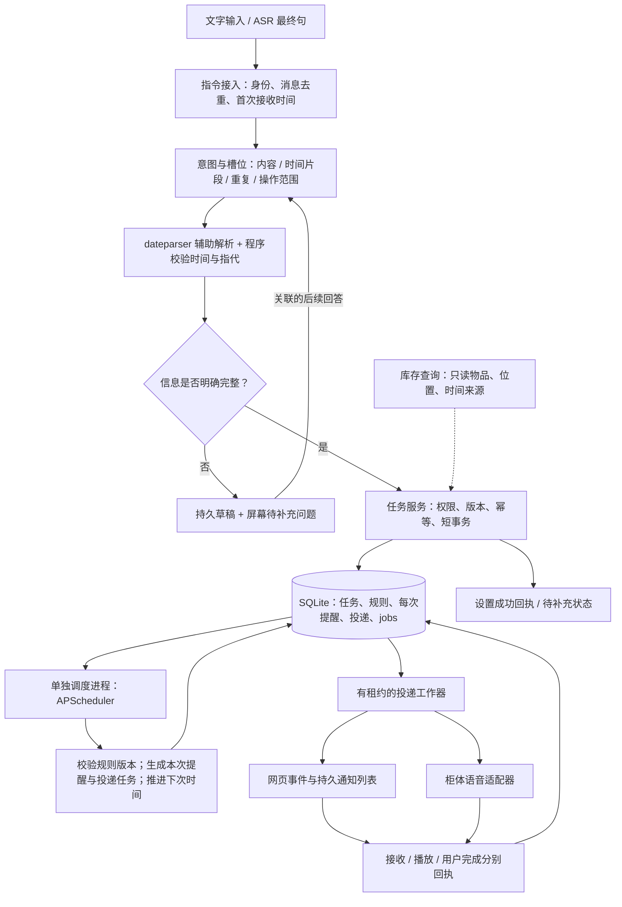
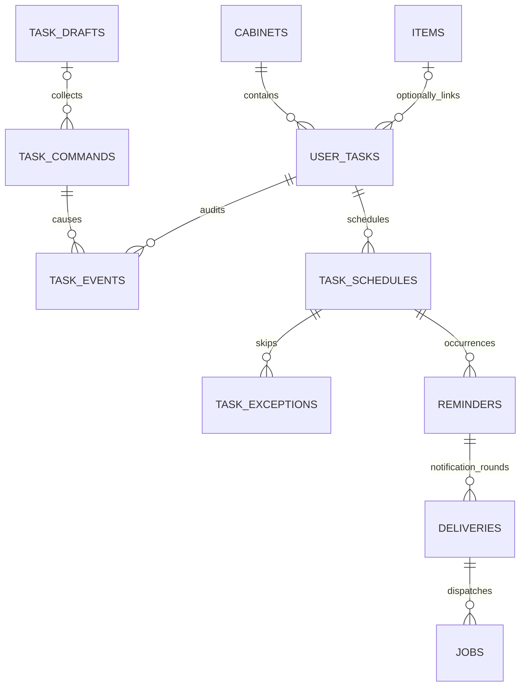

# 用户任务与定时提醒后端设计

更新：2026-10-17。第一批V2已实现一次提醒、语音草稿、过期取出条件规则和APScheduler周期扫描，复用SQLite/reminders/deliveries/jobs。本文其余每日/每周、通用多轮、HTTP和设备播报仍是目标设计。实际验收见末节，不将队列触发称为送达。

## 1. 产品定位与交付范围

Mind Box 平时自动记录收纳，用户需要时再查询或交代任务。提醒是可选入口，不让用户为了正常存东西先登记任务。用户说出的任务可以与柜内物品有关，也可以是“十分钟后提醒我打电话”；物品关联不是创建任务的必要条件。

首个闭环支持：一次性倒计时、指定日期时间、每天、每周指定星期；自然语言创建及补充；查看、修改、暂停、恢复、取消；本次完成、跳过、稍后提醒；网页展示和柜体语音投递。先用文字入口验证全部语义，再接语音。**首版不做重量变化，不依赖 HX711、差重或稳定重量等待。**

“任务”首版只执行提醒，不自动购物、控制设备或运行用户提供的代码。“放太久提醒”作为库存规则的后续接入，共用投递能力；没有可靠放入时间时不编造期限。“快过期”必须有明确日期来源，不能由包装外观或存放时长推断。

### 用户说法与实际行为

| 用户说法 | 保存和执行 | 给用户的反馈 |
| --- | --- | --- |
| “十分钟后提醒我吃苹果” | 从本条消息首次接收时间起计时，创建一次任务 | “已设置，18:10 提醒你吃苹果。” |
| “明天晚上九点提醒我拿充电器” | 转为用户时区的明日 21:00 一次任务 | 确认具体日期、时间和内容 |
| “每天九点提醒我吃鱼油” | 上午/晚上不明时保存草稿 | “每天上午九点，还是晚上九点？” |
| “每天提醒我吃鱼油” | 保存待补充任务，尚不调度 | 屏幕显示“每天几点提醒？”；对话中可简短追问 |
| “每天晚上九点” | 明确在回答前述问题时补齐原任务 | “已设置，每天晚上九点提醒你吃鱼油。” |
| “每周一、三晚上八点提醒我倒垃圾” | 一条每周规则，星期一和星期三 20:00 | 确认星期、时间和内容 |
| “过会儿提醒我” | 保存草稿，缺少内容和时间 | 先问一个关键问题：“要提醒你做什么？” |
| “每天早晚提醒我喝水” | 缺少早晚具体时间 | 不擅自使用 8 点和 20 点；支持后续补成两条时间安排 |
| “今天吃过了” | 指向明确时，只完成今天这次 | “今天这次已完成，明天照常提醒。” |
| “十分钟后再提醒我” | 推迟当前这次提醒，不移动每日规则 | “这次十分钟后再提醒，明天仍是晚上九点。” |
| “今天不用提醒” | 跳过今天对应的一次发生 | “今天已跳过，明天照常。” |
| “以后都改成晚上十点” | 修改整个系列的未来安排 | 确认“以后每天 22:00”；保留过去记录 |
| “暂停这个提醒” / “恢复” | 暂停后续触发；恢复从下一次未来时间开始 | 不补播暂停期间的提醒 |
| “取消苹果提醒” | 多个匹配时展示候选，指向明确后取消 | 不把所有同名任务一起删除 |
| “还有什么要提醒我的？” | 返回待补充、近期、暂停的任务及状态 | 区分“待补充”“已设置”“未送达”“已完成” |

完整且明确的指令直接保存并确认，不额外要求每次点击同意。缺少信息时保存已有原话和字段，不谎报设置成功。疑问可留在屏幕上，用户不立即回答也不阻塞收纳。“三十分钟”作为明确追问的回答才补入草稿；闲聊或“苹果在哪”不能意外激活提醒。

原型只处理一个柜体的共享任务空间，身份由已配对设备或网页会话提供，不从声音猜测用户。以后增加个人空间时，由服务注入真实用户及柜体权限；用户说“我的”不能成为身份凭据。共享柜体的语音默认可被旁人听到，个人任务应允许仅屏幕投递。

## 2. 开源选型与复用边界

以下版本于本次设计调研中从 PyPI 核验，官方文档用于核对能力；尚未安装或运行中文解析测试。项目使用 Python 3.13，落地时仍需验证完整依赖组合并更新 lock 文件。

| 项目 | 采用方式 | 解决的问题 | 边界 |
| --- | --- | --- | --- |
| [APScheduler](https://github.com/agronholm/apscheduler)，3.11.3，MIT | 安装并直接调用稳定 3.x API | 定时唤醒、日历重复规则、失约调度控制 | 不负责理解人话、用户权限或证明设备已播放 |
| [dateparser](https://github.com/scrapinghub/dateparser)，1.4.3，BSD-3-Clause | 提取时间片段后辅助解析中文日期 | 相对日期、明确日期和时间片段 | 自由文本搜索有误判，不能单独理解完整任务或可靠补齐所有中文说法 |
| [Rasa Open Source Forms](https://legacy-docs-oss.rasa.com/docs/rasa/forms/) | 参考所需槽位、验证和中断设计，本轮不部署 Rasa | 分几句话补齐内容、时间、重复规则 | 不引入完整对话训练平台，不将 Rasa Pro 功能算作 OSS 能力 |
| [Celery beat](https://docs.celeryq.dev/en/stable/userguide/periodic-tasks.html) | 对照方案，初期不引入 | 多工作器和分布式任务基础设施 | 现阶段 SQLite 单机不值得增加 broker、beat 和 worker 运维；未来扩容再评估 |

**选择 APScheduler + dateparser + 当前 SQLite/jobs。** 调度和日历交给成熟库；项目代码负责产品语义、数据库事务、补充对话、库存关联与渠道适配。

APScheduler 3.x 使用 `AsyncIOScheduler`、`DateTrigger`、`CronTrigger`、`IntervalTrigger`。3.x 持久 job store 不能在多个调度进程间共享，因此首版明确只有一个调度进程。采用 `MemoryJobStore`，业务数据库持久化规则及进度，启动时重建定时投影；避免再引入一套序列化 job 数据和 ORM。不要混用 4.x 的接口或部署结论。

资料：[3.x 使用说明](https://apscheduler.readthedocs.io/en/3.x/userguide.html)、[CronTrigger](https://apscheduler.readthedocs.io/en/3.x/modules/triggers/cron.html)、[3.x 多进程限制](https://apscheduler.readthedocs.io/en/3.x/faq.html)、[dateparser 使用与设置](https://dateparser.readthedocs.io/en/latest/)。版本元数据：[APScheduler](https://pypi.org/pypi/APScheduler/json)、[dateparser](https://pypi.org/pypi/dateparser/json)。

## 3. 总体模块与调用流程



网页/API 接入可采用已在依赖列表中的 FastAPI。API 进程、调度进程与投递工作器职责分开；视频识别或模型请求不占用定时回调。到点执行只读已保存的内容，不再次请求模型理解任务。

建议新增模块：`task_schemas.py` 定义意图及规则；`task_dialogue.py` 管理草稿；`task_time.py` 调用日期和调度库；`task_service.py` 执行业务事务；`task_scheduler.py` 投影与恢复；`task_delivery.py` 对接渠道；`task_api.py` 提供接口。复用 `database.py` 和现有 `jobs` 租约，拆分 `scheduling.py` 的旧接口为兼容入口；这些文件目前尚未创建。

## 4. 自然语言与多轮补充

### 指令处理原则

1. 为最终句分配稳定 `message_id`，先记录原话、首次 `accepted_at`、会话、身份范围和可选音频引用。ASR 中间稿只展示，不创建任务；重新转写同一句也不产生新任务。
2. 明确格式的指令可直接提取槽位；其余由现有语言模型输出严格结构。模型只提出意图、原文片段、内容与对象候选，不生成可执行 SQL 或任意操作。
3. 程序校验时间片段、允许的意图、重复规则、对象范围和来源。日期库只解析提取的片段；固定 `languages=['zh']`、参考时刻和时区，不让默认日期补全掩盖缺失信息。
4. 缺少关键槽位就存草稿并返回待补充。无关对话可中断后继续，明确“算了”关闭对应草稿。对整个提醒的取消与放弃草稿分开。
5. 创建或修改任务和返回成功结果必须有数据库回执；模型说“好的”不等于任务已保存。

接收指令时，同事务写 `task_commands` 与 `command.parse` 工作任务，解析可在事务外执行；崩溃后继续处理同一条消息。应用解析结果时检查指令状态及草稿版本，同一指令只落地一次；多条回答争用一个草稿时顺序应用或返回冲突，防止模型晚到结果覆盖用户的新补充。模型失败保留待处理/失败原因，用户能重试，不把原话丢掉。

建议结构化意图：`create/list/update/pause/resume/cancel/complete/skip/snooze/answer_draft/abandon_draft/other`。修改还需 `scope=occurrence|series`，缺失且有歧义时追问。“今天改到十点”只改本次，“以后改到十点”改系列；不明确的“改十点”不默认永久修改。

用户分三句说：

```text
18:00:00 用户：三分钟后提醒我。
         后端：保存 accepted_at=18:00:00、duration=180s，待补内容。
         屏幕：要提醒你做什么？
18:00:10 用户：吃苹果。
         后端：补内容，due_at=18:03:00。
         回答：已设置，18:03 提醒你吃苹果。
```

相对时间锚定**说出该相对表达的消息首次被服务器接受的时刻**，不锚定模型响应完成或草稿补齐时刻。“改成五分钟后”改用新消息的锚点。重传同一消息沿用原锚点。若用户补齐时 18:03 已过，应询问“现在提醒，还是从现在重新计时？”，不能悄悄重新算三分钟。

首版用服务器接收时间，不直接信任设备时钟。可观察到明显上传延迟或设备离线补传时，在回执中明确服务实际使用的时间；已失去实时意义的倒计时进入澄清，不自动播出。未来有可信录音时钟后，另行设计采集时间锚点。

草稿以 `owner_scope + cabinet_id + conversation_id` 关联；不能仅靠语音连接 ID，因为短连接会断开。建议 10 分钟后失去自动续接资格，但原话和待补充记录仍保留在列表，可主动打开继续。恢复草稿时重新检查相对时间是否已过。多个草稿或多个匹配对象时先选中，不把一句回答广播给全部草稿。

### 时间约定与规范化结果

| 表达 | 规范化规则 | 需要防止的错误 |
| --- | --- | --- |
| “X 分钟后” | 已验证正整数秒数 + 不变锚点 → UTC 时刻 | 重试重新计时、负时长、无界超大数值 |
| “明天晚上九点” | 明日当地日期 + 21:00 + IANA 时区 | 服务器时区替代用户时区 |
| “每天晚上九点” | daily，`local_time=21:00:00`，明确开始边界 | 当作固定 24 小时间隔 |
| “每周一三晚上八点” | weekly，`weekdays=[mon,wed]`，20:00 | 星期数字错位；APScheduler 周一为 0 |
| “每隔 24 小时” | 后续支持 elapsed interval，保存起点 | 偷换成“每天相同本地时间” |
| “工作日” | 问清周一至周五，还是法定调休工作日 | 用 Mon–Fri 冒充完整中国节假日日历 |
| “晚上”“一会儿”“月底” | 视为缺失或歧义时间 | dateparser 自动补值后直接执行 |

首版默认 `Asia/Shanghai`，创建后保存该时区。执行时刻统一转 UTC，同一精度和格式排序；每日/每周同时保存本地规则。首版验收限定上海时区；若以后允许夏令时地区，须增加不存在时刻/重复时刻策略及测试，不能声称存 UTC 就解决夏令时问题。

意图提取的示意结果，不直接当作数据库请求：

```json
{
  "intent": "create",
  "message_id": "msg-001",
  "content": "吃苹果",
  "time_expression": "十分钟后",
  "time_kind": "relative",
  "duration_seconds": 600,
  "recurrence": null,
  "source_spans": {"content": "吃苹果", "time": "十分钟后"},
  "missing_slots": []
}
```

程序生成的每日规则示例：

```json
{
  "kind": "daily",
  "timezone": "Asia/Shanghai",
  "local_time": "21:00:00",
  "start_on": "2026-10-16",
  "end_on": null,
  "misfire_grace_seconds": 1800,
  "catch_up": "latest_only"
}
```

`next_due_at` 由库计算，不由模型填写。首版不接受任意 cron 字符串，避免把技术表达当用户产品接口。daily/weekly 由规范字段构造 `CronTrigger`；首个时刻取创建完成后严格在未来的匹配值，用户另说“今天也现在提醒”才单独创建即时发生。

## 5. 数据库设计与关系图

核心区别：**用户任务 ≠ 重复时间表 ≠ 今天这次提醒 ≠ 送达或完成。** 每天任务可以有很多次发生，一次发生可有网页和语音多个投递；稍后提醒会产生新投递轮次。



图为拟议业务关系，不表示所有关系已经有外键。`jobs` 的关联仍可通过类型和 JSON 载荷表达；不另建重复的工作队列。复用现有 `reminders` 表表示一次发生，不再新建同义的 `task_occurrences`。

| 表 | 新增 / 复用 | 关键数据与约束 |
| --- | --- | --- |
| `task_commands` | 新增 | 原话、音频引用、身份范围、conversation/message ID、accepted_at、请求哈希、结构化结果、处理状态、稳定响应。唯一 `(owner_scope, message_id)`；同键异内容冲突 |
| `task_drafts` | 新增 | 作用域、槽位 JSON、每槽位来源消息/原文/锚点、缺失项、version、续接截止时间、open/resolved/abandoned；过期只停止自动续接 |
| `user_tasks` | 新增 | cabinet_id、owner_scope、标题/播报内容、可空 item_id、source=user/system_rule、active/paused/canceled/completed、version、渠道与隐私偏好、创建时间 |
| `task_schedules` | 新增 | task_id、once/daily/weekly、timezone、规范规则 JSON、version、next_due_at、enabled/exhausted、宽限与补发策略；一个任务可有早晚两条规则 |
| `task_exceptions` | 新增 | schedule_id、schedule_version、scheduled_for、skip/complete、来源指令；唯一该次发生键。用于“今天不用”和到点前“今天已完成” |
| `task_events` | 新增 | task_id、command_id、动作、本次/系列范围、before/after 或差异、时间；任务修改和状态改变可追溯 |
| `reminders` | 扩展现有 | 增加 task_id、schedule_id、schedule_version、scheduled_for、action_status、notification_round、next_notify_at、expires_at。唯一 `(schedule_id, schedule_version, scheduled_for)` |
| `deliveries` | 迁移现有 | 保留 reminder_id/channel，增加 round、target_id、task/schedule 版本快照、过期时间、发送/失败状态。唯一 `(reminder_id, round, channel, target_id)` |
| `jobs` | 复用 | `schedule.changed/reminder.deliver` 等类型、稳定业务键、租约和重试；不把投递排队当成已送达 |

数据约束补充：item 与任务须属于同柜体；调度规则与提醒必须属于同一任务；发送目标必须属于已授权柜体或会话范围。`target_id` 必填，屏幕频道也使用稳定目标，避免 NULL 绕过唯一约束。JSON 用严格 schema 校验并检查 `json_valid`。任务数量、时间跨度、原话长度和频率设可配置上限，防止误识别产生海量提醒。

索引建议：`task_schedules(enabled,next_due_at)`、`user_tasks(cabinet_id,owner_scope,status)`、`task_drafts(owner_scope,cabinet_id,conversation_id,status)`、`reminders(task_id,scheduled_for)`、`reminders(action_status,next_notify_at)`、`deliveries(state,expires_at)`；实际查询后再验证索引使用。

### 状态与操作规则

| 层级 | 状态含义 | 变化例子 |
| --- | --- | --- |
| 长期任务 | active / paused / canceled / completed | 每日任务今天完成后仍 active；明确结束整个任务才 completed/canceled |
| 时间表 | enabled 与 exhausted | 一次任务触发后不再有 next_due_at，但不代表人已完成 |
| 一次提醒的调度 | 沿用 pending / triggered / canceled / missed | 到点创建投递后为 triggered；过宽限为 missed |
| 一次提醒的用户动作 | pending / done / skipped | 语音播放不改为 done；用户确认才改变 |
| 投递 | queued / sent / received / played / failed / canceled / expired | sent 只表示适配器已发；voice played 必须有设备回执 |

原 `due_at` 保留为首次计划时刻并与 `scheduled_for` 一致；新增 `next_notify_at` 表示当前投递轮次时间，避免稍后提醒破坏原日历锚点。尚未完成且允许 snooze 的发生，增加 round 并撤销旧轮未发送项；新一轮到点通过同一投递协调器创建 deliveries/jobs。用户 done/skip 后取消该次未发送轮次，系列不变。重复 snooze 是覆盖当前未来轮次，不并行堆积多个倒计时。

投递协调器分别处理首次发生和 snooze 轮次。后者校验 reminder_id、round、next_notify_at 和 action_status，在同一事务创建该轮唯一 deliveries/jobs 并清空待唤醒的 next_notify_at；重复回调不再创建。新一轮明确保存自己的计划投递时间与 expires_at，原 scheduled_for 保持不变。

“今天完成/跳过”若发生在首次提醒前，写目标规则下一次匹配发生的 exception；到点消耗例外并继续推进。早晚多条规则而用户没有说明哪次时追问，不能一口气跳过两次。物品取出不等于吃掉或任务完成，不默认停止每日提醒；已取出或位置不确定时，播报不能继续断言它在柜内。

## 6. 调度、恢复与送达

### 正常调度

1. 业务事务保存任务、规则及第一次 `next_due_at`，同时写 `schedule.changed` 工作任务，提交后才返回设置成功。
2. 调度进程领取变更后，为规则建立 APScheduler `DateTrigger`；回调显式携带 `(schedule_id, schedule_version, scheduled_for)`。APScheduler 不会自动把计划运行时刻作为业务参数传入。
3. 到点回调使用短写事务重新核对 active/enabled、version 和 `next_due_at`。旧版本、已取消或已处理的回调直接结束。
4. 唯一键生成该次 `reminders`，检查 exception 和宽限策略；需要通知时同事务生成 deliveries/jobs。用 `CronTrigger.get_next_fire_time` 计算下次日历时间并保存进度；一次规则置 exhausted。
5. 提交后更新内存定时器。另用 APScheduler `IntervalTrigger` 定期对账数据库与内存投影、领取投递工作任务；负责兜住“事务已提交但进程尚未更新内存就宕机”的窗口。建议对账 5 秒，短回调不得等待模型或网络。

调度器使用稳定 job ID、`replace_existing=True`、`max_instances=1`、`coalesce=True`。这些只是进程内保护；业务唯一键、版本和事务才阻止重复生成。due 和 next_notify_at 都必须纳入恢复/对账，不能只恢复每日规则而丢失尚未到点的 snooze。

### 重启、漏提醒与修改竞争

启动先检查迁移与数据库完整性，再恢复尚未完成的任务和 snooze，按保存的进度处理逾期，最后建立未来定时器。APScheduler 内存定时器的 misfire 设置不能替代业务逾期策略，因为进程关闭期间根本没有内存 job。

建议初始产品策略：倒计时宽限 120 秒、每日/每周宽限 30 分钟；重复规则只补最近一次且仍在宽限内的发生，历史区间记录错过摘要，不逐条排队补播。原有一次性数据继续保留旧 600 秒策略，迁移不悄悄改变。首次通知从 scheduled_for 计算宽限；用户主动 snooze 则从新的 next_notify_at 计算该轮有效期，不能因原时间已过而立即丢弃。网络重试不能自行延长 expires_at。恢复暂停任务只算未来一次；暂停期间不算系统故障。

重启补发只需要库计算最近有效发生及下一次，或在有界批次里推进；不能为离线一年的每分钟规则展开几十万条投递。错过摘要记录起止、规则版本和数量/计算依据，与未实际生成的逐次记录区分。

修改系列在同一事务递增版本、撤销未来旧规则及未发投递、保存新规则与变更事件；不重写已经发生的历史。稍后提醒、完成、取消与工作器领取并发时，都在发送前再核对版本、round、动作状态和过期时间。网络发送与数据库提交之间仍有竞争窗口，已经发往设备或已经开始播放的音频无法保证撤回；回执应反映真实结果。

第一版只运行一个专用 scheduler 进程，HTTP worker 不自动启动自己的 scheduler。若启动第二个必须拒绝或通过部署锁限制；不宣称已支持主备切换或多实例调度。以后需要多节点时重新评估 PostgreSQL + 分布式队列，而不是直接共享 APScheduler 3.x job store。

### 投递与用户反馈

- 复用 `jobs` 的有限重试、原子领取和租约；语音/网页任务与识别任务使用 kind 过滤，不能被长视频任务耗尽全部执行资源。
- 网络投递按“至少一次”设计，始终携带稳定 delivery_id。网页按 ID 合并，设备若实现持久去重才可避免重试重播；在设备协议验证前不承诺端到端仅播放一次。
- 网页关闭后通知仍保存在数据库，重新打开可见；没有已接入的系统通知通道时不能声称浏览器关闭也已通知到人。
- 语音未连通、失败或没有 played 回执时显示未送达/待确认，而不是任务已完成。`received` 和 `played` 不可混淆，网页也不能替语音 ACK。
- 渠道优先使用用户或柜体明确配置；无偏好时使用屏幕通知，语音由柜体设置开启。静音时段可只显示，不积攒一批过期语音在早晨播放；有影响时在设置回执中说明。
- TTS/网络慢或不可用不阻止任务持久化。已配对设备应支持服务主动下发；只在用户唤醒后才能播音的协议无法满足主动提醒，需要设备联调确认。

### 实物到期与取出条件规则

新增v10后，视频优化V2先接本设计的最小一次性/草稿能力，并新增事件触发规则。完整每日/每周及系列操作仍按T1-T5推进，视频路径不另建第二套调度器、队列或投递系统。V2先用结构化输入验事务和真实定时唤醒，再接转写语义；模拟发送器须明确标注，真实设备播放另验。

“到期前提醒我吃掉”走一次定时规则；“过期后取出时提示”走实物事件条件，两者不能合并成一个due_at。到期年份、哪天几点提醒、日期有效期边界未明确时保留needs_input，不擅自用提前一天/09:00。原话、已提取信息和缺失项都应持久化，不为补齐任务阻塞收纳。

计划在统一task服务中增加持久item_event_rules：关联task_id/item_id、event_kind=confirmed_remove、日期条件及其事实版本、时区/边界策略、enabled/version、来源指令；DDL在实施迁移时确定。原task_schedules继续只保存时间安排，不将条件规则伪装成cron/到期提醒。字段结构统一以此处为准，其他流程文档只引用。

规则评估读取已提交的真实item事件及其可信事件时刻，与当前有效期事实/规则版本核对；身份或绝对时刻不明、日期边界有争议时不自动触发。仅关闭抽屉、看不见物品、用户说打算取出，都不算remove。取出不表示吃掉，不自动完成另一条任务。

以rule_id+version+verified_event_id形成唯一触发键，在短事务中创建提醒发生及统一deliveries/jobs，并记录实际事件时刻与触发处理时刻；重复消息、重启重放不能重复生成。规则创建/修改的生效序号和实际事件时刻一起参与校验，迟到或已失去实时意义的历史录像按明确策略记录/待确认，不在导入时突然播报警告。离线验收只用隔离时钟和模拟渠道。

用户修正有效期或取消规则时增加版本并撤销旧版未发送投递；发送前重验规则/实物事实版本。提醒文案只描述日期来源与“请关注保质期”，不据外观保证可食用。测试必须覆盖v10原有可乐不被绑定、缺年份/时刻、同一取出事件重放、改日期后旧任务晚到，以及实际已取出但通知仍误称在柜。

## 7. 服务与接口约定

以下是待实现接口，不是当前已经能访问的路由。文字和语音最终进入同一任务服务，权限和时间锚点由接入层注入。

| 接口 | 用途与必要参数 |
| --- | --- |
| `POST /v1/task-commands` | message_id、conversation_id、最终文本、可选音频引用；返回 created/needs_input/applied/unrelated 及稳定回执 |
| `GET /v1/task-drafts` | 读取待补充记录；按权限范围过滤 |
| `POST /v1/task-drafts/{id}/answers` | message_id、expected_version、回答；过期相对时间须重新确认 |
| `POST /v1/tasks` | 表单或已验证意图创建；一次请求原子保存任务及全部时间安排 |
| `GET /v1/tasks` | 按状态、物品、未来时间窗分页；返回 next_due_at 和投递/完成摘要 |
| `PATCH /v1/tasks/{id}` | 修改系列，expected_version、幂等键和字段；不接受任意 SQL/cron |
| `POST /v1/tasks/{id}/actions` | pause/resume/cancel/complete_series，expected_version、幂等键 |
| `GET /v1/tasks/{id}/occurrences` | 查看每次计划、missed、用户动作及投递历史 |
| `POST /v1/tasks/{id}/occurrence-actions` | schedule_id + scheduled_for 或 occurrence_id，done/skip/snooze，duration_seconds；支持到点前操作 |
| `POST /v1/deliveries/{id}/receipts` | 目标身份、received/played/failed、设备事件幂等键；仅目标渠道可以确认 |
| `GET /v1/notifications` 与事件流 | 持久通知查询 + 在线增量；重连按游标补齐，在线推送不是唯一记录 |

语音“取消/修改”走同样的权限、版本和幂等校验，不因为来自模型就绕过。请求重试返回同一结果；同幂等键异内容返回冲突。若是用户另说了一次同样的话，则属于新消息，可提示“已有每天 21 点的同内容提醒，保留原任务还是另建？”，不擅自合并用户可能有意设置的第二个任务。

一般版本冲突返回 409 及当前值，缺失字段返回 needs_input，不包装成成功。任务已保存但语音确认失败时，查询仍返回真实已保存状态，客户端不因没听到回应重新创建。

## 8. 与现有代码及数据的迁移

| 现有能力 | 改造方式 |
| --- | --- |
| `Scheduling.create_reminder` | 保留兼容入口，映射为一次用户任务 + once 规则；新代码改用具名 INSERT 列，现有按全表列数插入的写法不适合扩列 |
| `trigger_due` / `db trigger-reminders` | 统一调用新的发生/投递协调器；CLI 可手动触发同一逻辑，不保留另一套独立扫描器 |
| `cancel_reminder` | 映射为本次取消；取消整个系列走 task 服务，界面明确范围 |
| `acknowledge` | 扩展目标鉴权与回执幂等；继续禁止网页伪造语音播放 |
| `enqueue/claim_job/renew_lease/finish_job` | 复用事务任务和租约；新增 kind，不新建第二个队列 |
| 001 / 002 SQL 迁移 | 保持原文件及校验值；在实施时使用下一个可用迁移号，避免与商品 RAG 并行迁移撞号 |

迁移先一致性备份数据库和归档资源，在复制库验证。为旧提醒回填一次任务及 once 规则，保留提醒 ID、原幂等键、body_hash 和实际投递状态；已 triggered/played/canceled/missed 的记录不能因升级重新发一次。旧记录没有个人身份来源，归入原柜体共享范围。

旧 `deliveries` 的唯一约束 `(reminder_id, channel)` 不支持 snooze 和多目标，需依 SQLite 迁移方式重建表并回填 `round=0`、稳定 legacy target；保留 ID 和原 ACK。同步调整全列 INSERT 及查询，不只增加新表就宣称重复提醒已完成。迁移完成检查外键、完整性、历史数量、旧幂等请求重放以及旧回执不退回待发送。

## 9. 实施顺序与验收

| 阶段 | 交付 | 验收门槛 |
| --- | --- | --- |
| T1：业务模型 | 新迁移、任务服务、结构化 CLI/文字接口 | 一次/每天/每周、早晚多规则；原库迁移保留历史；版本与幂等通过 |
| T2：真正到点执行 | 安装并锁定 APScheduler，专用进程、恢复与投递队列 | 关闭并重启后恢复，模拟断电窗口；重复回调仅一次发生；旧版本不发送 |
| T3：用户说法 | dateparser + 结构化意图 + 草稿与中断 | 固定时钟中文用例；缺时间不执行；补齐/重传/改口的锚点正确 |
| T4：真实提醒 | 网页列表、在线事件、设备主动下发与 ACK | 网页重连不丢；设备离线如实显示；重试去重；received 不冒充 played |
| T5：整体验证 | 本次与系列操作、久放规则接入评估 | done/skip/snooze 不破坏每日规则；不改库存；没有可信日期不推断过期 |

先交付 T1-T2 的可靠定时闭环，再接 T3 的模型和 T4 的真实设备；T1-T2 可以用明确表单输入和测试发送器验证。测试发送器的结果只能叫“模拟投递”，不能作为设备播报验收。

必须覆盖的验收案例：

| 案例 | 期望结果 |
| --- | --- |
| “三分钟后提醒我吃苹果”重传同一句十次 | 一个任务，沿用首次时间，三分钟后生成一次发生 |
| 三句补齐任务；中途问“苹果在哪” | 草稿保留；查询不填时间；相对锚点不漂移 |
| “每天提醒我吃鱼油”后重启，再补“晚上九点” | 仍有待补充原话，明确选中草稿后创建每日规则 |
| 模型不可用，但已有任务到点 | 正常由程序触发，不依赖再理解 |
| 每日九点，今天完成/跳过/推迟十分钟 | 只影响选中的今天这次，明天仍九点 |
| 每日九点，八点就说今天完成 | 今天九点不再提醒，明天仍九点 |
| snooze 后取消，或发送工作器同时领取 | 旧轮及旧版本发送前拦截；已发网络竞争如实记录 |
| 原提醒宽限已过，用户主动推迟十分钟 | 新轮按推迟后的时间判断有效期；不因原 scheduled_for 过期而丢失 |
| 事务提交后、更新内存前崩溃 | 启动或对账从数据库重建，不丢任务 |
| 离线一天后重启 | 超宽限记 missed；每日只按策略补最近有效一次，绝不连播一天的提醒 |
| 语音失败、只有网页收到 | 不标为语音播放或用户完成，任务与投递分别展示 |
| 取出苹果、物品身份不明或任务没有物品关联 | 不自动完成任务，不强绑一个 item，不错误扣库存 |
| 旧库迁移和旧 API 请求重放 | 旧 ID/回执不丢，已响过不重播；原接口幂等结果不变 |

上表为完整任务能力的目标验收，不等于均已通过；第一批只验证下面列明的离线子集。

## 10. V2第一批实际状态

安装APScheduler3.11.3/dateparser1.4.3；`task_worker`是可重启扫描进程，启动后从SQLite业务表重建期限观察，不额外创建第二套任务队列或内存事实主库。本批未部署全天常驻服务，只运行有限时长的真实倒计时验收。

已验证：最终语音重传不会重复建任务；缺少年份、明确提醒时刻或过期边界先needs_input；显式补齐、来源受限实物日期更新、相同请求幂等、取消和条件规则版本检查。日期改变会停用旧规则并取消尚未领取的投递，已领取可能已发送的竞争不会谎称撤回。取出规则要求同item的committed remove、可信采集时钟及规则生效之后的事件，条件判断与rule/version/event去重同事务；旧录像导入或无可信时钟不触发。

v10真正说出的“提醒我吃掉它”只生成before_expiry。产品需求中的“过期后取出提醒”通过显式`removal_policy_reason`另建after_expiry_remove，并记录configured_policy；不把需求说明伪装成ASR听到的句子。复核演示的两条任务均缺年份/边界，前者还缺提醒时刻，因此没有报“已设置”。

独立结构化倒计时约2秒后实际triggered，生成1条web投递和1个既有reminder.deliver工作任务；received_at/played_at均null。它标为模拟验收，不来自v10语音，也没有设备播放。固定测试时钟的条件取出规则通过重放去重测试。产物：`backend/var/experiments/batch-a-assisted-v10-r2/acceptance-report.json`及其`comparisons/countdown/scheduler-report.json`。

尚未实现：流式ASR、中间稿展示、自动重转写改稿、多轮补齐对话、周期规则、snooze、网页通知、设备主动下发和真实ACK。第一次批只接受整音轨最终结果；改稿拒绝副作用并保留原任务，后续再做显式重验证/更新流程。
