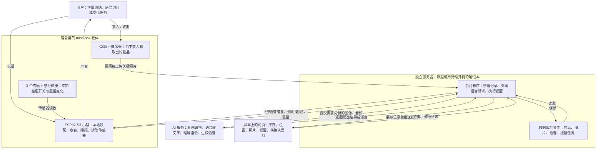

# mind box——无感物品存储

给队友的产品说明 · v0.2 · 2026-10-16

本文说明我们想做什么、用户怎么用、各部分怎么配合。下面描述的是产品目标，不代表功能已经实现或通过测试。更详细的技术内容放在附录。

**当前重点：先把硬件做出来，再优先跑通自动记录和语音找物，随后加入提醒和用户交代的任务。**

## 1. 我们要做什么

**一个放在宿舍里的智能收纳柜：平时帮你记住放进去的东西，需要时告诉你在哪里，该处理时提醒你。**

用户把充电线、零食、水果等物品正常放进柜子，设备自动尝试记录“是什么、放在哪、什么时候放入”。不要求每次扫码、填写表格或逐件说话。

用户也可以边放边说“这个保质期是六个月”。设备把这段语音、转成的文字和能理解的信息，与本次收纳记录一起保存。有疑问就显示在屏幕上，用户可以稍后处理，不打断收纳。

先服务于愿意把一部分物品集中收纳、又容易忘记它们的宿舍用户。只管理设备能够观察到的收纳范围。

## 2. 用户能得到什么

| 场景 | 用户怎么做 | 产品应该怎么回应 |
| --- | --- | --- |
| 收纳时自动记录 | 把充电线放进第三个抽屉，照常关上 | 自动记录物品、位置、放入时间；用户不必另外登记 |
| 边放边补充 | 放入零食时说：“这个保质期是六个月。” | 保存原始语音和文字，关联本次收纳；能确定对应物品时补充信息，不清楚的地方显示在屏幕上 |
| 开口找物品 | “充电线在哪？” | 有可靠记录时播报：“充电线在我这里的第三个柜子。”屏幕也能看到位置和照片 |
| 想起被忘记的零食 | 不需要专门操作 | 达到设定的存放时长后，屏幕提醒：“零食已经放了很久了，记得吃。” |
| 交代一次性任务 | “今晚提醒我把水果吃了。” | 保存指令；缺少具体时间时在屏幕显示“今晚几点提醒？”，补齐后设置，到时提醒 |
| 交代每天的任务 | “每天提醒我吃鱼油。” | 保存指令；补齐每天几点后设置重复任务，以后每天到时提醒；用户可以用语音改时间或取消 |

“放很久”依据存放时间和提醒规则判断，具体默认时长待定。它不表示食品已经过期，也不表示现在一定能吃。鱼油示例只执行用户交代的提醒，不决定用量。

## 3. 体验上坚持什么

- **正常收纳就能用。** 语音是查询、交代任务和自愿补充的入口，不是每次入库的必经步骤。
- **随口补充也要记住。** 收纳时的语音与这次操作一起保存，不能只保留 AI 总结而丢掉用户原话。
- **先把看见的记下来。** 首先支持摄像头能看清的单件、少量物品；不承诺整袋倒入、严重遮挡时全部识别。
- **疑问先放在屏幕上。** 没看清、没听清，或不知道“这个”指哪件物品时，保留已有记录并显示待确认信息，不强制语音追问或立即回答。查询时找不到记录就如实说明。
- **位置跟着实际收纳变化。** 观察到取出或换抽屉时更新；一时没看见，不能直接当成已取出。只有历史记录时，说“最后记录在……”。
- **提醒必须真的保存。** 时间不明确先保存为待补充任务，在屏幕提示；时间齐全且设置成功才说“已设置”。已经响过不等于用户已经吃了或做了。

## 4. 整个系统怎么配合

柜体负责看、听、感知和说话；服务器负责理解、记忆和安排提醒；屏幕负责展示。两者通过网络配合，可以分开放置。

这里的“AI 服务”是能力统称，实际可以由服务器本地程序或云端服务提供，不要求使用同一个模型。**AI 提供分析结果，后台检查后再写入数据库；到点提醒由程序执行。**

语音记录也由后台保存：数据库记录原话文字、音频位置和关联的收纳操作；原始音频作为文件保存，方便回看和纠错。

| 部分 | 队友需要理解的职责 |
| --- | --- |
| K230 与摄像头 | 拍到物品经过的过程，提供合适的照片；图片直接发服务器 |
| ESP32-S3 小智 | 在柜子旁唤醒、收音和播报，同时上传门磁、重量；完整语音理解依赖服务器 |
| 服务器后台 | 关联照片、传感器事件和用户语音，识别物品，维护记录，回答查询，保存和执行提醒 |
| 网页界面 | 让用户看到有什么、在哪里、放了多久、有哪些提醒和待确认问题；显示设备是否在线 |

**使用条件：** 柜体需要供电和网络，服务器需要保持运行。笔记本可以放在别处，关闭网页不等于关闭后台；若仍由笔记本运行后台，关机后完整功能会停止。独立显示屏尚未确定，原型可先用现有电脑或手机打开网页，这是显示方式建议。

## 5. 三条主要流程

**收纳：** 打开某个抽屉 → 拍到物品放入过程，同时接收用户自愿补充的语音 → 结合抽屉编号、照片、重量变化和语音 → 保存物品、位置、时间及语音记录 → 网页更新，疑问显示为待确认。取出时按实际观察更新记录；用户不说话也能自动记录。

**找物：** 唤醒小智 → 说“充电线在哪” → 服务器查询已有记录 → 柜体播报位置，网页展示照片。没有可靠记录时，不猜一个位置。

**提醒：** 说“每天提醒我吃鱼油” → 保存指令，缺少时间则在屏幕提示 → 用户补齐后设置并确认 → 程序到点触发 → 网页显示，柜体按设置播报。零食久放提醒由存放时长规则产生，不要求用户为每件零食先设任务。

## 6. 按什么顺序做

上述功能都保留为产品目标，按以下顺序推进：

| 顺序 | 做什么 | 阶段完成的样子 |
| --- | --- | --- |
| 先把硬件做出来 | 柜体、相机安装、门磁、称重、麦克风、扬声器、供电与网络接通 | 能拍到放入过程、区分哪个抽屉开关、读取重量、收音和播报，并把数据传到服务器；各部分能一起运行 |
| 优先打通核心体验 | 自动记录 + 随口补充信息 + 语音找物 | 充电线放入第三个抽屉，不另做登记，就能问出它的位置；放入时补充的语音也能保存 |
| 随后补齐提醒和任务 | 零食久放提示、一次性提醒、每日提醒、语音修改或取消 | 用户交代后任务能保存，到时在屏幕显示，并按设置播报 |

原型先使用一个三抽屉柜体、一个摄像头和少量代表物品验证。摄像头是否能覆盖三个抽屉，需要实际测试；若需要减少抽屉或增加摄像头，另行决定。

本次先不扩展到整个宿舍的任意物品定位、多人归属识别、自动购物或严重遮挡下的完整库存。包装日期识别、余量估算等保留为后续扩展，不作为下面主流程的前提。

## 7. 做到什么，才算跑通

按上一节顺序逐步检查，先硬件，再记录与找物，最后提醒。这些是待实现的检查场景，不是已有测试结果。

| 检查 | 应该看到的结果 |
| --- | --- |
| 硬件一起运行 | 摄像头、三个门磁、称重、收音和播报能配合工作，数据能到达服务器，供电没有导致异常重启 |
| 充电线放入第三个抽屉后询问位置 | 无需手动登记，记录正确物品和抽屉，并能回答 |
| 放入时说“这个保质期是六个月” | 语音、文字和本次收纳操作有关联；对应物品明确时记录保质期时长，缺少生产日期时不虚构到期日 |
| 同时放入多件物品，说“这个”无法确定指哪件 | 保留原话和本次操作，屏幕提示待确认，不把信息随意写到某件物品上，也不要求立即回答 |
| 实际观察到取出或换位置 | 记录随之更新，不继续给出过时的确定位置 |
| 零食达到设置的久放提醒条件 | 网页出现相关物品、存放时长和提醒，不把久放说成过期 |
| 设置一次性和每日提醒 | 先保存具体时间；一次性任务到点提醒，每日任务在之后的约定时间继续执行 |
| 提醒指令缺少具体时间 | 指令保留为待补充，屏幕提示；补齐前不声称已设置成功 |
| 提醒前长时间不与设备对话 | 到点仍能主动提醒，不依赖用户再次唤醒 |
| 后台重启，或消息重复发送 | 已保存的物品和任务能恢复；同一操作不重复入库，同次提醒不反复播报 |
| 识别不清或服务离线 | 不编造记录、不谎报设置成功；网页如实显示待确认或离线状态 |

---

## 附录 A：给实现同学的补充

### A1. 最少需要记住哪些信息

| 记录 | 基础内容 |
| --- | --- |
| 物品 | 唯一编号、名称或待识别、照片、抽屉编号、观察到的放入时间、当前状态；可选的保质期信息及来源 |
| 收纳事件 | 操作编号、抽屉开关、关键照片、动作前后稳定的整柜重量、关联语音、处理结果 |
| 语音记录 | 语音编号、原始音频文件位置、转写文字、录音时间、关联操作编号、关联物品（不确定可为空）、提取信息及处理状态 |
| 待确认信息 | 对应操作或任务、疑问内容、已有依据、处理状态；用户未回答时保留待确认 |
| 提醒任务 | 内容、关联物品（可为空）、原始指令、具体时间（待补充时可为空）、是否每日重复、状态、实际送达情况 |

位置统一对应实际第 1、2、3 个抽屉；“第三个柜子”是语音说法，不表示另有第三台设备。放入时间未知时保留未知；食品有效期与存放时间分别记录。

“保质期六个月”是时长，不等于“从今天起六个月后到期”；缺少生产日期等依据时，不自动生成到期日。用户说出的明确到期日可单独记录，标注来源为用户语音；与包装识别结果不一致时，保留双方依据，在屏幕提示待确认。

### A2. 设备和数据的关系

- 三个门磁分别对应三个抽屉，只说明哪个抽屉开关。
- 两个 20 kg 称重传感器共同测整个柜子，通过 HX711 采集；不是每个抽屉分别称重。模块数量、传感器接法和实际精度仍需核对。
- 重量用于辅助判断变化，不能仅凭重量确定是哪件物品。多个抽屉同时打开时，不能强行把变化归给其中一个。
- K230 在物品经过时留图；关门后可能已经看不到里面，不能等关门后才开始拍。
- 照片由 K230 直接传服务器，不经过 ESP32。服务器用同一操作编号关联照片与传感器事件，避免串错抽屉。
- 用户边放边说时，服务器结合正在进行的收纳操作、时间和画面关联语音。语音会话编号与收纳操作编号分别保存；不能仅因时间接近，就认定“这个”必然对应某件物品。关联不清时先保存到操作层，在屏幕待确认。
- ESP32 承担本地唤醒、音频采集与播放，不承诺在板上完成完整语音转文字或大模型推理。提醒在后台持久化，不靠模型“记着等”。
- 局域网原型中，两块板通过 2.4 GHz Wi-Fi 接入，服务器使用网线或 Wi-Fi。远程部署还需可访问的服务器地址与实际连接测试。

### A3. 当前重点待验证

| 项目 | 为什么影响产品体验 |
| --- | --- |
| 单摄像头覆盖及充电线等目标物品的识别 | 决定能否自动记对名称和抽屉 |
| 小智空闲时接收提醒并主动播放 | 决定用户没有对话时，提醒能否真正响起；现有固件未验证 |
| 收纳时的语音接收与物品关联 | “边放边说”是交互目标；是否需要先唤醒、能否由开门进入短时语音接收状态，需核对固件并测试，不能假设现有小智能自动做到 |
| 音频与传感器同时运行 | 决定说话时会不会漏掉开门、称重事件 |
| 整柜称重与机械安装 | 抽屉运动、手部按压会影响读数，量程不能代替精度 |
| 供电、网络和长时间运行 | 决定是否重启、掉线，提醒是否能送达；目前没有整机实测结果 |

供电设计沿用已有讨论方向：12 V 电池经匹配保护、开关和降压后向柜体提供规定电压，不能把 12 V 直接接到 5 V 输入。电池容量、降压模块、实际板卡接线及续航未定，服务器与路由器各自供电。本文不新增硬件采购或修复决定。

## 附录 B：资料更新与后续决定

### B1. 本轮补充与确认

| 内容 | 早期资料 | 本文记录的最新要求 |
| --- | --- | --- |
| 产品场景 | 食品管理优先，场景尚待确定 | 明确为宿舍，包括充电线找物、零食久放、用户交代提醒 |
| 语音入口 | 电脑语音优先候选，ESP32 可选 | 此前对话已要求语音放在 ESP32，设备与服务器可分开放置 |
| 收纳补充与疑问处理 | 已有自愿语音补充的方向 | 本轮明确：边放边说的信息与本次收纳关联保存，原始语音和文字保留；疑问优先显示在屏幕上，不打断用户 |
| 实现顺序 | 每日提醒曾列为加分项 | 本轮已确认先完成硬件，优先自动记录与语音找物，随后希望做出提醒和用户任务；各功能按顺序推进 |
| 实现进度 | 设计与讨论阶段 | 本文也不声称任何功能已开发或整机通过测试 |

### B2. 尚需决定的少量事项

1. 用什么屏幕展示网页，是否需要放在柜子旁。
2. 久放提醒的默认时长、提醒方式，以及声音是否需要设置安静时段。

### B3. 详细资料入口

- [早期产品形态](product-concept.md)：无感使用原则、遮挡边界和早期功能取舍。
- [用户走访一](../survey/1.md)、[用户走访二](../survey/2.md)：原始调研。现有走访支持减少登记负担的方向，尚未证明普遍需求。
- [开发入口](../../../code/README.md)：当前软件实现、处理流程、数据约定、评测和下一步。
- [可运行性评估](../../../system-assessment.md)：功耗、网络、延迟的资料依据和待实测清单。
- [详细架构源码](../../../system-architecture.md)、[机器可读节点与连接](../../../system-architecture.json)：完整数据关系、硬件连接与未决项，接线前需核对实物。

给队友介绍产品先读正文；实现接口、供电和接线时再查附录与技术文件。重复讨论记录已合并，软件实际状态以开发入口为准；本文中的要求与待定项分别理解。
