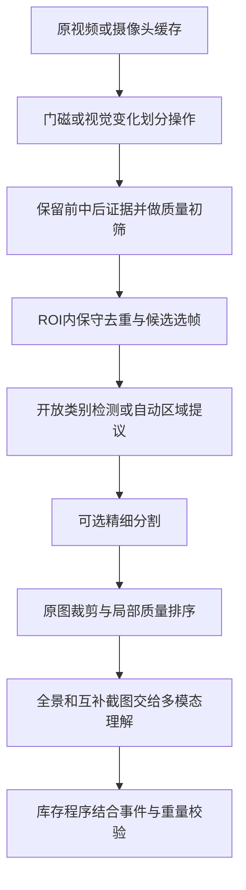

# Mind Box：视频关键帧与开放类别物品裁剪调研

调研日期：2026-10-16，Asia/Shanghai。本文是技术调研与验证建议，不是已确认技术方案。已查阅下列官方仓库、官方文档；没有安装模型、下载权重或用柜体视频实测。项目页面会变化，实施时需固定版本。

## 1. 结论

可以不为每种生活物品训练模型，使用预训练的开放词汇检测、通用分割与多模态理解组合实现。这里的“免训练”指不用自行采集标注数据再训练；模型本身已经预训练，并不能保证任意物体都能检出。

建议把问题拆为五件事：视频清洗与事件分段、选择有效帧、发现物品区域、精细裁剪、跨帧关联。识别商品名称和库存增减是后续任务，不能由“裁出了图片”直接推出。

对本项目，优先验证：

1. **基础视频处理：FFmpeg/PyAV/OpenCV + 抽屉操作分段 + 局部质量评分与保守去重。**
2. **开放物品定位：有合适 GPU 和权重访问条件时测试 SAM 3/3.1；并以 Grounded SAM 2（Grounding DINO + SAM 2.1）作为可复用对照。**
3. **效率路线：YOLOE 的文字/视觉提示检测分割；未知类别用动态词表和通用区域提议补漏。**
4. **语义层：多模态模型对全景和物品裁剪命名、读取包装文字、解释变化；也可提供粗框，实际框质量需单独评测。**

没有找到可据官方资料直接认定为“对任意储物柜输入视频，自动无遗漏地输出每件物品最佳截图”的成品。下面的项目覆盖了主要模块，业务分段、证据保存、去重边界和评测仍需自行整合。

## 2. 先区分三种输出

| 输出 | 含义 | 用途与边界 |
| --- | --- | --- |
| 关键帧 | 视频中适合观察物品的整张画面 | 保留时间和场景上下文；编码 I 帧不等于业务关键帧 |
| 检测框 bbox | 矩形圈住物品 | 足够生成库存缩略图和送识别的裁剪；框内通常仍有背景 |
| 分割 mask | 标记物品可见部分的像素 | 可生成透明底抠图，或由 mask 求更贴合的外接框 |

若只是“把物品截图出来”，先做带少量边距的矩形裁剪，通常比强求透明底更适合识别。需要精细轮廓时再用分割。遮挡物后面从未拍到的部分无法从真实画面裁出；生成式补全不能用作真实库存证据。

## 3. 视频怎么清洗和选帧

### 3.1 保留原始证据，另建筛选结果

“删重复”先实现为不把冗余画面送进模型，或给候选帧打排除标记。调试期保留原视频和时间戳，避免误筛以后无法回查。

- 解码并检查损坏/异常帧，统一图像旋转、色彩处理与坐标约定。
- 用源视频 PTS/时间基保留真实时间，不只靠“帧号 / 标称 FPS”，尤其注意可变帧率视频。
- 图像缩放用于快速评分；真正物品截图从高分辨率原帧裁，避免先缩成小图再放大。
- 过曝、欠曝、严重模糊、遮挡标记为低质量；若某次操作只有这些帧，应报告证据不足，不能悄悄删掉整次操作。
- 不优先用生成式去模糊、补字或超分辨率处理包装日期，避免把生成细节当成证据。

### 3.2 用“操作”分段，比单纯按镜头切换更符合柜体场景

门磁事件可作为每次开关抽屉的分段线索；普通导入视频则可先用局部变化形成候选时间段，再识别其中的取放动作。

一次操作应考虑保存：

1. 操作前可比较的稳定画面；若关门时看不见内部，可在本次刚打开时手进入前取帧，或保留上次关闭前的有效基线并标明时间。
2. 操作中物品暴露最充分的画面，例如拿起后短暂露出包装正面。
3. 操作后、关门遮挡之前的可见稳定画面。

不能只在门关上后拍照，也不能只选全视频最清晰的一张。新物品可能在手拿着时更完整，取出的物品在操作后的画面里已经不存在。

开门触发存在网络延迟，因此短时循环缓存很有价值，但其帧率、长度和实际可用内存需在 K230 实测。保留“操作前/中/后”是证据角色，不代表每次固定三张一定足够：多件物品分时出现时应增加代表帧。

### 3.3 清晰度不能只看一个全图分数

| 指标 | 可用方法 | 注意点 |
| --- | --- | --- |
| 清晰度 | Laplacian 方差、Tenengrad 梯度能量；FFmpeg blurdetect | 尺寸、噪声、纹理和曝光都会影响分数，不能直接使用网上某个统一阈值 |
| 曝光与反光 | 亮度分位数、过暗/饱和像素比例 | 全图平均亮度正常时，包装标签仍可能反光过曝 |
| 运动与稳定 | 局部帧差、光流、连续短窗口变化 | 低运动不代表没有手，也不代表物品已放置完成 |
| 可见性 | 手/人体遮挡、边缘截断、mask 完整程度的代理指标 | 无法仅凭一帧可靠知道被挡住的真实总面积；这些是代理指标 |
| 物品像素量 | bbox/mask 面积、物品在图中尺寸 | 物品大而清楚通常更适合识别，但不能选只剩局部的大特写 |
| 信息增量 | 新视角、可读文字、新出现区域 | 两张语义相似图可能分别是包装正反面，都值得保留 |

推荐两遍筛选：先在收纳区域 ROI 做便宜的质量检查，发现物品后再对每件物品局部排序。背景柜沿很清晰而物品运动模糊时，全图 Laplacian 分数会误导。

可采用“先剔除严重曝光异常/明显遮挡，再按局部清晰度、物品大小和信息增量排序”的规则。若使用综合分数，各项需归一化并用实拍视频调权重，不能把随意加权公式当成通用算法。每个物品可以保留一张主图和少量互补图。

PyIQA 提供无参考质量评价等现成指标，可作补充对照；图像观感分数不等于包装文字可读性，也不等于库存识别效果。[S12]

### 3.4 如何删除相同或没有变化的画面

建议按计算成本逐级判断：

1. 精确文件/解码像素去重，用于真正相同的帧。
2. pHash/dHash 或 FFmpeg mpdecimate，快速找相似候选。
3. 在同一收纳 ROI、分块或候选物品区域计算 SSIM/像素差，检查局部是否有变化。
4. 对确实冗余的一组画面保留质量更好的代表帧和时间范围。

不能仅凭“全图 SSIM 很高”就删除：从大画面中拿走一小袋零食，变化像素比例可能很小。相邻帧变化很小时，还应与最近保留的稳定基线比较，避免缓慢变化被逐帧比较漏掉。

特别需要保留的情况：

- **A → B → A：**拿出又放回，最后画面像之前，但中间动作不能因全局查重被删除。
- **同款两包：**裁剪外观相似不能证明是同一个实体，不能据此合并数量。
- **前后状态相同、过程不同：**等重量换物、交换位置、拿出查看后放回，需结合过程帧。
- **不同包装面：**外观特征相似但文字不同，可能是新增证据。

因此先做同一次操作内、相近时间和同一视角的画面去重，跨操作保留事件与引用。CLIP/CNN 向量适合找相似候选，不应直接作为库存实体去重依据。

### 3.5 抽屉移动是重要限制

OpenCV MOG2/KNN 背景减除适合静止摄像头下的前景运动检测。[S9] 但摄像头固定并不代表抽屉里的背景不动：抽屉拉动会使整个内部画面变化，光线也会随开门变化。

- 优先比较抽屉在可重复位置、视角接近的稳定画面。
- 条件允许时对柜体/抽屉固定特征做配准，或用标记确定位置。
- 单个平面变换不能消除立体物品的全部视差，不要把配准后的所有差异都当作进出物品。
- MOG2 运行久了会将静止物品吸收为背景，所以它适合判断运动/候选变化，不适合作为库存主记录；操作期间可冻结用于前后比较的基线。

## 4. 不固定类别时，怎么框定生活物品

### 4.1 常规 YOLO 的适用边界

YOLO 是一类检测模型/实现体系，能检什么取决于具体权重和任务。使用固定类别预训练权重时，不应指望它检出类别表之外的所有生活物品。“能检出瓶子”也不等于能区分具体饮料 SKU。

因此不推荐把普通固定类别 YOLO 作为本项目唯一物品发现器；它仍可用于覆盖范围内的物品，或作为人/手等辅助检测器，具体能力取决于所选权重。

YOLO-World 和 YOLOE 是需要单独考虑的开放词汇路线，不能与普通闭集 YOLO 混为一谈。

### 4.2 候选比较

| 路线 | 要不要自行训练 | 如何指定目标 | 能输出什么 | 本项目的主要边界 |
| --- | --- | --- | --- | --- |
| Grounding DINO + SAM 2.1 | 可直接使用预训练模型 | 检测器接受文字词组，SAM 接检测框/点 | bbox + mask；可接视频跟踪 | 词组会影响召回；“object”并不保证找齐所有物品；需要组合模型 |
| YOLO-World | 可零样本推理 | 文字词表，另有图像提示路线 | 检测框，项目也有分割相关实现 | 开放词表仍有覆盖限制；识别未知商品不是无限泛化 |
| YOLOE | 可直接推理 | 文字、视觉示例、prompt-free | 检测框和分割 | prompt-free 也不是没有类别先验；官方示例加载了内部词表 |
| SAM 2.1 自动 mask 生成 | 可直接推理 | 不需要物品名称；自动采样提示点 | 类别无关的候选 mask 与区域 | 可能把包装图案、瓶盖等切成独立区域，也可能合并相邻物体，需要过滤与语义判断 |
| SAM 3 / 3.1 | 可直接推理，须取得权重访问 | 开放概念文字或视觉提示 | bbox、mask、分数、视频跟踪 | 仍是按概念/提示检出，不能把抽象“所有生活物品”当作完整性保证；部署要求更高 |
| Florence-2 | 可使用预训练模型 | 检测、区域提议、描述或文字定位任务提示 | 区域框、描述等；可接 SAM | 可自动产生候选区域/描述，但输出完整性与细粒度需测 |
| 有 grounding 能力的多模态模型，如 Qwen3-VL | 可调用现有模型/API | 自然语言指定目标、生成列表与框 | 名称、描述、框/点、文字理解 | 文本生成坐标需校验，可能漏检/框偏；不默认有精细像素 mask |

依据：[S4–S8、S10]。这张表不是精度排行榜，不能用不同数据集上的 AP 或官方演示 FPS 直接决定本项目赢家。

### 4.3 重点现成项目：Grounded SAM 2

官方仓库提供：图片检测分割、直接输入 MP4 的视频跟踪、bbox/mask/分数 JSON 导出、Florence-2 区域提议及描述后定位等示例。[S4]

它适合复用成“输入视频 → 找到目标 → 跨帧追踪 → 每条轨迹选最好截图”的骨架。

但要注意：

- 基础跟踪示例只在首帧进行检测。首帧没有、后面才放入的物品，需要周期性/事件触发重新检测并注册新目标。
- 仓库的 continuous ID 示例正是针对新物体，但维护方明确写了仍在开发、稳定性不足，不能当成已完成的库存身份系统。
- 本地 Grounding DINO 路线与 Grounding DINO 1.5/1.6、DINO-X 的云 API 示例是不同部署选项；不能把后者的 API 能力当作全部已有可下载本地权重。
- 仓库集成说明和 SAM 2 上游当前依赖版本存在差异，部署前应固定可兼容版本，不混装最新版依赖。

### 4.4 更新的 SAM 3/3.1 值得纳入对照

官方仓库说明 SAM 3 支持文字/视觉提示下的检测、分割、跟踪，返回 masks、boxes、scores；2026-03-27 发布 SAM 3.1 Object Multiplex，改进多物体联合跟踪效率。[S6]

仓库当前列出 Python >= 3.12、PyTorch >= 2.7、CUDA >= 12.6 的 CUDA GPU 环境，SAM 3 模型规模为 848M 参数，权重需申请访问，使用 SAM License。没有本项目硬件实测，不能给出可用显存下限或承诺响应速度。

它能减少手工拼接文字检测器和分割器的工作，但“给一个概念找出对应实例”和“自动知道哪些区域应作为库存物品”仍是两件事。应比较具体提示词、同类密集物品和无提示发现的补漏效果。

### 4.5 物品名称事先也不知道怎么办

可采用两个相互补充的入口：

**入口 A：自动区域发现。** 用 SAM 2 自动 mask 或 Florence-2 region proposal 生成候选，再依据收纳区域、面积、包含关系、变化区域和语义筛选；不要要求用户逐件框选。

**入口 B：先看图生成动态词表。** 多模态模型/Florence-2 从当前画面提出可见对象描述，如 `snack bag`、`bottle`、`box`、`red packet`，再让 Grounding DINO、YOLOE 或 SAM 3 按这些描述定位，必要时用视觉示例补充。

两者都可能漏检，所以需要保留“尚未识别候选”。动态词表来自模型看到的内容，如果模型一开始漏看某物体，仅靠后续词表检测无法补回来。可用类别无关区域与变化证据发现缺口。

YOLOE 官方 prompt-free 脚本读取 `tools/ram_tag_list.txt` 再设置 vocabulary，说明无需用户逐次给词，不等于摆脱词表或天然支持一切实体。[S7a]

### 4.6 多模态大模型能不能直接框

可以，前提是选用明确支持 grounding 的模型；Qwen3-VL 官方提供 2D grounding 示例，支持框和点。[S10] 不能把任意“能看图聊天”的模型都视为有经过训练的定位能力。

快速原型可先要求输出每件可见物品的 `label + bbox`，程序校验坐标并裁剪。若需要更贴合轮廓，再将粗框交给 SAM。

必须明确并验证：

- 模型返回的是 xyxy、xywh 还是其他格式；坐标是原图像素、缩放后像素，还是归一化值。
- 图像是否经过缩放、补边或切片，框能否正确映射回原图。
- 框在边界内、面积有效；重复框和漏框如何处理。
- 细粒度商品、反光/遮挡、多小物体的定位效果与费用、延迟。

一些 grounding 模型使用 0–1000 等相对坐标，但必须以所选模型/接口实际文档为准；本次未成功加载 Qwen 的 notebook 正文，因此不把其具体坐标数值范围列为已核验事实。

对 Mind Box 的建议是让多模态模型负责命名、文字和变化解释；区域定位优先与专门检测/分割器做对照。若实拍结果证明直接大模型框定已经足够，可以采用更简单的路线，不必为了架构复杂而叠模型。

## 5. 真正把物品截图裁出来

建议输出三类关联图片：原始全景、带边距物品 crop、可选 mask 透明图。

处理顺序：

1. 将检测框/mask 从工作分辨率映射回原图。
2. 过滤明显属于柜体、手、杂散小区域的候选；处理同一物品的重复框。包含关系只能作为线索，例如瓶盖可能是瓶子的一部分，也可能是独立存放物。
3. 有 mask 时取其外接框，并保留适量背景边距。可先试框宽高各扩约 5%–10% 的边距，再根据截断与背景干扰调整；这只是实验参数。
4. 从高分辨率原图裁剪，不拉伸成错误比例；需要固定尺寸时保留宽高比。
5. 对同一条短时轨迹的物品 crop 再比较局部清晰度、可见性和信息增量，选主图与互补视角。
6. 保存来源和时间，至少包括 operation_id、frame_id、时间戳、原图尺寸、原图坐标、mask 引用、模型版本和筛选理由。

分割 mask 只代表当前可见部分；若手盖住半个物体，mask 不会让被盖部分变得可见。不要为追求透明底而误删包装边缘、细小透明部件或文字上下文。

若大图里小物体被缩没了，可采用 SAHI 重叠切片推理或固定收纳区域分块，再合并重复检测。SAHI 官方已有 YOLOE、Grounding DINO 等示例。[S11] 切片增加推理次数，跨切片合并也可能把相邻同款物品错误合并，所以应将整图结果和切片结果对照，不能默认切片一定更好。

## 6. 适合本项目的整合流程

如果需要在视频中追踪同一物品，可以在候选段保留较密集帧序列，用 SAM 视频跟踪或检测加跟踪；给识别模型的图片则只用精选帧。不要先把视频稀疏到只剩几帧，再假定视频跟踪仍然稳定。

追踪 ID 仅表示算法在一段视频中的关联，不自动成为跨重启、跨遮挡、跨操作的永久 item_id。周期性重新检测、相似外观、遮挡重现与身份不确定都要单独处理。

变化区域的用途是筛选候选物品，不是直接生成完整物品边界。取出操作要查操作前画面的物品；帧差本身也不能确定变化属于新增还是移除。

## 7. 可复用工具清单

| 工具/项目 | 能直接复用的部分 | 对 Mind Box 的定位 |
| --- | --- | --- |
| FFmpeg [S1] | 解码、采样、mpdecimate、freezedetect、blurdetect | 视频处理底座；freeze 检测是指标，不会自动理解业务 |
| Katna [S2] | LUV 帧差、亮度/熵过滤、直方图聚类、Laplacian 清晰度选帧 | 最贴近离线“输入视频选代表帧”；全视频摘要目标需改成操作证据目标 |
| PySceneDetect [S3] | 镜头切换、场景表与代表图片 | 多镜头素材有用；固定柜体轻微取放不等于切镜头 |
| imagededup [S8] | pHash/dHash 等哈希和 CNN 相似检索 | 候选帧去重工具；不作为物品实体合并依据 |
| Grounded SAM 2 [S4] | 检测、分割、视频追踪、结构化导出 | 开放类别裁剪整合骨架，注意后进入物体的重新检测 |
| SAM 2.1 [S5] | 自动 mask、点框提示分割、视频传播 | 不预先知道类别时的区域提议与精细裁剪 |
| SAM 3/3.1 [S6] | 概念提示检测分割跟踪 | 有 GPU/权重访问条件时的重点对照 |
| YOLOE [S7] | 文字/视觉/无提示检测分割、模型导出 | 需要效率的开放类别候选，不能将桌面 GPU FPS 套用到 K230 |
| YOLO-World [S13] | 零样本文字词表检测、重参数化词表、图像提示路线 | YOLOE 之外的开放词汇对照 |
| SAHI [S11] | 大图切片与结果合并 | 小物体召回不足时再加入 |
| PyIQA [S12] | 现成图像质量指标 | 对比质量排序方法，不是物品识别或文字可读性的替代品 |

Katna 的 smart crop 是根据显著性/构图选取指定尺寸画面，不等于把画面中每件库存物品逐一抠出。两个任务不要混用。[S2]

## 8. 部署建议与取舍

### 有 NVIDIA GPU 的电脑/服务器

先拿相同视频对比 SAM 3/3.1、Grounded SAM 2 和 YOLOE 的漏检、边界完整性、延迟与显存。已有可用环境优先，避免赛时先投入大量时间解决模型环境。

### 没有合适 GPU，但已有多模态 API

在电脑上完成解码、ROI 帧差、清晰度筛选和去重；只对少量有效帧调用支持 grounding 的模型出框，先得到矩形 crop。需精细 mask 时再评估托管分割服务或可接受速度的本地小模型，不承诺 CPU 实时。

### K230

保留采集、压缩、时间/序号、循环缓存及实测可行的轻量筛选。大型开放词汇模型先放电脑/服务器。

YOLOE 可导出 ONNX 或与普通 YOLO 接近的结构，不等于能直接在 K230 上运行；仍需验证 nncase 转换、算子、量化、输入尺寸、内存、后处理，以及动态文字/视觉提示如何处理。不能把模型库的桌面速度当作板卡性能。

降低送大模型的帧数会减少模型调用；如果原始视频仍持续上传，未必降低设备网络带宽。要降低上行带宽，需要在设备端缓存/筛选/按需上传，并验证快动作不会漏拍。

## 9. 建议的最小验证，不先训练

拍摄或收集一组真实柜体短视频，覆盖单件/小批量、同款多包、未知形状、透明/反光包装、手遮挡、拿出放回、快速操作、抽屉移动和灯光变化。验证集可以人工标注，无需用它训练模型。

建议先做三个对照：

- 基线：固定间隔采样 + 支持 grounding 的多模态模型出框。
- 专门定位：同样候选帧 + YOLOE 或 Grounding DINO，必要时 SAM 精修。
- 补漏/新模型：自动 mask 或 region proposal，以及有条件时 SAM 3/3.1。

不要同时更换选帧算法、检测模型和输入分辨率后再归因；先固定其中两项，逐项比较。

| 评测项 | 实际要回答的问题 |
| --- | --- |
| 操作证据覆盖率 | 每次真实取放是否至少保留能判断该动作/物品的画面？ |
| 选帧保留率 | 原来多少候选帧，最终送模型多少？节省是否伴随漏事件？ |
| 可见物品召回率 | 本来能看见的物品有多少被找到？完全遮挡单列不可观察项 |
| 裁剪完整性与混入 | 是否截断目标、框进多个物品、把物品零件重复算一件？ |
| 定位指标 | bbox IoU、必要时 mask IoU；同时人工核查文字是否被切掉 |
| 最佳截图可用率 | 被选主图是否清楚、足够完整，包装信息可读？ |
| 去重误删 | 小物体变化、A→B→A、同款不同件是否被错误省略？ |
| 身份关联 | 重复计数、ID 切换、遮挡后错误合并分别多少？ |
| 成本与时延 | 选帧、检测、分割、语义识别分别的耗时、p50/p95、显存和 API 用量 |

暂不设“保证精准”的百分比。先报告样本、失败类型和各项指标，再据实拍结果锁定方案。项目最值得先验证的是“能否留住每次操作中足以辨认的画面”，之后才是裁剪边界是否足够细。

## 10. 官方来源

以下均于 2026-10-16 通过浏览器读取。官方性能宣传与 benchmark 不等于本项目实测。

- S1：[FFmpeg Filters](https://ffmpeg.org/ffmpeg-filters.html)，已核对 mpdecimate、freezedetect、blurdetect 定义。
- S2：[Katna 官方仓库](https://github.com/keplerlab/katna)，已核对关键帧算法步骤与 smart crop 的目标。
- S3：[PySceneDetect 文档](https://www.scenedetect.com/docs/latest/) 与 [CLI 检测器文档](https://www.scenedetect.com/docs/latest/cli.html#detect-adaptive)，已核对场景切换、选图与参数。
- S4：[Grounded SAM 2 官方仓库](https://github.com/IDEA-Research/Grounded-SAM-2)，已核对视频、JSON 导出、Florence-2、首帧提示及 continuous ID 稳定性说明。
- S5：[SAM 2 官方仓库](https://github.com/facebookresearch/sam2)，已核对自动 mask、视频传播、SAM 2.1、Windows WSL 建议及 Apache 2.0 说明。
- S6：[SAM 3 官方仓库](https://github.com/facebookresearch/sam3)，已核对 SAM 3.1 发布记录、提示能力、模型规模、环境与权重访问要求；采用 SAM License。
- S7：[YOLOE 官方仓库](https://github.com/THU-MIG/yoloe)，已核对三种提示方式、检测分割与导出；仓库显示 AGPL-3.0。
- S7a：[YOLOE prompt-free 官方脚本](https://github.com/THU-MIG/yoloe/blob/main/predict_prompt_free.py)，已核对其加载内部词表。
- S8：[imagededup 官方仓库](https://github.com/idealo/imagededup)，已核对哈希/CNN 方法及 Windows 支持说明。
- S9：[OpenCV 背景减除教程](https://docs.opencv.org/4.x/d1/dc5/tutorial_background_subtraction.html)，已核对固定摄像头前景检测及背景更新。
- S10：[Qwen3-VL 官方仓库](https://github.com/QwenLM/Qwen3-VL)，已核对其 grounding 能力与 [2D grounding 示例入口](https://github.com/QwenLM/Qwen3-VL/blob/main/cookbooks/2d_grounding.ipynb)；示例 notebook 正文未成功加载，不据此声称已核验具体坐标数值范围。
- S11：[SAHI 官方仓库](https://github.com/obss/sahi)，已核对切片推理和 YOLOE/Grounding DINO 示例入口。
- S12：[PyIQA 官方仓库](https://github.com/chaofengc/IQA-PyTorch)，已核对图像质量评分与指标方向配置。
- S13：[YOLO-World 官方仓库](https://github.com/AILab-CVC/YOLO-World)，已核对零样本检测、词表重参数化和图像提示更新。

复用时记录所用模型、权重、组件版本与来源；Grounded SAM 2 的各组件和云 API 分别有对应许可/服务条件，不能用仓库总标题替代实际组件信息。本文没有将任何候选移入“已确认技术方案”。
