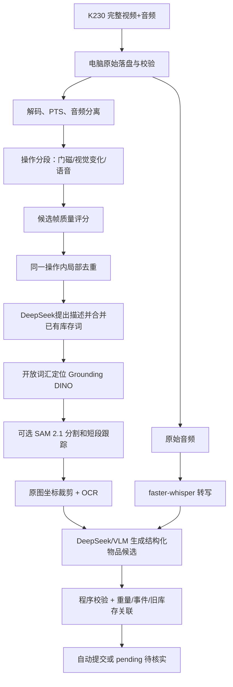

# Mind Box：完整音视频处理与物品记录方案

版本：0.2；日期：2026-10-16。本文是给第一轮真实视频实验使用的实施方案。K230 负责完整采集和上传；电脑负责解码、清洗、关键帧选择、物品定位、文字识别、语义整理和库存候选生成。当前没有用真实柜体视频验证效果，所有阈值和时延目标都需要实验校准。

本轮用户已明确：完整视频和音频均传到电脑处理。这替代旧架构中“主要上传照片”的输入方案；不据此声称 K230 的麦克风、编码或完整上传固件已经验证。本文选定的是首轮实验基线，模型和参数尚未经过用户视频验收。

配套：[字段与时间规则](item-information-contract.md)、[数据集录制和标注规范](../../../code/datasets/README.md)、[前次算法调研](research/video-keyframes-and-open-world-cropping.md)。

## 1. 目标和边界

一次 K230 采集应保留：

- 原始视频文件和原始音频，不在设备端做不可逆删除；
- 设备时间、服务器接收时间、帧号、音频和视频的关联信息；
- 一次取放操作的前、进行中、结束前的有效证据；
- 物品的图片裁剪、可选分割轮廓、文字识别结果和模型原始响应；
- 可追溯的物品记录和库存变化候选。

本方案不承诺从一段视频推断不可观察事实。物品在视频开始前已经放入时，系统只能记录 `first_seen_at`，不能把它伪造为 `put_in_at`。手遮挡的部分不能由分割模型恢复，AI 估计的保质期不能当作包装上的真实日期。

## 2. 首版技术选定

| 环节 | 首版选定 | 作用 | 备用/对照 |
| --- | --- | --- | --- |
| 原始接收与解码 | FFmpeg + PyAV | 保存原视频，提取视频帧和音频，保留 PTS | OpenCV 仅用于局部图像运算 |
| 视频清洗与质量评分 | OpenCV、Tenengrad 主排序、Laplacian 对照 | 曝光、模糊和局部变化评分 | `blurdetect`、Katna 用于离线对照 |
| 音频预处理 | FFmpeg 转 16 kHz 单声道 WAV，VAD | 给语音转写和说话时间段定位 | 保留原始音频作为证据 |
| 中文语音转文字 | faster-whisper | 本地转写“放入一瓶可乐”等操作说明 | 云端 ASR 仅作准确率对照 |
| 开放物品定位 | Grounding DINO | 用动态词组得到物品 bbox | YOLOE、YOLO-World |
| 精细物品轮廓 | SAM 2.1 Hiera Small，按需执行 | 框内多物品、轮廓精修和区域补漏 | 矩形 crop 可独立输出；SAM 3 后续对照 |
| 物品文字 | PaddleOCR PP-OCRv6 | 读取品牌、品名、日期、规格、条码附近文字 | DeepSeek/其他视觉模型复核 OCR |
| 名称、描述、动作、字段整理 | DeepSeek 官方 `deepseek-flash`（对应 V4.1 Flash 视觉服务） | 图片+文字输入，输出 JSON 候选 | GPT6.1 中转站作为同数据集对照 |
| 存储和任务 | 沿用已有设计：FastAPI + SQLite/WAL + 本地媒体 | 保存原始证据、任务状态和审核结果 | 尚无业务实现；重型模型独立进程 |

DeepSeek 官方文档当前把视觉接口模型名写作 `deepseek-flash`，旧的 `deepseek-v4-flash-vision-exp` 会由最新 Flash 模型服务；它支持 JPEG/PNG/GIF/WebP 图片和 JSON Output。项目配置保留 `provider`、`model` 和 `base_url`，不把 `ds4.1f` 这个口语简称硬编码为接口模型名。[DeepSeek Vision](https://api-docs.deepseek.com/guides/vision) 、[DeepSeek JSON Output](https://api-docs.deepseek.com/guides/json_mode)

GPT6.1 通过中转站，当前尚未确认完整模型 ID、图片输入、视频输入和结构化输出。因此第一轮将其作为可插拔对照，不把“中转站接受请求”当作视觉能力验证。DeepSeek 官方和学校图信中心也分别配置、分别测，不默认学校已同步官方视觉能力。云端仅接收精选图片和必要文字；完整原音视频保存在电脑。

本轮访问 OpenAI 两个官方模型文档入口均被网站访问控制拦截，未核验 GPT6.1 的官方模型规格。模型名称和账号可用性以中转站实际接口和样本测试为准，不在这里虚构价格、上下文或多模态能力。DeepSeek 官方的图片输入已经核验，但官方支持图片不等于框定位精度已被验证。

电脑显卡未确认时，按可离线运行设计：媒体处理、OCR、ASR 和定位依次限并发执行，不承诺 CPU 实时。Grounding DINO 选 Swin-T 预训练权重（官方支持 CPU-only），无须训练。主服务 Python 3.11；SAM、OCR 等推理服务独立环境，安装时固定兼容版本。

## 3. 总体流程



每次操作产生一个 `operation_id`。电脑后端不直接让模型写数据库：模型只能产生候选，程序验证证据引用、字段类型、库存版本和动作逻辑后，才允许提交库存事务。

## 4. 电脑后端的详细处理步骤

### 4.1 接收和归档

1. 接收 K230 的视频分片或完整文件，写入临时文件。
2. 校验文件大小、可解码性和 SHA-256，写入完成后原子移动到原始目录。
3. 保存 `device_id`、`boot_id`、设备序号、设备单调时间、服务器接收时间、视频编码、分辨率、标称 FPS、实际时长。
4. 实验期间保留完整原文件；后续“删除重复帧”只影响分析输入，不删除原始文件。长期连续运行另设可配置保留期和容量策略；已被库存引用的证据需单独保留。
5. 若视频和音频分开上传，用 `capture_id`、设备序号和服务器接收窗口关联；不同设备的单调时间不能直接当作同一时钟。

首轮实验建议允许 MP4/H.264 + AAC 或 K230 实际能输出的格式；电脑端统一生成一个分析代理视频和一个 16 kHz WAV，但不覆盖原文件。

**传输技术选定：离线文件导入优先；实时阶段用可确认、可重传的 HTTP(S) 媒体分片上传。** 每片以编码器关键帧为边界，初始目标约 4 秒，首尾连续、不省帧；容器按固件能力协商。若无法生成独立可解码分片，使用有初始化段的连续封装或完整文件上传，不能把任意字节切块当作独立 MP4。

- 建议新增 `POST /api/v1/media-sessions`、`POST /api/v1/media-sessions/{id}/segments`、`POST /api/v1/media-sessions/{id}/complete`；它们是拟实现接口，现有照片接口继续保留。
- 元数据至少包含 `capture_id/device_id/boot_id/segment_seq/track_id`、媒体 PTS 范围、时间基、编码信息、SHA-256 和时间质量。一个长采集可包含多次操作，`capture_id` 不能替代 `operation_id`。
- 文件和元数据持久化后才 ACK；同序号同哈希幂等返回原结果，同序号不同内容返回冲突。设备收到 ACK 前缓存并重传，实际能力待固件验证。
- 结束清单包含分片序号、轨道和结束原因；乱序到达先归档，缺口标记 `media_gap`。音频缺失时视觉继续，图像缺失时不伪造物品截图。
- 声画尽量用同一采集时钟；若麦克风仍由 ESP 采集，用轨道关联、时钟偏移和漂移标定，不能按网络到达时间硬对齐。声源接线与实际板型待硬件验证。
- 建议先试 1080p/25fps、视频 4 Mb/s、音频 16 kHz，均为实验目标，不能当作 K230 已支持。4 Mb/s 视频约 1.8 GB/小时（十进制，不含音频和协议开销），需测持续吞吐和磁盘占用。

电脑原样保存编码媒体，再生成低分辨率分析代理。“完整上传”指上传设备实际采集编码的全部音视频，不要求未压缩像素/PCM 全部走网络。

### 4.2 音频处理

1. 从原视频提取 WAV，保留原始音频引用。
2. 用 VAD 找出说话区间，faster-whisper 转写，并保存句子起止时间、语言和转写置信代理。
3. 从文本识别“放入、拿出、取出、放回、查看”等动作词和用户明确说出的名称、数量、日期。
4. 语音只作为证据之一。用户说“放一瓶可乐”可以提高名称和动作判断，但不能替代画面定位。
5. 没有人声时不报错；将 `voice_evidence_status=none`，继续图像流程。

首版固定为多语言 `small` + CPU INT8 + 中文语言设置，启用集成的 Silero VAD，保留分段时间；有合适 GPU 后再用 `large-v3` 对照。`distil-large-v3` 不作为中文默认模型。faster-whisper 官方支持 CPU INT8、GPU FP16、词级时间戳和 VAD；官方 benchmark 不直接代表本电脑性能。[faster-whisper](https://github.com/SYSTRAN/faster-whisper)

VAD 不删除原音频；转写区间须映射回原媒体时间，不能把切除静音后的时间当作原时间。保留原始转写，润色文本只存派生版本。电视、旁人讲话和设备播报不能自动变成用户修改指令；正常取放不要求说话，语音归属不清楚时记候选。明确的查询/提醒走独立指令服务。

### 4.3 操作分段

硬件接入后优先使用 ESP 门磁事件和 `operation_id`。离线视频实验没有门磁时，使用三种信号组合：

- 收纳区 ROI 的连续变化和稳定窗口；
- 语音动作词的时间段；
- 固定时间采样发现的手、抽屉或物品运动。

不要把一次视频简单切成“最清晰的一张”。每个操作至少形成三个证据角色：

| 角色 | 选择目的 |
| --- | --- |
| before | 物品原来是否存在；如果内部不可见，标记为不可比较 |
| during | 新物品或被拿起的物品最完整、包装正面最可能可见 |
| after | 操作结束前的稳定状态；用于比较最终库存 |

如果多件物品在不同时间出现，增加候选帧。新放入物品通常要查 `during/after`，取出物品必须查 `before/during`；只看 after 会把被取走的东西误判为从未存在。

初始分段参数：在长边 640 的抽屉 ROI 代理上按约 5fps 扫描；短时稳定窗先试 0.8 秒，操作前后各保留约 2 秒上下文。它们只用于候选分段，不是固定删除边界。一次操作可包含多个子动作；缺门磁时结束时间只作为视觉估计。抽屉移动时优先比较可重复姿态，不把整体运动当作物品变化。

### 4.4 关键帧选择

先以低分辨率解码做候选评分，最终从原始高分辨率帧裁剪。初始规则如下，阈值不视为最终标准：

1. 第一遍约 5fps 扫描活动；before/after 选择稳定帧，during 按不同可见物品选择代表帧。每 30 秒操作先以 6--12 张全景作为送视觉模型预算，超出时分批，不按上限丢掉独立动作。
2. 在收纳区 ROI 内计算 Laplacian 方差或 Tenengrad；同时检查过曝、欠曝和局部运动。
3. 用开放检测器得到候选物品后，重新在每个 bbox/mask 内计算清晰度、可见面积、边界截断和文字区域质量。
4. 每个物品轨迹保留一张主图和 0--2 张互补图，例如正面与日期面；保留来源时间戳。
5. 选不到合格帧时输出“证据不足”，不静默删除本次操作。

质量分数只用于排序。柜体边缘清晰、物品本身运动模糊时，全图清晰度会误导，因此最终排序必须以局部物品区域为主。

快速变化、新物体只短暂出现或候选不足时，回读原媒体该段的全部帧，再选局部最佳图。5fps 仍可能漏掉极短动作，需要数据集验证；固定抽样频率不是覆盖保证。短段跟踪使用稠密原帧，不在摘要帧上强行传播。

64 位 pHash 汉明距离 ≤4 可作为相似候选起点，再用 ROI 分块 SSIM/变化比例复核。没有通用的 Laplacian、SSIM 或分块像素阈值，必须在本柜体同一尺寸和曝光条件下校准。物品候选合格后按“未截断和少遮挡→局部清晰度→文字可读→互补视角”排序，避免随意加权得到一个无法解释的总分。

### 4.5 去重和变化筛选

按成本从低到高：精确像素/文件哈希 → pHash/dHash → ROI 分块差异或 SSIM → 候选物品区域差异。只在同一操作、相近时间和相近视角内合并相似帧；跨操作保留证据。

以下画面不能被全局去重删除：

- A→B→A 的拿出再放回过程；
- 同款但不同实体的两包物品；
- 包装正面和背面文字不同的互补视角；
- 只变化了大图中很小区域的新增或移除。

去重输出为 `excluded_from_model=true` 和相似组引用，原始帧仍可回查。

### 4.6 物品定位、分割和裁剪

Grounding DINO 接收动态词组，例如 `snack bag . bottle . food box .`，输出 bbox。动态词表由 DeepSeek 在少量全景上生成英文外观/类别短语，同时合并已有库存词和瓶、袋、盒、罐等通用先验。按检测器限制拆分长词表，不静默截断。SAM 2.1 用 bbox 生成 mask；矩形已足够时可跳过，混框/切边或需要透明图时再启用。开放类别不等于必然发现所有物体。

主路与按需补漏路如下，不要求每帧都运行全部模型：

- **提示定位路：**DeepSeek 或人工从画面提出对象描述，再交给 Grounding DINO；适合名称和形状比较明确的物品。
- **区域补漏路：**SAM 2 自动 mask/变化区域提出候选，随后交给 DeepSeek 判断是否是完整物品；适合名称未知的物品。

检测器没有框但存在无法解释的变化区域时，保留上下文 crop 并触发补漏。帧差不是完整物品边界；SAM 自动 mask 也可能把零件/图案拆开或合并多物品，需要过滤。

初始可使用 Grounding DINO 官方示例 box=0.35、text=0.25，再用校准集调整。分数用于排序，不是成功概率。检测框、ROI、缩放、补边和切片变换统一记录，映射回原图后固定为 `xyxy` 像素坐标。多个词命中同一框时保留来源；重叠不能自动证明两个框是同一件物品。

视频传播必须周期性和在新变化时重新检测，不能只检测首帧。轨迹 ID 不是永久 item ID；跨操作身份由旧库存、外观、文字和动作证据共同判断，无法分辨的同款物品保留身份不确定。

最终裁剪步骤：把工作分辨率 bbox/mask 映射回原图，过滤柜体、手和极小碎片，外接框四边先试扩 5%--10%，从原图裁剪并保存坐标。小物品漏检时再加入 SAHI 重叠切片；切片会增加推理量和重复框合并风险。

### 4.7 OCR 和语义理解

PaddleOCR 先读取包装文字、品牌、规格、日期和条码附近区域；OCR 原文和框坐标保留。DeepSeek/VLM 输入：

- 一张全景或操作关键帧；
- 一至多张物品 crop；
- OCR 文本及坐标；
- 操作前后可见状态；
- 语音转写及时间段；
- 当前库存候选，不直接给模型写库权限。

模型输出必须是 JSON，字段缺失使用 `null`，不允许用猜测填充。DeepSeek 官方 JSON Output 要求 `response_format={"type":"json_object"}`，提示词还要明确包含 JSON 和目标格式；程序仍需用 Pydantic 再校验。

OCR 从原始 crop 执行，必要时传统旋转/对比度处理并保留派生引用，不用生成式补字。条码优先用 zxing-cpp 等解码器并校验；仅凭 OCR 一串数字不能等同于有效条码。条码相同不表示同一个包装。全景和 crop 分开编号；DeepSeek 官方说明大图会自动缩放，小字应单独裁剪。

默认一至两次语义调用：全景动态词表；带 evidence_id 的 crop/OCR/时间线上下文抽取。多物品分批保留时间顺序。GPT6.1 对照单独运行，不默认每事件双模型调用。JSON 空输出、截断和无效引用有限重试，仍失败则记录处理失败，不能伪装成“没有物品”。

## 5. 物品记录设计

一个 `item` 优先对应一件或一包装，不因名称相同自动合并。建议字段如下：

| 字段 | 含义 | 来源规则 |
| --- | --- | --- |
| `item_id` | 系统内部稳定 ID | 程序生成，不由模型生成 |
| `name` | 规范名称，如“可口可乐罐装饮料” | 视觉、OCR、用户语音；不确定时保留宽泛名称 |
| `description` | 颜色、包装形态、规格、可见特征 | AI 生成，必须附证据图片 |
| `category` | 饮料、零食、日用品等 | AI 候选，允许 `unknown` |
| `brand` / `product_model` | 品牌和型号 | OCR/视觉，未知为 null |
| `barcode` | 条码文本 | 解码并校验后写入，不作为单件身份 |
| `quantity` / `unit` | 数量和单位 | 画面、语音、重量辅助；不确定为 null |
| `location_id` | 抽屉或位置 | 来自操作上下文；多抽屉同时打开时可为 unknown |
| `presence_status` | present/unseen/removed/uncertain | 未看见不能直接置 removed |
| `identity_status` | confirmed/candidate/group_uncertain | 同款多件不能自动认成同一个实体 |
| `first_seen_at` | 第一次在系统证据中看到 | 服务器时间或视频时间 |
| `put_in_at` | 对外展示的本次放入时刻 | 程序由有效时间证据计算，不让模型编造 |
| `put_in_window_start/end` | 放入时间区间 | 通常比伪造精确时刻更可靠 |
| `last_seen_at` | 最近一次确认看见 | 由证据更新 |
| `removed_at` | 观察到取出的时间 | 无明确取出证据为 null |
| `production_on` | 生产日期 | 只接受包装或用户提供的日期 |
| `expires_on` | 确定的到期日 | 只有包装/用户明确提供才填写 |
| `review_at` / `review_reason` | 需要复查的时间和原因 | AI 估计保质期只能进入这里 |
| `field_meta` | 每个字段的来源、置信和证据 | 必填，不能只保存总置信度 |

日期逻辑：

- 画面开始时已经存在的物品：记录首次看见的媒体时间，可信时钟存在时再填 `first_seen_at`，`put_in_at` 为 null；
- before 不可见、during 第一次出现、after 仍存在：保存 `put_in_window_start/end`，必要时将用户语音时间作为辅助；
- 用户明确说“我刚放入”：可把语音时间作为用户来源，不把它伪装成纯视觉事实；
- 只凭“现在没看见”不能写 `removed_at` 或把状态改成 `removed`。

每次识别还要写一条 `observation`，包括 `operation_id`、`frame_id`、时间戳、原图坐标、crop 路径、mask 路径、OCR 引用、模型版本和原始响应引用。

推荐的模型候选 JSON 形状：

```json
{
  "operation_id": "op-001",
  "items": [
    {
      "action": "add",
      "existing_item_id": null,
      "name": "可乐饮料",
      "description": "深色铝罐，红色标签，正面文字部分可见",
      "category": "饮料",
      "quantity": 1,
      "unit": "piece",
      "location_id": "drawer-1",
      "event_window_ms": {"start": 5200, "end": 8400},
      "field_meta": {
        "name": {"source": "vision", "certainty": "estimated", "evidence_refs": ["obs-001"]},
        "event_window_ms": {"source": "vision", "certainty": "estimated", "evidence_refs": ["obs-001"]}
      },
      "needs_review": false,
      "review_reason": null,
      "evidence_refs": ["obs-001", "audio-003"]
    }
  ],
  "uncertainties": [],
  "needs_review": false
}
```

上例只说明模型候选形状，不能直接入库。`event_window_ms` 必须由输入帧/音频引用校验，不允许任意编造；程序结合时间轴生成 `put_in_window_start/end` 和必要的 `put_in_at`。完整类型和已有字段映射见 [字段合同](item-information-contract.md)。

## 6. 任务一和任务二的交付效果

第一轮处理后，电脑应能输出：

1. 原视频、原音频、分析代理文件和操作时间线；
2. 每次操作的候选帧清单，标出保留、排除、排除原因和质量分数；
3. 每个候选物品的全景框、原图 crop、可选 mask 和来源时间；
4. 音频转写及与视频时间对应的动作语句；
5. 物品名称、描述、类别、数量、位置、首次看到/放入时间区间、日期字段和每个字段的来源；
6. 离线实验仅导出校验结果，不写正式库存。接入后端后映射已有 `committed/pending/pending_evidence/failed` 状态；不能把低证据结果伪装成确定库存。

首轮不承诺“自动无遗漏”。目标是先测出每类失败：漏掉小物品、手遮挡、抽屉移动造成误变化、同款合并、日期 OCR 失败、语音与视频不同步等。

## 7. 你录制数据集时的拍摄规范

每条视频建议 20--60 秒，固定摄像头位置，尽量同时录到操作区域和手部动作。每个场景单独一个视频，文件名使用：

```text
dataset01_case03_add_cola_drawer1.mp4
dataset01_case04_remove_unknown_drawer1.mp4
```

第一轮至少覆盖：

| 数据集 | 内容 | 目的 |
| --- | --- | --- |
| A | 空抽屉放入一个明显物品，并口头说名称 | 基础 add、语音与视觉对齐 |
| B | 物品已在柜内，视频中直接开始拿取 | 验证 unknown put-in 时间 |
| C | 连续放入 2--4 件不同物品 | 多物品分段和数量 |
| D | 两个相同包装同时存在 | 防止实体错误合并 |
| E | 拿出后又放回同一物品 | A→B→A 去重边界 |
| F | 手遮挡、快速动作、反光或透明包装 | 证据不足和局部清晰度 |
| G | 只移动抽屉、不改变物品 | 防止把抽屉运动当库存变化 |
| H | 不说话但完成取放 | 图像独立能力 |
| I | 说出“刚才放入/拿出”但画面部分遮挡 | 多模态证据融合 |
| J | 包装正面、背面、日期面分别短暂出现 | 互补 crop 与 OCR |

每条视频旁边可放一个人工标注 JSON，作为评测真值，不参与模型训练：

```json
{
  "video": "dataset01_case03_add_cola_drawer1.mp4",
  "drawer": "drawer-1",
  "events": [
    {"action": "add", "object": "cola_can", "visible_from_s": 5.2, "visible_to_s": 18.4}
  ],
  "speech": "我放入一罐可乐",
  "expected_name": "可乐",
  "expected_quantity": 1
}
```

标注不要求精确到毫秒；关键是写清楚真实动作、物品是否在视频开始前已存在、是否遮挡、是否同款多件。原始视频和人工标注不要覆盖或重编码。

## 8. 第一轮模型比较和验收

对同一批候选帧固定输入分辨率，比较三条路线：

1. `Grounding DINO + SAM 2.1 + DeepSeek`：本方案主路线；
2. `Grounding DINO + SAM 2.1 + GPT6.1 中转`：判断 GPT6.1 的字段整理质量和视觉稳定性；
3. `DeepSeek/VLM 直接出名称和框`：快速原型对照，不能默认替代专门定位器。

记录以下指标：

- 操作证据覆盖率：每个真实取放是否有可辨认帧；
- 可见物品召回率：画面中可见物品有多少被找到；
- crop 完整率和混入率：是否截断、是否把多个物品框在一起；
- OCR 字段正确率：品名、品牌、日期、规格分别统计；
- 动作判断准确率：add/remove/no-change/uncertain；
- 放入时间区间是否覆盖真实动作；
- 同款实体错误合并和重复计数；
- 视频结束到候选结果的 P50/P95、模型调用次数、失败重试；
- 每次请求图片大小、token/API 费用和数据是否离开本地。

第一轮通过标准不是一个模型自报的 confidence，而是人工核对这些指标和失败样例。库存自动提交建议只对“动作、物品和证据都明确”的样本开启；其余写入 `pending_review`，不阻塞下一次操作。

这里 `pending_review` 是面向报告的待核实标签，数据库操作状态沿用 `pending`，详见字段合同；品牌/日期未知不要求强制确认，不能因此阻塞已有事实的记录。

初始验收目标（非当前成绩）：基础无明显遮挡场景的操作证据覆盖率 ≥95%、可见物品召回率 ≥90%、人工判定截图完整可用率 ≥90%；实测样本中无依据错删和同款实体误合并目标 0。复杂遮挡集单独报告。名称粗类别与精确品牌/SKU 分开评分，未知字段比例与已填字段正确率一起报，避免把全部留空当作高准确率。

时间窗报告覆盖率和宽度，不能用覆盖整段视频的宽窗获得虚假高分。先以校准集调参，再冻结参数跑独立测试集；同一段视频的相邻帧不分到两个集合。CPU 离线首轮报告处理时长/视频时长比，不承诺实时。沿用后端关门到结果 P95≤10 秒作为后续有合适算力时的待验证目标，不能把离线耗时当作在线达标。

## 9. 实施顺序

### P0：离线视频实验

先实现本地目录输入、原始归档、视频/音频分离、关键帧 JSON、crop 图片和识别结果 JSON。暂不接 K230 和数据库写入。

### P1：真实模型串联

接入 faster-whisper、Grounding DINO、SAM 2.1、PaddleOCR，并保存每一步中间产物。先跑数据集 A--J，输出失败报告。

### P2：DeepSeek/GPT6.1 对照

对同一组图片和相同 JSON schema 做双模型调用，记录模型名、入口、提示词版本、原始响应、耗时、费用和解析失败。中转站具体能力不能从模型名称推断。

### P3：接入现有后端

将结果写入现有 `operations`、`observations`、`analysis_attempts`、`items`、`item_observations` 和 `inventory_changes` 设计；模型仍只能产生候选，统一库存服务负责事务提交。

### P4：K230 完整上传

K230 只实现采集、编码、分片/完整上传、序号和缓存；电脑端使用同一离线处理器。完成一次真实上传、断点/重复上传和晚到帧测试后，再做实时化。

## 10. 明确的最终建议

第一轮不要让 DeepSeek 或 GPT6.1 直接决定库存，也不要先训练普通 YOLO。先用专门的开放物品定位和分割产生可信图片证据，再让视觉语言模型生成字段和解释。对你的“物品不固定”场景，这样既能处理未知日用品，又能把模型漏检、框偏、命名错误分别定位。

K230 的工作边界保持简单：完整视频+音频上传、时间/序号、必要缓存和重传。所有高成本选择放在电脑端，便于反复更换 DeepSeek、GPT6.1、Grounding DINO、SAM 2.1 和 OCR，而不改硬件固件。

## 11. 官方依据与核验范围

- [DeepSeek 首次调用](https://api-docs.deepseek.com/)：官方模型名 `deepseek-flash` 与 V4.1 Flash 的对应；已读取。
- [DeepSeek Vision](https://api-docs.deepseek.com/guides/vision)：图片输入、缩放与多图限制；已读取。未据此声称支持原生音视频输入或精确 grounding。
- [DeepSeek JSON Output](https://api-docs.deepseek.com/guides/json_mode)：JSON Object 与空输出注意事项；已读取。JSON 有效不代表满足业务 schema。
- [Grounding DINO](https://github.com/IDEA-Research/GroundingDINO)：文字定位、Swin-T 权重、CPU-only 和官方阈值示例；已读取。
- [faster-whisper](https://github.com/SYSTRAN/faster-whisper)：CPU INT8、分段/词级时间、Silero VAD；已读取。
- [PaddleOCR](https://github.com/PaddlePaddle/PaddleOCR)：当前 PP-OCRv6 场景文字能力；已读取。包装弯曲、反光和日期效果尚未实测，不套用文档识别 benchmark。
- SAM 2、SAM 3、YOLOE、FFmpeg 等前次已核对的官方来源见 [完整调研](research/video-keyframes-and-open-world-cropping.md)。

其他模型推荐：若后续希望视觉理解也本地运行，优先对照支持 grounding 的 [Qwen3-VL](https://github.com/QwenLM/Qwen3-VL)；若定位速度成为瓶颈，优先对照 YOLOE；若需要更强的概念分割/视频跟踪，再测 SAM 3。三者分别解决理解、效率和分割跟踪，不要求第一版同时部署。未测具体电脑时不指定显存门槛、FPS 或替代主模型的精度承诺。

