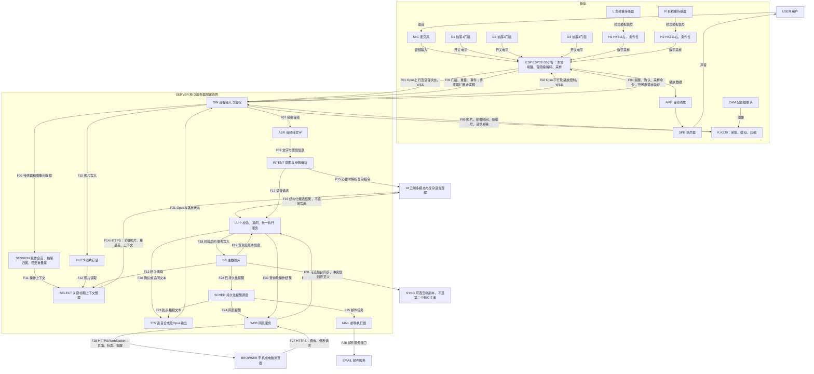
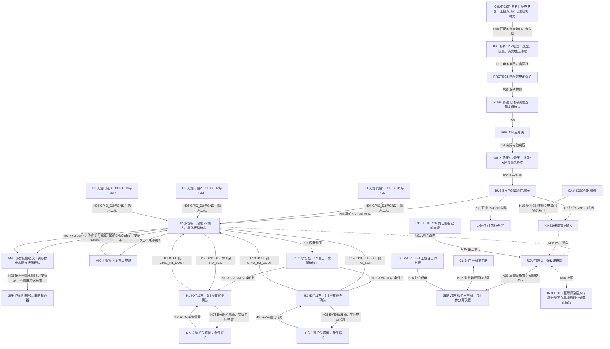
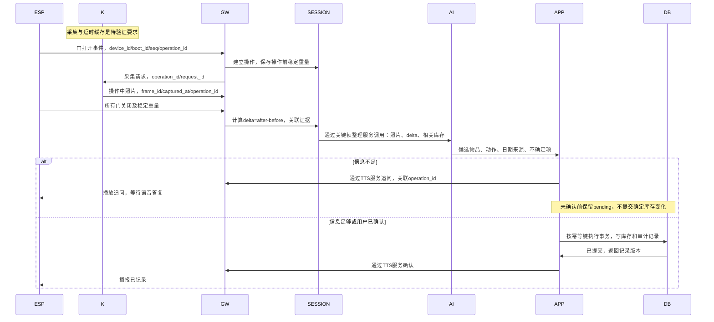

# 智能储物柜：供 AI 读取的架构源文件

版本：0.1；日期：2026-10-16；状态：设计快照，未实现、未完成整机验证。
配套文件：system-assessment.md 为可行性证据；system-architecture.json 为固定节点及连接清单。

本文件保留硬件架构快照，软件实际状态统一见[开发入口](code/README.md)。当前采集目标已细化为K230上传完整音视频；本快照中的关键照片连接不表示完整视频上传已经实现。

2026-10-16 最新范围决定：用户明确暂不做重量变化。本文件下方的称重连线、稳定重量状态和差重约定仅为历史架构，不用于当前实现或验收；当前操作通过视频/照片及开合状态关联。数据库实际设计见[数据与调用约定](code/doc/data-contract.md)。

## 读取规则

1. 以文字、节点 ID 和边定义为准，不依赖图片 OCR。箭头标签指定数据内容和方向。
2. implemented=false 表示没有实现证据，不代表已经确认设备不支持。
3. 两个称重传感器测整个柜体，不是两个抽屉独立称重；门磁只提供门状态。
4. ESP 是语音终端，不运行通用 ASR/LLM/TTS；这些服务在 SERVER 或其调用的云服务内。
5. SERVER 可以远离柜体，但完整业务需要 SERVER 在线；BROWSER 不是服务器进程。
6. K230 与 ESP 不直接互传图像；SERVER 关联两者数据。
7. 小智 voice_session_id 与柜体 operation_id 是两个不同概念，不能自动视为相同。
8. 两个完整桥传感器加两个 HX711 是条件性接线，实物型号与数量仍待确认。
9. 连接是设计要求，不是现有小智、K230 固件默认全部支持的声明。
10. 此次没有授权或执行修复；所有 unresolved 项保持待用户决定。

## A. 完整数据框图源码

ROUTER 是传输基础设施，为避免把路由器误认为业务处理节点，下图协议箭头直接连接应用端点；JSON 记录所有无线链路经 ROUTER。



## B. 完整硬件框图源码

箭头中的 5 V/GND、3.3 V/GND 均表示供电正线和对应回路，不是只接正极。所有柜体非隔离电路共地；服务器和柜体通过 Wi-Fi 通信，无需另拉地线。



不提供实际 GPIO 编号；不能把 GPIO_D1 等符号当成板上丝印。实际型号确定前，上图不能直接作为施工接线表。三线半桥、单 HX711 或分离 VCC/VDD 模块均须另行确认，当前不修改方案。

## C. 操作处理时序源码



## D. 机器读取的数据约定

以下为建议业务约定，不是小智原生协议；传感器扩展如何承载尚未决定。operation_id 可由设备本地产生并经服务器验证；断网采集需保留本地事件顺序。voice_session_id 只标识一次语音连接／会话，可关联零个或多个 operation_id。

```json
{
  "schema_version": "proposed-0.1",
  "type": "cabinet.sensor_event",
  "device_id": "cabinet-01",
  "boot_id": "example-boot-uuid",
  "seq": 104,
  "event_id": "example-event-uuid",
  "operation_id": "example-operation-uuid",
  "voice_session_id": null,
  "device_monotonic_ms": 83000,
  "captured_at_utc": null,
  "clock_quality": "unsynchronized",
  "drawer_states": {"1": "closed", "2": "closed", "3": "closed"},
  "weight": {
    "unit": "g",
    "scope": "whole_cabinet",
    "left_g": 8100.0,
    "right_g": 7900.0,
    "total_g": 16000.0,
    "stable": true,
    "calibration_id": "example-calibration-v1"
  }
}
```

上例重量只是消息样例，不是实际设备读数。left_g/right_g 仅适用于两个完整桥独立采集假设。未同步设备时不能靠不同设备的 monotonic_ms 直接对齐照片，必须使用操作编号、请求关联及服务器接收时间，并记录时间不确定性。

```text
operation_state:
  IDLE -> CAPTURING -> WAITING_STABLE -> ANALYZING
  ANALYZING -> PENDING_CONFIRMATION | READY_TO_COMMIT | FAILED
  PENDING_CONFIRMATION -> READY_TO_COMMIT | CANCELLED
  READY_TO_COMMIT -> COMMITTED

invariants:
  - delta_g = closed_stable_after_g - closed_stable_before_g
  - positive_delta_is_evidence_for_addition_not_proof_of_item_identity
  - zero_delta_does_not_prove_no_item_change
  - weight_scope_always_whole_cabinet
  - AI_output_is_candidate_and_never_direct_database_write
  - repeated_event_id_does_not_create_repeated_inventory_changes
  - one_operation_may_contain_multiple_drawers_or_items_and_need_confirmation
  - unsynchronized_timestamps_are_not_equal_to_accurate_wall_clock_time
  - expiry_date_source_must_be_one_of_user_label_ai_estimate_unknown
  - reminder_sent_is_not_equal_to_reminder_played
  - server_offline_does_not_imply_full_offline_voice_or_reminders
```

## E. 当前未解决事项

- U01：小智具体开发板、PSRAM、固件版本、麦克风／功放、电源路径和空闲引脚未知。
- U02：传感器型号／线数、HX711 数量及模块电路未知。
- U03：电池、降压模块和电源线规格未知。
- U04：空闲主动提醒通道生命周期未定义，语音会话通道不一定常驻。
- U05：传感器主动事件上报、断线缓存、幂等及恢复尚无实现证据。
- U06：K230 现有 Socket 协议、缓存可用性、远程 TLS 支持未知。
- U07：服务器、ASR/TTS/模型供应商、地址及实际服务健康未知。
- U08：整柜机械支撑、有效称重分辨率、视野和实际识别成功率未测。
- U09：邮件服务配置与浏览器离线通知能力未定义。
- U10：所有目标延迟、吞吐和功耗预算均待实测，不得升级为实测结论。
